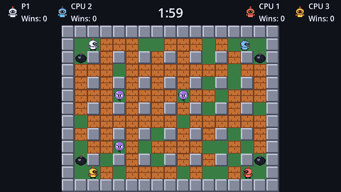

**Blast Grid** is a Bomberman-style arena game. Up to four bombers start in the corners of a grid full of breakable blocks. You drop bombs, the bombs explode in a cross, the blasts clear a path and set off other bombs, and whoever is still standing at the end wins the round.



By the end of the tutorial the game has:

- an arena built from **TileMapLayers**: painted walls, generated blocks and tile collision
- grid movement that still feels smooth, with **corner sliding** so you don't snag on pillars
- bombs with a fuse, a bomb limit, and bombs you can walk off but not back onto
- cross-shaped explosions that stop at walls, destroy blocks and **chain** into other bombs
- power-ups hidden under blocks: more bombs, a bigger blast, more speed
- wandering monsters, and a **CPU bomber** that plans with a danger map
- rounds, win counts, draws and an optional **sudden death**
- a main menu, mode select, pause menu and results screens
- an options screen with volume, fullscreen, rounds to win, CPU difficulty and **key rebinding for both players**, all saved to disk
- sound, particles, screen shake and a death animation, then an exported build

Every chapter ends with something you can run.

## Before you start

This is an **intermediate** tutorial. It assumes you've made a small game in Godot before; the [Pong tutorial](../../godot-pong/01-setup/01-install-godot.md) covers everything you need. Things Pong already taught (input actions, signals, autoloads, menus) are explained again briefly here, so you don't need it open, but the pace is quicker and the new topics get the space:

| New here | What it's for |
| --- | --- |
| `TileSet` and `TileMapLayer` | The arena: tiles, painting, collision, and editing cells from code |
| Grid coordinates | `local_to_map` and `map_to_local`, the bridge between pixels and cells |
| Collision exceptions | Walking off a bomb you just dropped |
| Breadth-first search | How the CPU finds the nearest safe cell |
| A danger map | Predicting where (and when) fire will be |
| Typed dictionaries | `Dictionary[Vector2i, Bomb]` and friends |

You'll need **Godot 4.4 or newer** (the standard build, not .NET). The tutorial was written against Godot 4.7.

:::note["Bomberman-style"]
Bomberman is a trademark of Konami. Blast Grid borrows the genre (grids, bombs, blocks), not the name, characters or art. Everything in this tutorial is drawn from scratch.
:::

```quiz
question: Which Godot node does this tutorial use to draw the arena's tiles?
options:
  - TileMap
  - TileMapLayer
  - GridContainer
  - Sprite2D, one per cell
answer: 1
explain: Since Godot 4.3, each layer of tiles is its own **TileMapLayer** node. The older `TileMap` node, which held several layers at once, is deprecated.
```
