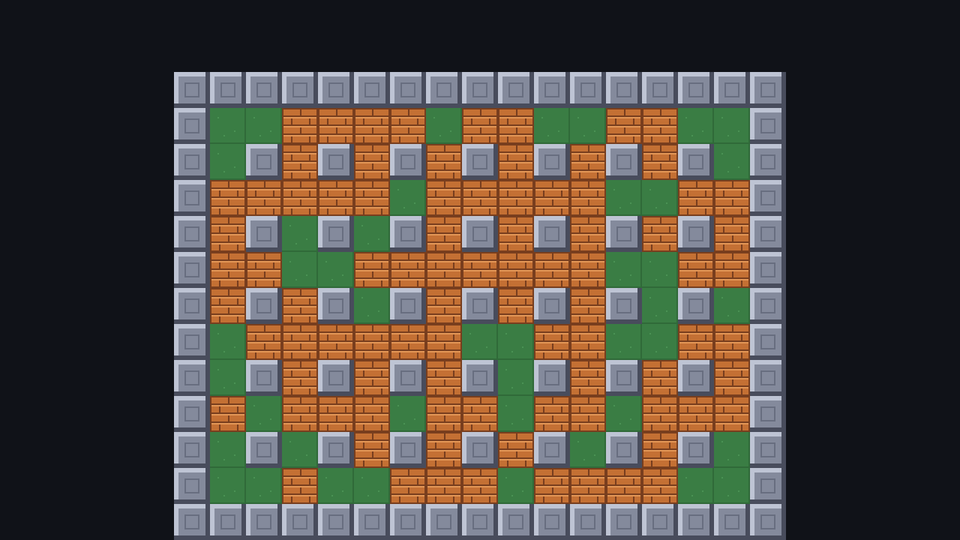

## One node per layer

A `TileMapLayer` draws one grid of tiles. Stack several and you get layers, drawn in tree order like any other 2D nodes. The arena uses three, all sharing `arena_tiles.tres`:

| Layer | Tiles | Changes during play? |
| --- | --- | --- |
| `Floor` | floor everywhere inside the border | never |
| `Walls` | the border and the pillars | only during sudden death |
| `Blocks` | breakable blocks | generated every round, destroyed by bombs |

Keeping blocks on their own layer pays off quickly. Starting a new round is `blocks.clear()` followed by filling it again, and "is there a block here?" is just "does the `Blocks` layer have a tile here?". No need to look at *which* tile it is.

:::note[TileMap is deprecated]
Older tutorials use a single `TileMap` node with several layers inside it. Since Godot 4.3 each layer is its own `TileMapLayer` node instead: simpler to script, and each layer can have its own position, z-index, collision settings and script. If you open an old project, Godot offers to convert a `TileMap` for you.
:::

## The arena scene

Create a scene with a `Node2D` root named `Arena`, add three `TileMapLayer` children, and drag `arena_tiles.tres` into each one's **Tile Set** property:

```text
Arena (Node2D)
├── Floor (TileMapLayer)    # Tile Set: arena_tiles.tres
├── Walls (TileMapLayer)    # Tile Set: arena_tiles.tres
└── Blocks (TileMapLayer)   # Tile Set: arena_tiles.tres, left empty
```

Save it as `arena.tscn`.

## Painting

Select a `TileMapLayer` and the **TileMap** panel opens at the bottom. Pick a tile on the right, a tool in the toolbar, and paint in the 2D view:

| Tool | Shortcut | Good for |
| --- | --- | --- |
| Paint (pencil) | <kbd>D</kbd> | Single cells; drag for freehand |
| Line | <kbd>L</kbd> | Straight rows and columns |
| Rect | <kbd>R</kbd> | Filled rectangles |
| Bucket | <kbd>B</kbd> | Flood-filling an area |
| Picker | <kbd>P</kbd> | Picking up the tile under the cursor |
| Eraser | <kbd>E</kbd> | Toggles erasing for the other tools (or right-click) |

The arena is 17 columns by 13 rows. `#` is a wall, `.` is floor:

```text
#################   row 0
#...............#   row 1
#.#.#.#.#.#.#.#.#   row 2
#...............#
#.#.#.#.#.#.#.#.#
#...............#
#.#.#.#.#.#.#.#.#
#...............#
#.#.#.#.#.#.#.#.#
#...............#
#.#.#.#.#.#.#.#.#
#...............#
#################   row 12
```

1. Select **Floor**, pick the floor tile, choose **Rect**, and drag from cell `(1, 1)` to `(15, 11)`: a 15×11 green field. (Painting floor under the pillars too is fine; walls will cover it.)
2. Select **Walls** and pick the wall tile. Use **Line** for the four edges of the border: row 0, row 12, column 0 and column 16.
3. Still on **Walls**, use the pencil for the pillars: every cell where **both** the column and the row are even, from `(2, 2)` to `(14, 10)`. That's 7 × 5 = 35 pillars.
4. Leave **Blocks** empty. Code fills it.

:::tip[Which cell am I on?]
Cell `(0, 0)` is where the layer's origin is, at the top-left of the border. Turn on the grid (the **Toggle Grid** button in the TileMap panel toolbar) and count from there; with the pillar pattern it's easy to spot a mistake.
:::

## Where the data lives

Painted cells are saved inside the scene as one packed blob per layer:

```ini title="arena.tscn"
[node name="Walls" type="TileMapLayer" parent="."]
tile_map_data = PackedByteArray(0, 0, 0, 0, 0, 0, 0, 0, 1, 0, 0, 0, ...)
tile_set = ExtResource("2")
```

For every cell it stores the coordinates, the source id, the atlas coordinates and the alternative tile. You'll never edit it by hand, but it's good to know that tiles live in the *scene*, and the TileSet only describes what tiles exist.

## Put the arena in the game

Open `game.tscn` and instance `arena.tscn` as a child of `Game` at position **(116, 48)**:

- 17 × 24 = 408 pixels wide, and (640 − 408) / 2 = 116 centres it horizontally.
- 13 × 24 = 312 pixels tall, which leaves a 48-pixel strip at the top for the scoreboard we'll add later.

Run the game. You get the empty arena. Turn on **Debug → Visible Collision Shapes** and run again: every wall and pillar shows its collision square, without a single `CollisionShape2D` in the scene.

```quiz
question: Why do blocks get their own TileMapLayer instead of sharing the Walls layer?
options:
  - A TileMapLayer can only hold one kind of tile
  - Blocks can be cleared and refilled each round without touching the walls, and "is there a block here?" becomes a simple lookup
  - Blocks need a different TileSet
  - Walls must be drawn on top of blocks
answer: 1
explain: A layer can hold any mix of tiles. Separating them is a design choice that makes the code simpler.
```

```quiz
question: How many pillars does a 17×13 arena have, with pillars where both column and row are even (excluding the border)?
type: text
answer: ["35", "thirty-five", "thirty five"]
hint: Columns 2, 4, … 14 and rows 2, 4, … 10.
explain: 7 columns × 5 rows = 35.
```
