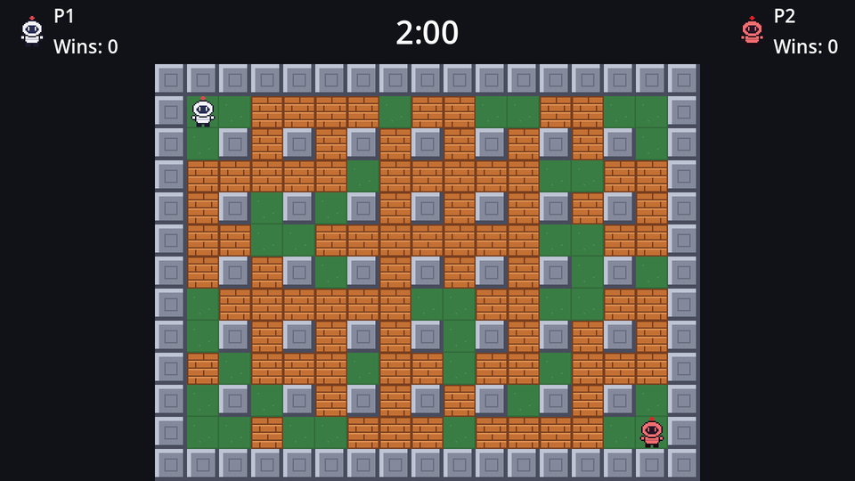

## Reading a direction

Bombers move in one of four directions, never diagonally. If you hold <kbd>D</kbd> and then also press <kbd>S</kbd>, the classic games turn you **down**: the most recently pressed key wins. That makes cornering feel great, because you can keep holding the old direction and tap the new one a little early.

We keep a list of held directions, newest last:

```gdscript title="bomber.gd"
class_name Bomber
extends CharacterBody2D
## A bomber, steered by the keyboard or by a CpuBrain child.

const DIRECTIONS := {&"up": Vector2.UP, &"down": Vector2.DOWN, &"left": Vector2.LEFT, &"right": Vector2.RIGHT}

## Prefix of this bomber's input actions: "p1" reads p1_up, p1_bomb and so on.
@export var controls := "p1"
@export var color := Color.WHITE
@export var speed := 72.0

## Set by the game before the bomber enters the tree.
var arena: Arena
## The direction we want to move in. Read from the keyboard, or set by a CpuBrain.
var input_direction := Vector2.ZERO

## Held directions, most recently pressed last.
var _held: Array[Vector2] = []

@onready var sprite: AnimatedSprite2D = $AnimatedSprite2D


func _ready() -> void:
	sprite.self_modulate = color


func _physics_process(_delta: float) -> void:
	input_direction = _read_direction()
	velocity = input_direction * speed
	move_and_slide()
	_animate(input_direction)


## The most recently pressed direction wins, so you can hold one direction
## and tap another to turn into a side corridor.
func _read_direction() -> Vector2:
	for action_suffix in DIRECTIONS:
		var direction: Vector2 = DIRECTIONS[action_suffix]
		if Input.is_action_pressed(controls + "_" + action_suffix):
			if not _held.has(direction):
				_held.append(direction)
		else:
			_held.erase(direction)
	return _held.back() if not _held.is_empty() else Vector2.ZERO


func _animate(direction: Vector2) -> void:
	if direction == Vector2.ZERO:
		sprite.stop() # Frame 0 of every animation is the standing pose.
	elif direction.x != 0:
		sprite.play(&"walk_side")
		sprite.flip_h = direction.x < 0
	else:
		sprite.play(&"walk_down" if direction.y > 0 else &"walk_up")
```

- **`DIRECTIONS`** maps action suffixes to vectors, so the loop in `_read_direction` handles all four keys with the same code.
- A direction is added to `_held` when its key goes down and removed when it comes up. `_held.back()` is then the newest key still held.
- **`self_modulate`** tints the sprite (but not its children). The bomber art is mostly white, so multiplying by a colour paints the suit while the dark outlines stay dark. One sprite sheet serves every player.
- `sprite.play()` does nothing if that animation is already playing, so calling it every frame is fine.
- `speed` is 72 pixels per second: three tiles a second.

:::note[An arena reference]
`arena` is a plain variable, not an `@export`. Bombers are spawned from code, and the code that spawns them hands each one the arena before adding it to the tree. That's simpler than searching the tree, and it makes the dependency explicit.
:::

## Spawning bombers

Back in `game.gd`, spawn one bomber per entry in a list. The list holds plain dictionaries for now; in the matches chapter it moves to a global `Match` object and grows CPU players.

```gdscript title="game.gd"
extends Node2D

## Who plays. This moves into a Match autoload in the matches chapter.
const BOMBERS := [
	{name = "P1", color = Color(1, 1, 1), controls = "p1"},
	{name = "P2", color = Color(1, 0.45, 0.45), controls = "p2"},
]

@export var bomber_scene: PackedScene

var bombers: Array[Bomber] = []

@onready var arena: Arena = $Arena


func _ready() -> void:
	arena.generate()
	_spawn_bombers()


func _spawn_bombers() -> void:
	var spawns := arena.spawn_cells()
	for i in BOMBERS.size():
		var info: Dictionary = BOMBERS[i]
		var bomber: Bomber = bomber_scene.instantiate()
		bomber.arena = arena
		bomber.color = info.color
		bomber.controls = info.controls
		bomber.position = arena.cell_center(spawns[i])
		arena.actors.add_child(bomber)
		bombers.append(bomber)
```

Select `Game` and drag `bomber.tscn` into **Bomber Scene** in the Inspector. `{name = "P1", ...}` is GDScript's Lua-style dictionary syntax: the keys are the strings `"name"`, `"color"` and `"controls"`, and `info.color` reads one.



Run the game and walk around with <kbd>W</kbd><kbd>A</kbd><kbd>S</kbd><kbd>D</kbd> and the arrow keys.

## The problem

Walk along the top row and try to turn down into a column. Unless you're lined up almost perfectly, you can't: the box catches on the corner of a pillar and stops. With 3 pixels of slack, "almost perfectly" means within 3 pixels, which is very hard to hit at 72 pixels per second.

That's what the next page fixes.

```quiz
question: You hold <kbd>D</kbd>, then press <kbd>W</kbd> while still holding <kbd>D</kbd>. What does `_read_direction()` return?
options:
  - Vector2.RIGHT
  - Vector2.UP
  - Vector2(1, -1)
  - Vector2.ZERO
answer: 1
explain: W was pressed last, so `Vector2.UP` is at the end of `_held`. Release W and you go right again.
```

```quiz
question: Why does the bomber use `self_modulate` for its colour instead of a separate sprite sheet per player?
options:
  - self_modulate is faster to draw
  - Multiplying the white art by a colour tints the suit while black outlines stay black, so one sheet serves every player
  - Godot can't load more than one sprite sheet
answer: 1
```
