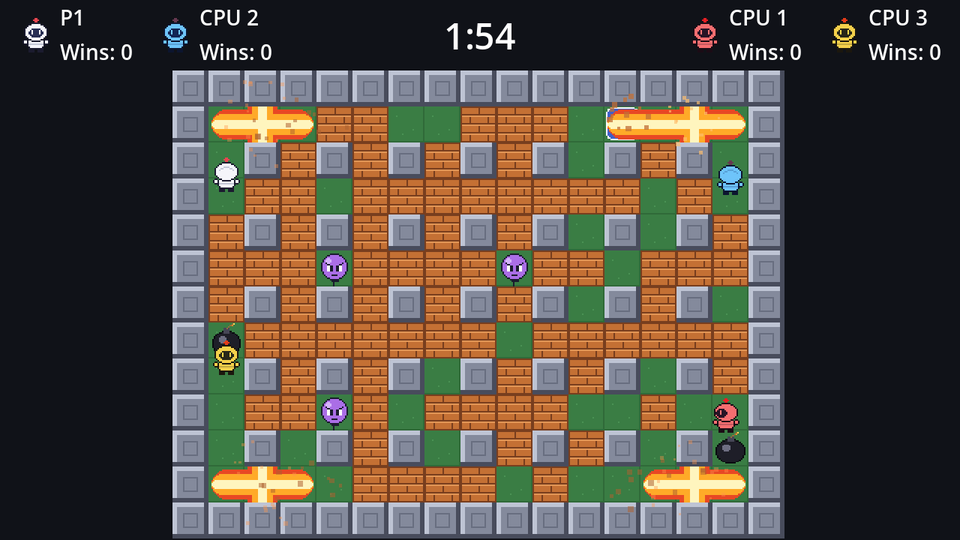

Two things are left: blasts should destroy the blocks they reach, and set off any bombs they reach.

## Destroying blocks

Erasing a cell from the `Blocks` layer removes its tile *and* its collision, because collision comes from the TileSet:

```gdscript title="arena.gd"
signal block_destroyed(cell: Vector2i)


func destroy_block(cell: Vector2i) -> void:
	blocks.erase_cell(cell)
	block_destroyed.emit(cell)
```

The signal is for debris particles in the polish chapter.

## Chain reactions

When a blast reaches another bomb, that bomb goes off immediately, and its blast may reach a third. Since `Bomb.explode()` emits `exploded`, which runs `_on_bomb_exploded` again, a chain needs no extra code beyond calling `explode()` on the bombs we hit:

```gdscript title="arena.gd" ins={10-17}
func _on_bomb_exploded(bomb: Bomb) -> void:
	bombs.erase(bomb.cell)
	var cells := blast_cells(bomb.cell, bomb.power)
	var explosion: Explosion = explosion_scene.instantiate()
	explosion.arena = self
	explosion.cells = cells
	explosion.position = cell_center(bomb.cell)
	flames.add_child(explosion)
	exploded.emit(cells)
	# Set off other bombs first, so their blasts still stop at the blocks
	# this one is about to destroy.
	for cell in cells:
		if bombs.has(cell):
			bombs[cell].explode()
	for cell in cells:
		if is_block(cell):
			destroy_block(cell)
```

### Why chains go first

Look at the order: first *every* bomb in the blast explodes, and only then do this blast's blocks get destroyed. Suppose we did it the other way round. Bomb A destroys a block, then sets off bomb B. B's arm now finds an empty cell where the block was, and keeps going, reaching cells it never should have. By setting off B first, B's arm still stops at the block, and then the block is destroyed.

Each `explode()` call runs the whole handler for that bomb before returning, so a chain of ten bombs is resolved within the same frame, depth first.

:::note[A bomb can't explode twice]
Two blasts in a chain can both reach the same bomb. The first `explode()` erases it from `bombs`, so the second blast doesn't see it. And if anything calls `explode()` again anyway, the `_exploded` flag in `bomb.gd` ignores it.
:::

## Checkpoint

That's the core of the game. Place a bomb next to another and watch the chain; clear a path through the blocks; trap your opponent. Bombs, blasts, blocks and death all work.

```quiz
question: Bomb A's blast reaches bomb B. In `_on_bomb_exploded(A)`, which happens first?
options:
  - A's blocks are destroyed, then B explodes
  - B explodes (and its whole blast is handled), then A's blocks are destroyed
  - Both happen in the next frame
answer: 1
explain: The first loop calls `explode()` on every bomb in the blast; the second loop destroys blocks. So B's blast still sees A's blocks.
```

```quiz
question: Why does erasing a block from the Blocks layer also remove its collision?
type: text
answer: ["tileset", "the tileset", "tile set", "the tile set", "arena_tiles.tres"]
hint: Where did we paint the collision polygons?
explain: Collision belongs to tiles in the **TileSet**. No tile in that cell means no collision there.
```
