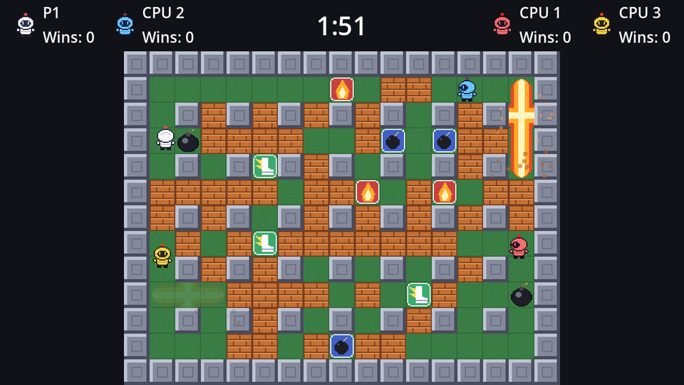

In the genre, power-ups are hidden under blocks, and you have to blast blocks to find them. The arena decides **in advance** which blocks hide what, so every round has a fixed amount of loot: 8 extra bombs, 8 fire-ups and 4 speed-ups.

## Hiding them

```gdscript title="arena.gd" ins={1-2,6,10-11,16}
## How many of each power-up hide under the blocks.
const POWER_UP_COUNTS := {PowerUp.Kind.BOMB: 8, PowerUp.Kind.FIRE: 8, PowerUp.Kind.SPEED: 4}

@export var bomb_scene: PackedScene
@export var explosion_scene: PackedScene
@export var power_up_scene: PackedScene

## Bombs on the field, by cell.
var bombs: Dictionary[Vector2i, Bomb] = {}
## The power-up hidden under each block that has one.
var hidden_power_ups: Dictionary[Vector2i, PowerUp.Kind] = {}

@onready var floor_layer: TileMapLayer = $Floor
@onready var walls: TileMapLayer = $Walls
@onready var blocks: TileMapLayer = $Blocks
@onready var power_ups: Node2D = $PowerUps
```

`generate()` now remembers the cells it filled, shuffles them, and hands out power-ups from the end of the list:

```gdscript title="arena.gd" ins={4,6,11-17}
## Fill the arena with fresh blocks, leaving room around the spawn corners.
func generate() -> void:
	blocks.clear()
	hidden_power_ups.clear()
	var spawns := spawn_cells()
	var block_cells: Array[Vector2i] = []
	for cell in floor_layer.get_used_cells():
		if is_wall(cell) or _near_any(cell, spawns, 1) or randf() > block_density:
			continue
		blocks.set_cell(cell, SOURCE_ID, BLOCK_TILE)
		block_cells.append(cell)
	# Hide the power-ups under random blocks.
	block_cells.shuffle()
	for kind in POWER_UP_COUNTS:
		for i in POWER_UP_COUNTS[kind]:
			if not block_cells.is_empty():
				hidden_power_ups[block_cells.pop_back()] = kind
```

`shuffle()` puts the cells in random order and `pop_back()` takes one off the end, so no block gets two power-ups. With ~80 blocks there are more than enough; the `is_empty()` check just keeps a tiny custom arena from crashing.

Drag `power_up.tscn` into the arena's **Power Up Scene**.

## Revealing them

When a block is destroyed, check whether it was hiding something:

```gdscript title="arena.gd" ins={4-9}
func destroy_block(cell: Vector2i) -> void:
	blocks.erase_cell(cell)
	block_destroyed.emit(cell)
	if hidden_power_ups.has(cell):
		var power_up: PowerUp = power_up_scene.instantiate()
		power_up.kind = hidden_power_ups[cell]
		power_up.position = cell_center(cell)
		hidden_power_ups.erase(cell)
		power_ups.add_child(power_up)
```

## Spawn protection

There's a catch. The power-up appears in a cell that is *on fire*: the blast that destroyed the block is still burning there. The flames' `area_entered` would fire on the very next physics step and burn the power-up before anyone sees it.

That's what `SPAWN_PROTECTION` in `power_up.gd` is for. The power-up counts its age in `_process`, and `burn()` does nothing while it's younger than 0.6 seconds, a little longer than the 0.5 seconds flames last. Once it's been sitting in the open for a while, a *new* blast destroys it, which is the classic rule: shoot carelessly and you burn your own loot.



Run it and bomb some blocks. About one block in four drops something. Grab a few fire-ups and watch your blasts grow.

```quiz
question: Why is `SPAWN_PROTECTION` 0.6 seconds?
options:
  - It's how long the bob animation takes
  - It's slightly longer than the 0.5 s the revealing flames burn, so they can't destroy the power-up they uncovered
  - Power-ups take 0.6 s to load
answer: 1
```

```quiz
question: Why does `generate()` shuffle the block cells and `pop_back()` from them, instead of picking a random block for each power-up?
options:
  - pop_back() is the only way to read an array
  - Removing each chosen cell from the list guarantees no block gets two power-ups
  - shuffle() makes the blocks look different
answer: 1
```
