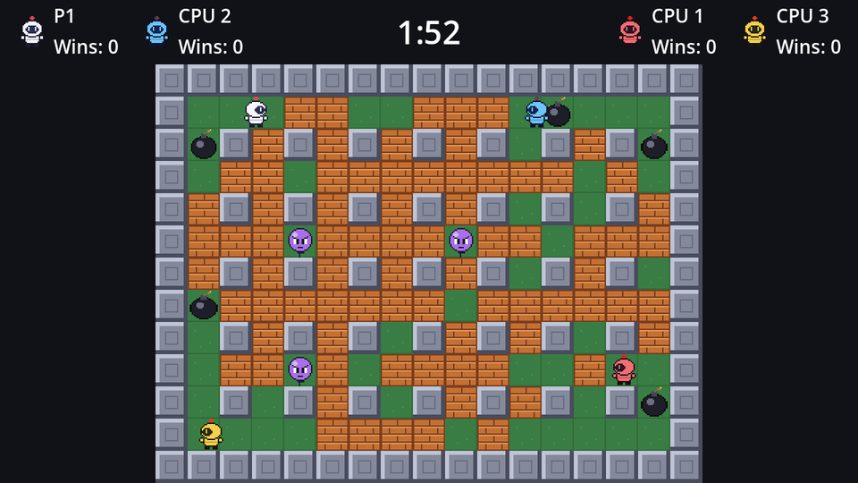

A CPU that only runs away never wins. It needs things to *want*:

1. **Power-ups**: walk to the nearest one.
2. **Bombing spots**: cells from which a bomb would hit a block or a rival.

And one rule it must never break: **don't drop a bomb you can't escape from.**

## What's worth bombing?

Add two more knobs next to `think_interval`:

```gdscript title="cpu_brain.gd" ins={3-6}
## Seconds between decisions. Slower thinkers react late to new bombs.
@export var think_interval := 0.25
## Chance of taking a bombing opportunity when one comes up.
@export_range(0.0, 1.0) var aggression := 0.6
## Whether to walk towards other bombers, or only clear blocks.
@export var hunts_rivals := true
```

Then the helpers that find targets:

```gdscript title="cpu_brain.gd"
## Cells of rival bombers worth blowing up (none for CPUs that don't hunt).
func _target_cells() -> Array[Vector2i]:
	var cells: Array[Vector2i] = []
	if not hunts_rivals:
		return cells
	for other: Bomber in get_tree().get_nodes_in_group("bombers"):
		if other != bomber and other.alive:
			cells.append(arena.cell_at(other.position))
	return cells


func _power_up_cells() -> Array[Vector2i]:
	var cells: Array[Vector2i] = []
	for power_up in arena.power_ups.get_children():
		cells.append(arena.cell_at(power_up.position))
	return cells


## A safe cell with a power-up, or a good place to drop a bomb.
func _is_goal(cell: Vector2i, danger: Dictionary[Vector2i, float], pickups: Array[Vector2i], targets: Array[Vector2i]) -> bool:
	if danger.has(cell):
		return false
	return pickups.has(cell) or (bomber.can_place_bomb() and _worth_bombing(cell, targets))


## Would a bomb in this cell hit a block, or one of the targets?
func _worth_bombing(cell: Vector2i, targets: Array[Vector2i]) -> bool:
	for target in arena.blast_cells(cell, bomber.power):
		if arena.is_block(target) or targets.has(target):
			return true
	return false
```

`_worth_bombing` uses `blast_cells` once more: "would a bomb here hit something?" is the same question as "where would this bomb's fire go?". A CPU that doesn't hunt gets no targets, so it only ever bombs blocks: a calmer opponent.

`_is_goal` is the search's new goal test: a safe cell that has a power-up, or (when we have a bomb to spare) a good bombing spot. It takes the danger map, the power-up cells and the targets as extra arguments, which we'll `bind` exactly like `_is_safe`.

## The full decision

```gdscript title="cpu_brain.gd" ins={8-20}
func _think() -> void:
	var danger := arena.danger_map()
	_add_monsters(danger)
	var here := arena.cell_at(bomber.position)
	if danger.has(here):
		path = _find_path(here, danger, _is_safe.bind(danger))
		return
	var targets := _target_cells()
	if bomber.can_place_bomb() and _worth_bombing(here, targets) and randf() < aggression:
		# Pretend the bomb is already there, and only drop it if we can get away.
		var with_bomb := arena.danger_map({here: bomber.power})
		_add_monsters(with_bomb)
		var escape := _find_path(here, with_bomb, _is_safe.bind(with_bomb))
		if not escape.is_empty():
			bomber.place_bomb()
			path = escape
			return
	path = _find_path(here, danger, _is_goal.bind(danger, _power_up_cells(), targets))
	if path.is_empty():
		path = _wander(here, danger)
```

In order:

1. **In danger?** Run to the nearest safe cell. Nothing else matters.
2. **Standing on a bombing spot?** Roll against `aggression`. If it hits, build a second danger map with an **imaginary bomb** right here, `{here: bomber.power}`, and search for an escape in *that* map. Only if there is one: drop the bomb for real and take that escape path immediately.
3. **Otherwise:** walk to the nearest goal (a power-up or a bombing spot), or wander if there isn't one.

Step 2 is the key to a CPU that doesn't blow itself up. The escape path is planned *before* the bomb exists, using the same danger rules and the bomb's full fuse, so the CPU commits to a route it knows is fast enough.

:::tip[Why "nearest goal" works]
A breadth-first search with `_is_goal` finds the *closest* useful cell, so the CPU naturally clears its own corner first, then pushes outwards, and grabs power-ups on the way. No scoring or weighting needed. If you want smarter CPUs, this is the place to experiment: prefer power-ups over blocks, avoid cells next to a rival's bomb, or predict where a rival will run.
:::

Run it with two CPUs and watch them clear the arena, collect power-ups, and go after each other. You can still play: they'll come for you too.

```quiz
question: The CPU stands next to a block, but every escape route from a bomb here would take longer than the fuse. What does it do?
options:
  - Drops the bomb anyway
  - Doesn't drop the bomb, and looks for another goal instead
  - Waits until the fuse gets longer
answer: 1
explain: The escape search runs on a danger map that includes the imaginary bomb. An empty escape path means no bomb, and `_think` carries on to step 3.
```

```quiz
type: multiple
question: Which cells can `_is_goal` accept? Select all that apply.
options:
  - A safe cell with a power-up on it
  - A safe cell from which a bomb would hit a block, when the CPU has a bomb to spare
  - A cell in the danger map, if it has a power-up
  - Any cell next to a rival
answer: [0, 1]
explain: Dangerous cells are never goals. Rivals only count through `_worth_bombing`, and only for CPUs that hunt.
```
