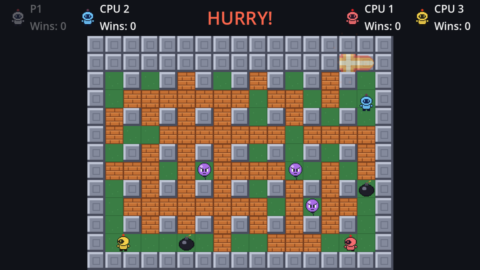

A time-out draw is an anticlimax. Classic battle modes have a better ending: when the clock hits zero, walls start dropping in a spiral from the outside in, crushing anything they land on. The arena shrinks until someone gets caught.

This is also the one time the `Walls` layer changes during play: `set_cell` works at runtime exactly like painting in the editor, collision included.

## The spiral

The arena produces the order. Walk the outer ring of the floor (top row left to right, right column down, bottom row right to left, left column up), then shrink the rectangle by one cell on every side and repeat:

```text
 1  2  3  4  5
14 15 16 17  6
13 20 19 18  7
12 11 10  9  8
```

```gdscript title="arena.gd"
## Floor cells from the outside in, ring by ring, for sudden death.
func spiral_cells() -> Array[Vector2i]:
	var area := floor_layer.get_used_rect()
	var left := area.position.x
	var top := area.position.y
	var right := area.end.x - 1
	var bottom := area.end.y - 1
	var cells: Array[Vector2i] = []
	while left <= right and top <= bottom:
		for x in range(left, right + 1):
			cells.append(Vector2i(x, top))
		for y in range(top + 1, bottom + 1):
			cells.append(Vector2i(right, y))
		if top < bottom:
			for x in range(right - 1, left - 1, -1):
				cells.append(Vector2i(x, bottom))
		if left < right:
			for y in range(bottom - 1, top, -1):
				cells.append(Vector2i(left, y))
		left += 1
		top += 1
		right -= 1
		bottom -= 1
	return cells.filter(func(cell: Vector2i) -> bool: return not is_wall(cell))
```

The `if top < bottom` and `if left < right` checks handle the last ring when it's a single row or column, so no cell is listed twice. Pillars are already walls, so `filter` drops them.

## Dropping a wall

```gdscript title="arena.gd"
signal wall_dropped(cell: Vector2i)
const WALL_TILE := Vector2i(1, 0)


## Sudden death: turn a cell into a wall, crushing whatever is in it.
func drop_wall(cell: Vector2i) -> void:
	blocks.erase_cell(cell)
	hidden_power_ups.erase(cell)
	if bombs.has(cell):
		bombs[cell].explode()
	walls.set_cell(cell, SOURCE_ID, WALL_TILE)
	for power_up in power_ups.get_children():
		if cell_at(power_up.position) == cell:
			power_up.queue_free()
	# Bombers and monsters both have burn(): crushed is as dead as burned.
	for actor: Node2D in actors.get_children():
		if cell_at(actor.position) == cell:
			actor.burn()
	wall_dropped.emit(cell)
```

- A block or a hidden power-up in that cell is simply removed.
- A bomb in that cell goes off first, before the wall lands. That's a nice surprise for anyone who thought it was safe to hide behind it.
- Power-ups are freed outright. They don't use `burn()`, because a power-up uncovered half a second ago would still be protected and end up sitting on top of the wall.
- Bombers and monsters are crushed with `burn()`: the same method flames call, the same death.

## Starting it

Add a `Timer` named `SuddenDeathTimer` to `game.tscn` with **Wait Time** `0.25` and **One Shot** *off*, so it keeps ticking. Connect its `timeout` to `Game`.

```gdscript title="game.gd" ins={1-2,6}
## Cells still to be walled up during sudden death, outermost first.
var _closing_cells: Array[Vector2i] = []

# ...
@onready var settle_timer: Timer = $SettleTimer
@onready var sudden_death_timer: Timer = $SuddenDeathTimer
```

```gdscript title="game.gd"
func _end_round(winner: int) -> void:
	round_over = true
	round_timer.stop()
	sudden_death_timer.stop()
	# ...


func _on_round_timer_timeout() -> void:
	hud.show_hurry()
	_closing_cells = arena.spiral_cells()
	sudden_death_timer.start()


func _on_sudden_death_timer_timeout() -> void:
	if _closing_cells.is_empty():
		sudden_death_timer.stop()
		return
	arena.drop_wall(_closing_cells.pop_front())
```

Four walls a second fill the 130 open cells in about half a minute, though the round is almost always over long before that. Sudden death becomes an option in the options chapter; for now it's always on.

To try it without waiting two minutes, set `RoundTimer`'s **Wait Time** to `5` temporarily.

```quiz
question: Why doesn't `drop_wall` call `burn()` on power-ups?
options:
  - Power-ups don't have a burn() method
  - A freshly uncovered power-up ignores burn() during its spawn protection, so it could survive on top of the new wall
  - burn() is too slow
answer: 1
```

```quiz
question: In the 4×5 spiral above, which number is the last cell of the outer ring?
type: text
answer: ["14"]
explain: The outer ring is 1–14 (top row, right column, bottom row, left column going up). 15 starts the inner ring.
```
