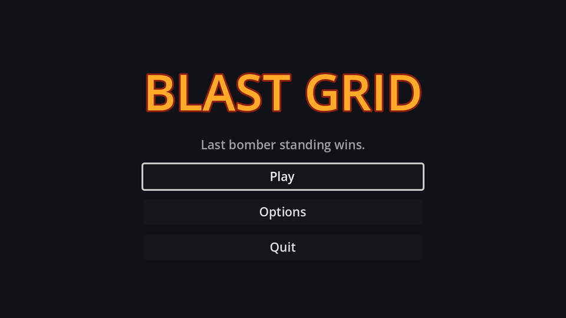

## A project theme

Godot's default UI text is tiny at 640×360. Instead of overriding the font size on every control, create a **Theme**: FileSystem dock → **Create New → Resource… → Theme**, save it as `theme.tres`, and set **Default Font Size** to `14`. Then make it the project-wide theme in **Project Settings → GUI → Theme → Custom**. Every control in the game now uses it.

## Layout

New scene, `Control` root named `MainMenu`, **Anchor Preset → Full Rect**:

```text
MainMenu (Control, Full Rect)
└── CenterContainer (Full Rect)
    └── VBoxContainer              # min width 200, separation 12
        ├── Title (Label)          # "BLAST GRID", size 56, see below
        ├── Tagline (Label)        # "Last bomber standing wins.", 60% opacity
        ├── PlayButton (Button, %)
        ├── OptionsButton (Button)
        └── QuitButton (Button, %)
```

The title gets its look from **Theme Overrides** on the label:

| Override | Value |
| --- | --- |
| Colors → Font Color | `#ffab29`, a fiery orange |
| Colors → Font Outline Color | `#8c1f0d`, a dark red |
| Constants → Outline Size | `8` |
| Font Sizes → Font Size | `56` |

For the tagline, set **Visibility → Modulate** to white at 60% alpha. It dims the label without touching the theme.

## The script

Connect each button's `pressed` signal to `MainMenu`:

```gdscript title="main_menu.gd"
extends Control

@onready var play_button: Button = %PlayButton
@onready var quit_button: Button = %QuitButton


func _ready() -> void:
	# Browsers can't close the tab for us, so hide Quit in web builds.
	quit_button.visible = not OS.has_feature("web")
	play_button.grab_focus()


func _on_play_button_pressed() -> void:
	get_tree().change_scene_to_file("res://mode_select.tscn")


func _on_options_button_pressed() -> void:
	get_tree().change_scene_to_file("res://options_menu.tscn")


func _on_quit_button_pressed() -> void:
	get_tree().quit()
```

`grab_focus()` lets the whole menu work from the keyboard: arrow keys move between buttons, <kbd>Enter</kbd> or <kbd>Space</kbd> press them. Godot works out the focus order from the layout.

Set **Project Settings → Application → Run → Main Scene** to `main_menu.tscn`. <kbd>F5</kbd> now starts at the menu; <kbd>F6</kbd> still runs the open scene, which stays handy for testing `game.tscn` directly. The next two screens don't exist yet, so Play and Options print an error for now.

```quiz
question: Why does the menu call `play_button.grab_focus()` in `_ready`?
options:
  - Buttons don't work without focus
  - So the keyboard can drive the menu straight away; arrow keys move focus and Enter or Space presses the focused button
  - To highlight it in a different colour
answer: 1
```
