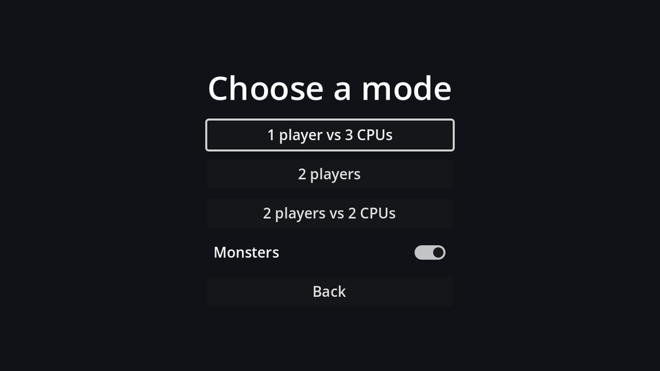

```text
ModeSelect (Control, Full Rect)
└── CenterContainer (Full Rect)
    └── VBoxContainer                    # min width 220, separation 10
        ├── Title (Label)                # "Choose a mode", size 32
        ├── VsCpuButton (Button, %)      # "1 player vs 3 CPUs"
        ├── TwoPlayersButton (Button)    # "2 players"
        ├── TwoPlayersCpuButton (Button) # "2 players vs 2 CPUs"
        └── BackButton (Button)          # "Back"
```

(The screenshot also shows a **Monsters** switch. That's a setting, so it arrives with the options chapter.)

Connect the four buttons' `pressed` signals:

```gdscript title="mode_select.gd"
extends Control

@onready var vs_cpu_button: Button = %VsCpuButton


func _ready() -> void:
	vs_cpu_button.grab_focus()


func _start(mode: Match.Mode) -> void:
	Match.start(mode)
	get_tree().change_scene_to_file("res://game.tscn")


func _on_vs_cpu_button_pressed() -> void:
	_start(Match.Mode.VS_CPU)


func _on_two_players_button_pressed() -> void:
	_start(Match.Mode.TWO_PLAYERS)


func _on_two_players_cpu_button_pressed() -> void:
	_start(Match.Mode.TWO_PLAYERS_VS_CPU)


func _on_back_button_pressed() -> void:
	get_tree().change_scene_to_file("res://main_menu.tscn")
```

`Match.Mode` is the enum from the `Match` autoload, usable as a parameter type like any class's enum. `Match.start` fills in the bombers and resets the score; the game scene reads them in `_ready`.

Save it as `mode_select.tscn`. Play now goes through the mode select into a real match.

```quiz
question: The player picks "2 players vs 2 CPUs". How many entries does `Match.bombers` have, and how many have empty controls?
options:
  - 2 entries, 0 CPUs
  - 4 entries, 2 CPUs
  - 4 entries, 3 CPUs
answer: 1
```
