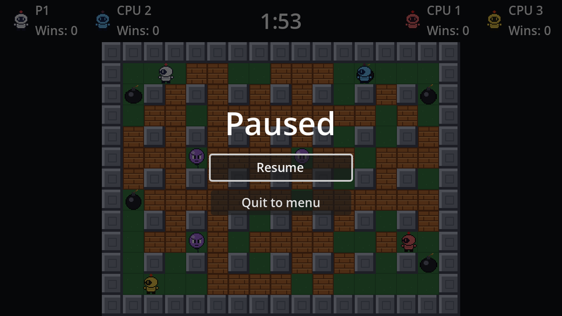

`get_tree().paused = true` freezes every node's processing, physics, timers and tweens. Each node's **Process → Mode** decides what happens to it:

| Mode | While paused |
| --- | --- |
| Inherit (default) | Same as its parent; the root is *Pausable* |
| Pausable | Stops |
| When Paused | Runs *only* while paused |
| Always | Keeps running |
| Disabled | Never runs (we used this to freeze the arena) |

The pause menu itself must keep working while everything else is frozen, so its mode is **Always**.

```text
PauseMenu (CanvasLayer)            # Layer 10, Process Mode: Always
├── Dim (ColorRect, Full Rect)     # black, 60% alpha
└── CenterContainer (Full Rect)
    └── VBoxContainer              # min width 160, separation 12
        ├── Title (Label)          # "Paused", size 36
        ├── ResumeButton (Button, %)
        └── MainMenuButton (Button)    # "Quit to menu"
```

Layer 10 draws it above the HUD (layer 1). The `Dim` rectangle darkens the arena and swallows mouse clicks.

```gdscript title="pause_menu.gd"
extends CanvasLayer

@onready var resume_button: Button = %ResumeButton


func _ready() -> void:
	hide()


func _unhandled_input(event: InputEvent) -> void:
	if event.is_action_pressed("pause"):
		set_paused(not get_tree().paused)
		get_viewport().set_input_as_handled()


func set_paused(paused: bool) -> void:
	get_tree().paused = paused
	visible = paused
	if paused:
		resume_button.grab_focus()


func _on_resume_button_pressed() -> void:
	set_paused(false)


func _on_main_menu_button_pressed() -> void:
	get_tree().paused = false # The pause state outlives the scene!
	get_tree().change_scene_to_file("res://main_menu.tscn")
```

- `_unhandled_input` only sees events that no UI control used, the right place for a gameplay shortcut. `set_input_as_handled()` stops the same key press from reaching anything else.
- `paused` belongs to the **SceneTree**, not to the scene, so it survives a scene change. Forget to unpause before leaving and the main menu loads frozen.

Instance `pause_menu.tscn` in `game.tscn` and add a reference:

```gdscript title="game.gd"
@onready var pause_menu: CanvasLayer = $PauseMenu
```

The round timers, bomb fuses and CPU brains are all normal pausable nodes, so they wait politely while the game is paused.

```quiz
question: Which process mode does the pause menu need?
options:
  - Pausable
  - When Paused
  - Always
answer: 2
explain: With *When Paused*, `_unhandled_input` wouldn't run while the game is running, so pressing Esc could never open the menu. *Always* covers both.
```
