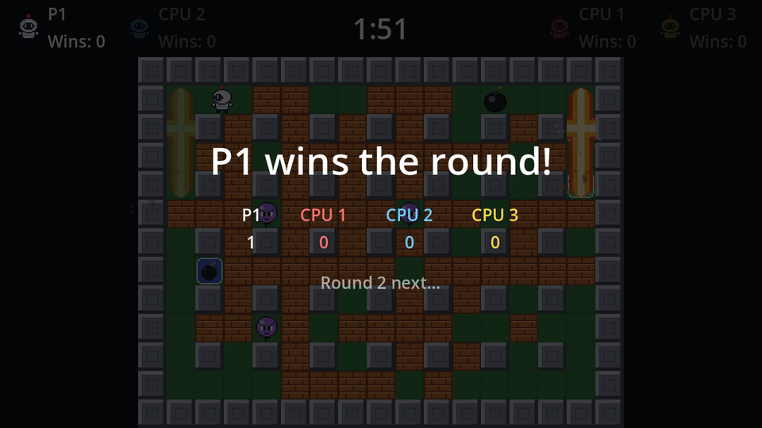
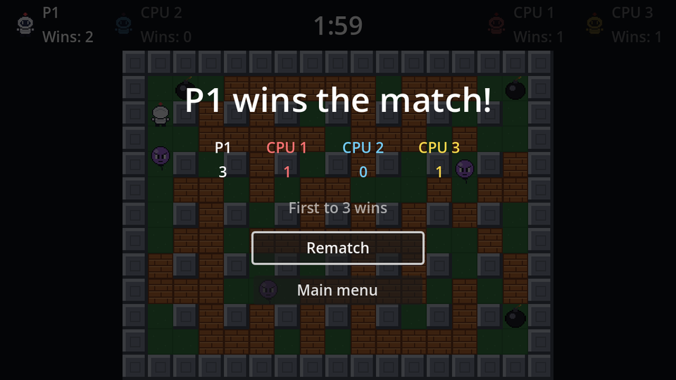

Time to replace the `print` and the hidden reload with real screens:

- After a **round**: who won it, the scores, and the next round starts by itself after three seconds.
- After the **match**: the champion, the final scores, and buttons for a rematch or the main menu.



## The scene

Both cases share one scene; the buttons only show at the end of a match.

```text
Results (CanvasLayer)                 # Layer 10
├── Dim (ColorRect, Full Rect)        # black, 70% alpha
├── CenterContainer (Full Rect)
│   └── VBoxContainer                 # separation 14
│       ├── Title (Label, %)          # size 32, centred
│       ├── Scoreboard (HBoxContainer, %)   # separation 32, alignment Center
│       ├── Hint (Label, %)           # 60% opacity, centred
│       └── Buttons (VBoxContainer, %)      # min width 160, Shrink Center
│           ├── RematchButton (Button, %)
│           └── MainMenuButton (Button, %)
└── NextRoundTimer (Timer)            # Wait Time 3, One Shot
```

Connect both buttons' `pressed` and the timer's `timeout` to `Results`.

```gdscript title="results.gd"
extends CanvasLayer
## Round and match results, shown over the frozen arena.

## Seconds before the match buttons respond, so a bomb key still being
## mashed when the match ends doesn't press Rematch by accident.
const INPUT_DELAY := 1.0

@onready var title: Label = %Title
@onready var scoreboard: HBoxContainer = %Scoreboard
@onready var hint: Label = %Hint
@onready var buttons: VBoxContainer = %Buttons
@onready var rematch_button: Button = %RematchButton
@onready var main_menu_button: Button = %MainMenuButton
@onready var next_round_timer: Timer = $NextRoundTimer


func _ready() -> void:
	hide()


## `winner` is a bomber index, or -1 for a draw.
func show_round(winner: int) -> void:
	title.text = "Draw!" if winner < 0 else "%s wins the round!" % Match.bombers[winner].name
	hint.text = "Round %d next…" % Match.round_number
	_fill_scoreboard()
	buttons.hide()
	show()
	next_round_timer.start()


func show_match(winner: int) -> void:
	title.text = "%s wins the match!" % Match.bombers[winner].name
	hint.text = "First to %d wins" % Match.ROUNDS_TO_WIN
	_fill_scoreboard()
	rematch_button.disabled = true
	main_menu_button.disabled = true
	show()
	create_tween().tween_callback(_enable_buttons).set_delay(INPUT_DELAY)


func _enable_buttons() -> void:
	rematch_button.disabled = false
	main_menu_button.disabled = false
	rematch_button.grab_focus()


func _fill_scoreboard() -> void:
	for i in Match.bombers.size():
		var label := Label.new()
		label.text = "%s\n%d" % [Match.bombers[i].name, Match.wins[i]]
		label.horizontal_alignment = HORIZONTAL_ALIGNMENT_CENTER
		label.modulate = Match.bombers[i].color
		scoreboard.add_child(label)


func _on_next_round_timer_timeout() -> void:
	get_tree().reload_current_scene()


func _on_rematch_button_pressed() -> void:
	Match.restart()
	get_tree().reload_current_scene()


func _on_main_menu_button_pressed() -> void:
	get_tree().change_scene_to_file("res://main_menu.tscn")
```

### The bomb-key problem

Remember the note from the first chapter: both bomb keys, <kbd>Space</kbd> and <kbd>Enter</kbd>, also press the focused button. A match often ends mid-panic, with someone still hammering their bomb key. If **Rematch** had focus the instant the screen appeared, that key press would start a rematch before anyone had seen who won.

So the buttons start **disabled**, and a tween with nothing but a delayed callback enables them and grabs focus a second later. `create_tween().tween_callback(f).set_delay(d)` is a compact "call this in d seconds" that's bound to the node: if the scene goes away first, the callback never runs.

The round screen has no buttons at all, so it has nothing to worry about.

## Hooking it up

Instance `results.tscn` in `game.tscn` and replace the end of `_end_round`:

```gdscript title="game.gd" del={9-12} ins={7,13-17}
func _end_round(winner: int) -> void:
	round_over = true
	round_timer.stop()
	sudden_death_timer.stop()
	# Freeze the arena: no more bombs, flames or deaths.
	arena.process_mode = Node.PROCESS_MODE_DISABLED
	pause_menu.set_process_unhandled_input(false)
	Match.finish_round(winner)
	print("Round over. Winner: %d, wins: %s" % [winner, Match.wins])
	if Match.match_winner() >= 0:
		Match.restart() # A proper results screen comes in the menus chapter.
	get_tree().create_timer(3.0).timeout.connect(get_tree().reload_current_scene)
	var champion := Match.match_winner()
	if champion >= 0:
		results.show_match(champion)
	else:
		results.show_round(winner)
```

with `@onready var results: CanvasLayer = $Results` next to the other references. `set_process_unhandled_input(false)` switches off the pause menu's <kbd>Esc</kbd> handling: pausing on top of a results screen would only stack two menus.



That's the full loop: menu → mode → rounds → match results → rematch or menu.

```quiz
question: Why are the match buttons disabled for the first second?
options:
  - To give the round-end sound time to play
  - Space and Enter are bomb keys and also press focused buttons; a player still mashing them would otherwise trigger Rematch instantly
  - Buttons can't be enabled in the same frame they're shown
answer: 1
```

```quiz
question: Why does Rematch call `Match.restart()` and not `Match.start(Match.mode)`?
options:
  - They're identical
  - restart() keeps the same bombers and only zeroes wins and the round number; start() would rebuild the bomber list too
  - start() can only be called from the mode select
answer: 1
explain: Both would work here, but `restart()` says exactly what a rematch means (same players, fresh score).
```
