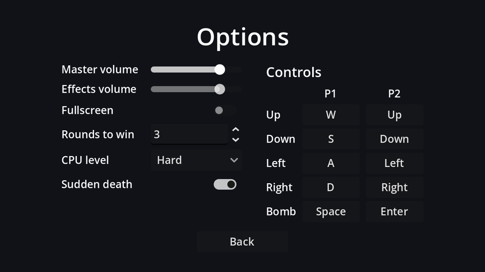

## Layout

New scene, `Control` root (Full Rect) named `OptionsMenu`. Settings go in a two-column `GridContainer` (label, control, label, control…), and the key bindings get their own column next to it:

```text
OptionsMenu (Control, Full Rect)
├── CenterContainer (Full Rect)
│   └── VBoxContainer                          # separation 12
│       ├── Title (Label)                      # "Options", size 32
│       ├── Columns (HBoxContainer)            # separation 32
│       │   ├── SettingsGrid (GridContainer)   # 2 columns
│       │   │   ├── "Master volume"   MasterSlider (HSlider, %)
│       │   │   ├── "Effects volume"  SfxSlider (HSlider, %)
│       │   │   ├── "Fullscreen"      FullscreenCheck (CheckButton, %)
│       │   │   ├── "Rounds to win"   RoundsSpin (SpinBox, %)
│       │   │   ├── "CPU level"       DifficultyOption (OptionButton, %)
│       │   │   └── "Sudden death"    SuddenDeathCheck (CheckButton, %)
│       │   └── Controls (VBoxContainer)
│       │       ├── ControlsTitle (Label)              # "Controls", size 18
│       │       └── ControlsGrid (GridContainer, %)    # 3 columns, filled from code
│       └── BackButton (Button)                # min width 120, Shrink Center
└── TestSound (AudioStreamPlayer)              # Bus: SFX
```

| Node | Properties |
| --- | --- |
| `MasterSlider`, `SfxSlider` | Max Value `1`, Step `0.05`; Custom Minimum Size x `120` on the first |
| `RoundsSpin` | Min `1`, Max `9` |
| `DifficultyOption` | no items: the script adds them from `Settings.DIFFICULTY_NAMES` |

Everything has to fit in 640×360, two players' controls included, so the separations are tight: 6 pixels between settings rows, 4 between control rows.

## The script

Connect each control's change signal to `OptionsMenu`: `value_changed` for the sliders and the SpinBox, `toggled` for the CheckButtons, `item_selected` for the OptionButton, and `pressed` for Back.

```gdscript title="options_menu.gd"
extends Control

@onready var master_slider: HSlider = %MasterSlider
@onready var sfx_slider: HSlider = %SfxSlider
@onready var fullscreen_check: CheckButton = %FullscreenCheck
@onready var rounds_spin: SpinBox = %RoundsSpin
@onready var difficulty_option: OptionButton = %DifficultyOption
@onready var sudden_death_check: CheckButton = %SuddenDeathCheck


func _ready() -> void:
	# The *_no_signal setters avoid triggering our change handlers (and the test sound).
	master_slider.set_value_no_signal(Settings.master_volume)
	sfx_slider.set_value_no_signal(Settings.sfx_volume)
	fullscreen_check.set_pressed_no_signal(Settings.fullscreen)
	rounds_spin.set_value_no_signal(Settings.rounds_to_win)
	for difficulty in Settings.DIFFICULTY_NAMES:
		difficulty_option.add_item(difficulty)
	difficulty_option.selected = Settings.cpu_difficulty
	sudden_death_check.set_pressed_no_signal(Settings.sudden_death)
	master_slider.grab_focus()


func _on_master_slider_value_changed(value: float) -> void:
	Settings.master_volume = value
	Settings.apply()


func _on_sfx_slider_value_changed(value: float) -> void:
	Settings.sfx_volume = value
	Settings.apply()
	$TestSound.play() # Let the player hear the new volume.


func _on_fullscreen_check_toggled(toggled_on: bool) -> void:
	Settings.fullscreen = toggled_on
	Settings.apply()


func _on_rounds_spin_value_changed(value: float) -> void:
	Settings.rounds_to_win = int(value)


func _on_difficulty_option_item_selected(index: int) -> void:
	Settings.cpu_difficulty = index


func _on_sudden_death_check_toggled(toggled_on: bool) -> void:
	Settings.sudden_death = toggled_on


func _on_back_button_pressed() -> void:
	Settings.save_settings()
	get_tree().change_scene_to_file("res://main_menu.tscn")
```

Changes apply **immediately** (you hear the volume change while dragging, and the window goes fullscreen as you flip the switch) and are **saved** when you leave. Saving on every slider tick would write the file dozens of times a second.

:::warning[The `_no_signal` setters]
Assigning `slider.value = x` emits `value_changed`, exactly as dragging does. In `_ready` that would run every handler and play the test sound the moment the screen opens. `set_value_no_signal` and `set_pressed_no_signal` update the control quietly. (Setting an OptionButton's `selected` never emits `item_selected`, so it needs no special treatment.)
:::

The difficulty names live in `Settings` rather than in the scene, so the list in the dropdown and the levels in `CpuBrain.LEVELS` are always next to each other in code. `TestSound` has no sound yet; it gets one in the polish chapter.

```quiz
question: In `_ready`, why use `set_value_no_signal` instead of assigning `value`?
options:
  - Assigning value is deprecated
  - Assigning value emits value_changed, which would run the handlers and play the test sound
  - set_value_no_signal is faster
answer: 1
```
