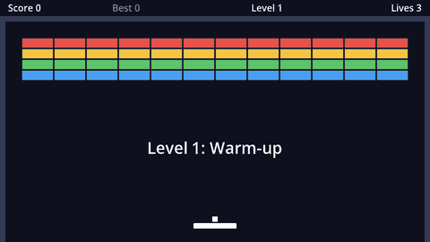

This tutorial builds a complete Breakout: a paddle you steer with the mouse or the keyboard, a ball you aim by where it hits the paddle, bricks that take one or more hits, four levels, lives, a high score that's saved to disk, falling power-ups (a wider paddle, multi-ball and a slow ball), menus, an options screen with key rebinding, sound, particles, screen shake, and finally an exported game you can share.



Every chapter ends with a game that runs, so you can stop anywhere and still have something to play.

## What you'll learn

If you've done the Pong tutorial, a few of these will be familiar. They're all explained again here, so you can start with this one too.

| Chapter | Godot ideas |
| --- | --- |
| Paddle, Ball | `CharacterBody2D`, input actions, mouse input, `move_and_collide`, vectors |
| Bricks, Levels | Instancing scenes from code, **custom resources**, typed arrays and dictionaries |
| Lives and score | `Area2D`, `CanvasLayer`, signals, saving with `ConfigFile` |
| Power-ups | Enums, `Timer` nodes, tweens, deferred calls, lambdas |
| Menus, Options | UI containers, pausing, autoloads, audio buses, remapping input |
| Polish | Sound, particles, camera shake |

## Download Godot

Get the **standard** build of Godot 4 (not the .NET one) from the official website. It's a single program, no installer needed. This tutorial uses Godot 4.7. Anything from **4.4** onwards works: we use typed dictionaries, which arrived in 4.4.

:::tip
On macOS, move Godot to `/Applications` so you can start it from Spotlight.
:::

## The project manager

Starting Godot opens the *project manager*, where you create and open projects. Picking a project opens the *editor*, where everything else happens.

```quiz
question: Why does this tutorial need Godot 4.4 or newer?
options:
  - It uses the Compatibility renderer
  - It uses typed dictionaries like `Dictionary[String, BrickType]`
  - Older versions can't export to the web
answer: 1
explain: Typed dictionaries were added in Godot 4.4. Typed **arrays** have been around since 4.0.
```
