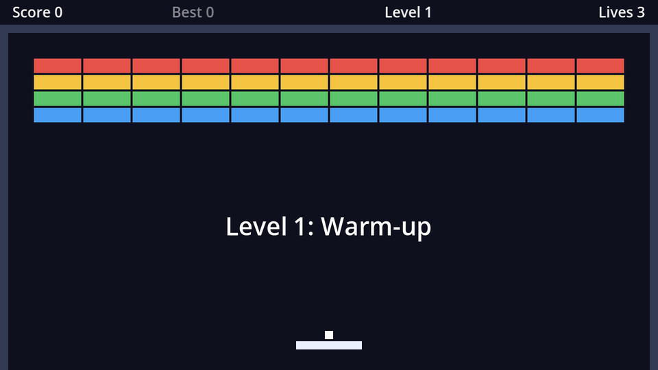

Placing 48 bricks by hand is no fun, and redoing it for every level even less. Instead, we'll describe a wall of bricks as text, one character per brick:

```text
rrrrrrrrrrrr
yyyyyyyyyyyy
gggggggggggg
bbbbbbbbbbbb
```

Twelve columns of 48px is 576px, which leaves a 24px margin inside each side wall.

## A typed dictionary of brick types

Add a `Node2D` named `Bricks` to `game.tscn` at position `(32, 56)`: the top-left corner of the grid. Attach `brick_grid.gd`:

```gdscript title="brick_grid.gd"
extends Node2D

const BRICK_SCENE := preload("res://brick.tscn")
## Room for each brick: 46×14 plus a 2px gap.
const CELL_SIZE := Vector2(48, 16)
const LAYOUT := [
	"rrrrrrrrrrrr",
	"yyyyyyyyyyyy",
	"gggggggggggg",
	"bbbbbbbbbbbb",
]

## Which brick type each layout character stands for.
@export var brick_types: Dictionary[String, BrickType] = {}


func _ready() -> void:
	for row in LAYOUT.size():
		var line: String = LAYOUT[row]
		for column in line.length():
			var symbol := line[column]
			if symbol == ".":
				continue
			_add_brick(brick_types[symbol], Vector2(column, row) * CELL_SIZE + CELL_SIZE / 2)


func _add_brick(type: BrickType, at: Vector2) -> void:
	var brick := BRICK_SCENE.instantiate()
	brick.type = type
	brick.position = at
	add_child(brick)
```

`Dictionary[String, BrickType]` is a **typed dictionary**: keys must be strings and values must be `BrickType`s. The Inspector understands it. Select `Bricks`, open **Brick Types**, and add six pairs, dragging each `.tres` file from the FileSystem dock onto the value:

| Key | Value |
| --- | --- |
| `r` | `red.tres` |
| `y` | `yellow.tres` |
| `g` | `green.tres` |
| `b` | `blue.tres` |
| `s` | `silver.tres` |
| `#` | `steel.tres` |

## How the loop works

- `for row in LAYOUT.size()` counts from 0 up to the number of rows. Same for `column`.
- `line[column]` is a single character, like `"r"`. A `.` means "no brick here".
- `Vector2(column, row) * CELL_SIZE` multiplies component-wise: column 3, row 2 becomes `(144, 32)`. Adding half a cell moves from the cell's corner to its centre, because a brick's `position` is its centre.
- Positions are relative to `Bricks`, so moving that node moves the whole wall.

:::warning[Set the type before `add_child`]
`add_child` is what triggers the brick's `_ready()`, which reads `type`. Set `type` afterwards and `_ready()` finds `null`, and the game stops with *Invalid access to property or key 'hit_points' on a base object of type 'Nil'*.
:::

Run it: a full wall of bricks, ready to be broken.

```quiz
question: Where (relative to the `Bricks` node) is the centre of the brick in row 2, column 3?
options:
  - (144, 32)
  - (168, 40)
  - (150, 34)
answer: 1
explain: (3 × 48 + 24, 2 × 16 + 8) = (168, 40). Rows and columns count from 0.
```

```quiz
question: What happens if code tries to store a `Color` as a value in `brick_types`, a `Dictionary[String, BrickType]`?
options:
  - It's converted to a BrickType automatically
  - Godot reports an error, because values must be BrickType
  - Nothing, the type is just a hint
answer: 1
explain: Typed collections check what goes into them. That catches mistakes such as dragging the wrong file into the Inspector.
```
