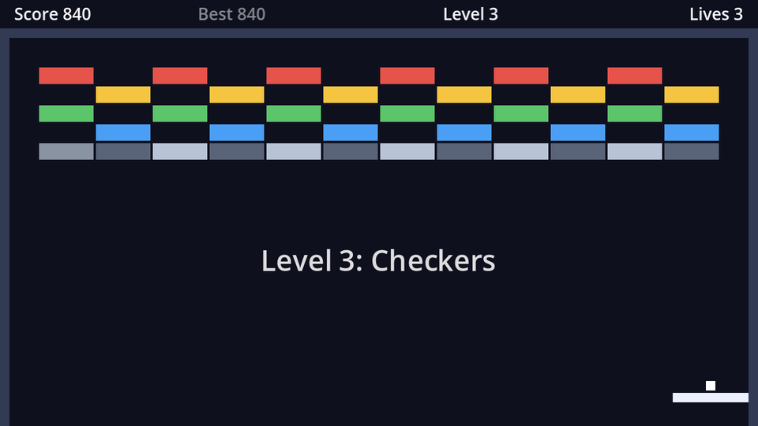

The brick layout is still a constant in `brick_grid.gd`. To have several levels, and to edit them without touching code, each level becomes a resource file, just like the brick types.

## The Level resource

```gdscript title="level.gd"
class_name Level
extends Resource
## A level: a title and a text map of bricks.
##
## Each character in `layout` is one grid cell. "." is empty; any other
## character is looked up in the brick grid's `brick_types`.

@export var title := ""
@export_multiline var layout := ""
```

`@export_multiline` gives `layout` a multi-line text box in the Inspector instead of a single-line field. The `##` lines are **documentation comments**: Godot shows them in the built-in help (search for `Level` with <kbd>F1</kbd>) and as tooltips in the Inspector.

## Four levels

Create a `levels` folder and four `Level` resources in it (**Create New → Resource… → Level**): `level_01.tres` to `level_04.tres`. Give each a title and type the layout into the text box. Each line is a row:

```text title="level_01.tres: Warm-up"
rrrrrrrrrrrr
yyyyyyyyyyyy
gggggggggggg
bbbbbbbbbbbb
```

```text title="level_02.tres: Pyramid"
.....rr.....
....rrrr....
...yyyyyy...
..gggggggg..
.bbbbbbbbbb.
ssssssssssss
```

```text title="level_03.tres: Checkers"
r.r.r.r.r.r.
.y.y.y.y.y.y
g.g.g.g.g.g.
.b.b.b.b.b.b
s#s#s#s#s#s#
```

```text title="level_04.tres: Fortress"
ssssssssssss
s..........s
s.rrrrrrrr.s
s.yyyyyyyy.s
s.gggggggg.s
s..........s
###......###
```

Steel (`#`) is unbreakable. In *Fortress* the only way in is the gap in the steel at the bottom, or through the silver walls.

## Building from a Level

`brick_grid.gd` loses its constant and gains a `build()` function that takes a level:

```gdscript title="brick_grid.gd"
extends Node2D

const BRICK_SCENE := preload("res://brick.tscn")
## Room for each brick: 46×14 plus a 2px gap.
const CELL_SIZE := Vector2(48, 16)

## Which brick type each layout character stands for.
@export var brick_types: Dictionary[String, BrickType] = {}


func build(level: Level) -> void:
	for child in get_children():
		child.queue_free()
	var rows := level.layout.strip_edges().split("\n")
	for row in rows.size():
		var line := rows[row].strip_edges()
		for column in line.length():
			var symbol := line[column]
			if symbol == ".":
				continue
			if not brick_types.has(symbol):
				push_warning("Level '%s' uses unknown brick '%s'" % [level.title, symbol])
				continue
			_add_brick(brick_types[symbol], Vector2(column, row) * CELL_SIZE + CELL_SIZE / 2)


func _add_brick(type: BrickType, at: Vector2) -> void:
	var brick := BRICK_SCENE.instantiate()
	brick.type = type
	brick.position = at
	add_child(brick)
```

- `build()` first removes the previous level's bricks, so it can be called again for the next level.
- `split("\n")` cuts the text into rows. `strip_edges()` trims spaces and stray newlines, so an extra empty line at the end of a layout does no harm.
- A typo in a layout doesn't crash the game: `push_warning` prints a yellow warning in the **Debugger** panel, and the cell stays empty.

## A list of levels

The game holds the levels in a **typed array** and builds one by index:

```gdscript title="game.gd" ins={5-8,10,17,26-32} del={15-16}
extends Node2D

const BALL_SCENE := preload("res://ball.tscn")

@export var levels: Array[Level] = []

var level_index := 0

@onready var paddle: CharacterBody2D = $Paddle
@onready var bricks: Node2D = $Bricks
@onready var balls: Node2D = $Balls


func _ready() -> void:
	var ball := _spawn_ball()
	ball.held_by = paddle
	_start_level(0)


func _unhandled_input(event: InputEvent) -> void:
	if event.is_action_pressed("launch"):
		for ball in balls.get_children():
			ball.launch()


func _start_level(index: int) -> void:
	level_index = index
	bricks.build(levels[index])
	var ball := _spawn_ball()
	ball.held_by = paddle


func _spawn_ball() -> CharacterBody2D:
	var ball: CharacterBody2D = BALL_SCENE.instantiate()
	balls.add_child(ball)
	return ball
```

The ball is now spawned by `_start_level`, so every level begins with a ball on the paddle. Select `Game`, expand **Levels** in the Inspector, click **Add Element** four times and drag the four `.tres` files into the slots, in order. `Array[Level]` only accepts `Level` resources, so you can't drop a brick type in there by mistake.

:::tip[Testing a level]
To try level 3 without clearing 1 and 2, change `_start_level(0)` to `_start_level(2)` for a moment. Or drag `level_03.tres` to the top of the Levels list.
:::

```quiz
question: What does `"rr.\nyy.".split("\n")` return?
options:
  - '["rr.", "yy."]'
  - '["r", "r", ".", "y", "y", "."]'
  - '"rr.yy."'
answer: 0
explain: '`split` cuts a string at every separator and returns the pieces as an array (a `PackedStringArray`).'
```

```quiz
question: Which annotation turns a String export into a multi-line text box in the Inspector?
type: text
answer: ["@export_multiline", "export_multiline"]
```
