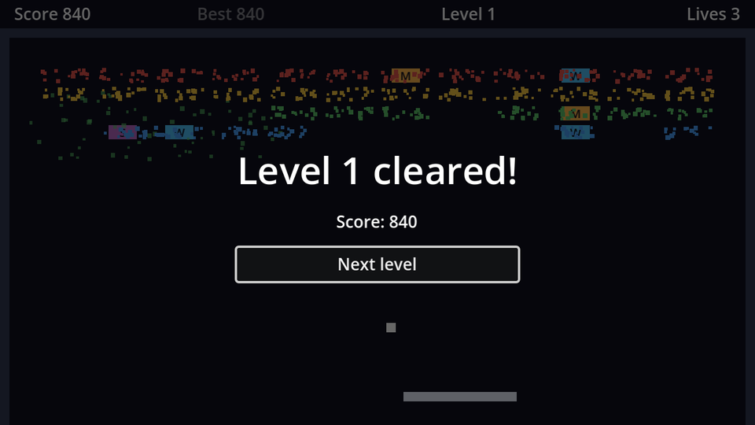

Jumping straight into the next level is abrupt. Let's stop for a moment, show what you achieved, and continue when the player is ready.

## A project theme

Godot's default UI text is tiny at 640×360. Rather than setting a font size on every control, create a **Theme**: in the FileSystem dock, **Create New → Resource… → Theme**, save it as `theme.tres`, and set **Default Font Size** to `14` in the Inspector. Then make it the project-wide theme under **Project Settings → GUI → Theme → Custom**. Every UI control in the game now starts from it, and individual nodes can still override it.

## The scene

UI goes on a **CanvasLayer**. A canvas layer draws its children in screen coordinates on its own layer, unaffected by anything happening in the game world (we'll shake the camera later, and the menus must stay still).

New scene, `CanvasLayer` root named `LevelComplete`, saved as `level_complete.tscn`. Set its **Layer** to `10`, above everything else, and its **Process → Mode** to **Always** (more on that below).

```text
LevelComplete (CanvasLayer, layer 10, Process Mode: Always)
├── Dim (ColorRect)                 # Full Rect, black at 60% alpha
└── CenterContainer                 # Full Rect
    └── VBoxContainer               # minimum size 200×0, separation 12
        ├── TitleLabel (Label, %)   # font size 32, centred
        └── NextButton (Button, %)  # "Next level"
```

- **Full Rect** is in the toolbar's anchor preset menu (the green crosshair icon). It stretches the control over the whole screen.
- A `CenterContainer` keeps its child in the middle; a `VBoxContainer` stacks its children vertically. Containers do the layout for you, at any window size.
- Right-click `TitleLabel` and `NextButton` → **Access as Unique Name**. The `%` lets the script find them with `%TitleLabel`, wherever they are in the tree.
- `Dim` darkens the game behind the text, and as a full-screen control it also stops clicks from reaching anything underneath.

Connect `NextButton`'s `pressed` signal to `LevelComplete` and add the script:

```gdscript title="level_complete.gd"
extends CanvasLayer

signal next_pressed

@onready var title_label: Label = %TitleLabel
@onready var next_button: Button = %NextButton


func _ready() -> void:
	hide()


func open(level: int) -> void:
	title_label.text = "Level %d cleared!" % level
	show()
	get_tree().paused = true
	next_button.grab_focus()


func _on_next_button_pressed() -> void:
	hide()
	get_tree().paused = false
	next_pressed.emit()
```

- `"Level %d cleared!" % level` is **string formatting**: `%d` is replaced with the number.
- `grab_focus()` lets the keyboard press the button with <kbd>Enter</kbd> or <kbd>Space</kbd>, so a keyboard player never needs the mouse.
- The screen doesn't decide what happens next; it emits `next_pressed` and the game decides.

## Pausing, briefly

`get_tree().paused = true` freezes the game: physics, `_process`, timers and tweens all stop. A node keeps running while paused only if its **Process Mode** says so. The screen is set to **Always**, so its button still works while the game behind it is frozen. The pause menu chapter covers the modes in full.

## Hook it up

Instance `level_complete.tscn` in `game.tscn`. Connect its `next_pressed` signal to `Game`, and show the screen instead of jumping ahead:

```gdscript title="game.gd" ins={2,7,10-13} del={6}
@onready var balls: Node2D = $Balls
@onready var level_complete: CanvasLayer = $LevelComplete

func _on_bricks_cleared() -> void:
	if level_index + 1 < levels.size():
		_start_level(level_index + 1)
		level_complete.open(level_index + 1)
	else:
		_start_level(0) # A proper "you win" screen comes in the menus chapter.


func _on_level_complete_next_pressed() -> void:
	_start_level(level_index + 1)
```

`level_index + 1` is the number of the level just finished, since indexes start at 0 and level numbers at 1.

```quiz
question: The game is paused. Which nodes still run?
options:
  - Every node, pausing only stops physics
  - Only nodes whose Process Mode lets them run while paused, like Always
  - Only CanvasLayers
answer: 1
explain: '`paused` stops processing for nodes with the default (Inherit → Pausable) mode. The level complete screen is set to **Always**, so its button keeps working.'
```

```quiz
question: 'What does `"Score: %d" % 840` produce?'
type: text
answer: ["Score: 840"]
```
