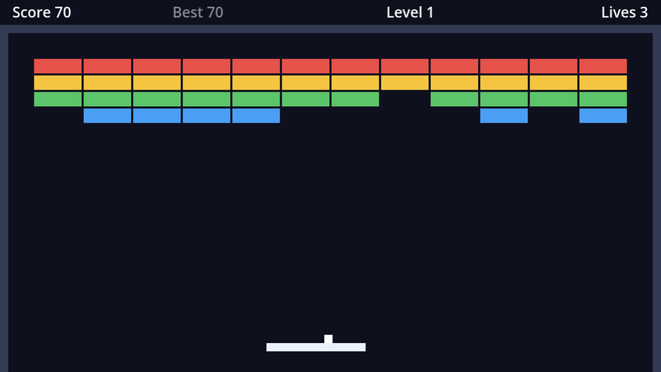

## The HUD scene

The 24px strip above the top wall holds the HUD (heads-up display). New scene, `CanvasLayer` root named `HUD`, saved as `hud.tscn`:

```text
HUD (CanvasLayer)
├── Bar (HBoxContainer)       # anchor preset Top Wide; left 12, right -12, bottom 24
│   ├── ScoreLabel (Label, %) # "Score 0"
│   ├── BestLabel (Label, %)  # "Best 0", font colour white at 50% alpha
│   ├── LevelLabel (Label, %) # "Level 1", horizontal alignment Center
│   └── LivesLabel (Label, %) # "Lives 3", horizontal alignment Right
└── Banner (Label, %)         # anchor preset H Center Wide; top 20, bottom 60
                              # font size 24, centred both ways, modulate alpha 0
```

On all four labels in `Bar`, tick **Layout → Container Sizing → Horizontal → Expand**. An `HBoxContainer` normally squeezes its children to their minimum size; *Expand* makes them share the full width equally, so the four labels spread across the screen.

`Banner` shows the level name for a moment when a level starts. It starts invisible (alpha 0) and fades in and out from code.

```gdscript title="hud.gd"
extends CanvasLayer

@onready var score_label: Label = %ScoreLabel
@onready var best_label: Label = %BestLabel
@onready var level_label: Label = %LevelLabel
@onready var lives_label: Label = %LivesLabel
@onready var banner: Label = %Banner


func update_score(score: int, best: int) -> void:
	score_label.text = "Score %d" % score
	best_label.text = "Best %d" % best


func update_level(level: int) -> void:
	level_label.text = "Level %d" % level


func update_lives(lives: int) -> void:
	lives_label.text = "Lives %d" % lives


## Show a message in the middle of the screen for a moment, then fade it out.
func show_banner(text: String) -> void:
	banner.text = text
	banner.modulate.a = 1.0
	var tween := create_tween()
	tween.tween_interval(1.5)
	tween.tween_property(banner, "modulate:a", 0.0, 0.5)
```

A **tween** animates properties over time from code. Steps added to a tween run one after the other: wait 1.5 s, then fade `modulate:a` (the alpha part of `modulate`) to 0 over half a second.

The HUD only offers functions like `update_score`. The game never touches its labels directly, so you could redesign the HUD completely without changing `game.gd`.

## Scoring

Instance `hud.tscn` in `game.tscn`. Connect the `Bricks` node's `brick_destroyed` signal to `Game`, and keep the HUD up to date:

```gdscript title="game.gd" ins={2-3,6,10-11,18-19,26,28-37}
var level_index := 0
var score := 0
var best := 0
var lives := START_LIVES

@onready var hud: CanvasLayer = $HUD


func _ready() -> void:
	hud.update_score(score, best)
	hud.update_lives(lives)
	_start_level(0)


func _start_level(index: int) -> void:
	level_index = index
	bricks.build(levels[index])
	hud.update_level(index + 1)
	hud.show_banner("Level %d: %s" % [index + 1, levels[index].title])
	_reset_round()


func _on_kill_zone_body_entered(body: Node2D) -> void:
	body.queue_free()
	lives -= 1
	hud.update_lives(lives)
	# ...


func _add_points(points: int) -> void:
	score += points
	best = maxi(best, score)
	hud.update_score(score, best)


func _on_bricks_brick_destroyed(brick: Node2D) -> void:
	_add_points(brick.type.points)
```

- Points come from the brick's type, so tougher bricks are worth more without any extra code.
- `best` follows the score live once you beat it. For now it starts at 0 every time; on the next page it's loaded from disk.
- With two values, the format needs an array: `"Level %d: %s" % [2, "Pyramid"]`. `%s` inserts a string.

## Score on the level complete screen

Add a `ScoreLabel` (unique name, centred) between the title and the button in `level_complete.tscn`, and pass the score along:

```gdscript title="level_complete.gd" ins={2,7,9} del={6}
@onready var title_label: Label = %TitleLabel
@onready var score_label: Label = %ScoreLabel
@onready var next_button: Button = %NextButton


func open(level: int) -> void:
func open(level: int, score: int) -> void:
	title_label.text = "Level %d cleared!" % level
	score_label.text = "Score: %d" % score
	show()
```

and in `game.gd`, `level_complete.open(level_index + 1, score)`.

```quiz
question: Four labels in an HBoxContainer all have Horizontal → Expand. The container is 616px wide. Roughly how wide is each label?
type: text
answer: ["154", "154px", "154 px"]
hint: Expanding children share the space equally.
explain: 616 ÷ 4 = 154 (minus a little for the separation between them).
```

```quiz
question: What does `"%s has %d bricks" % ["Pyramid", 42]` produce?
options:
  - Pyramid has 42 bricks
  - '%s has %d bricks'
  - An error, % only takes one value
answer: 0
```
