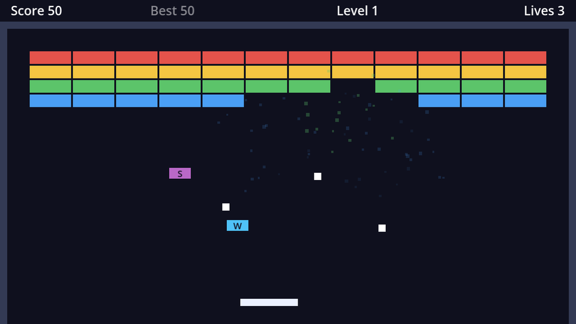

## The scene

A pickup falls in a straight line and only cares about one thing: touching the paddle. Like the kill zone, that's a job for an `Area2D`. New scene, saved as `pickup.tscn`:

```text
Pickup (Area2D)        # Layer: pickups, Mask: paddle
├── CollisionShape2D   # RectangleShape2D, 24×12
├── ColorRect          # left -12, top -6, right 12, bottom 6, Mouse Filter: Ignore
└── Label              # left -12, top -8, right 12, bottom 8, text "W"
                       # font size 10, font colour #0f0f1f, centred both ways
```

The mask contains only `paddle`, so `body_entered` can only ever mean "the paddle caught me". Connect the pickup's own `body_entered` signal to itself.

## One scene, three kinds

All three power-ups look and fall the same; only the letter, the colour and the effect differ. An **enum** names the kinds:

```gdscript title="pickup.gd"
class_name Pickup
extends Area2D
## A power-up capsule that falls from a broken brick until the paddle catches it.

signal collected(kind: Kind)

enum Kind { WIDE, MULTI, SLOW }

const LETTERS := {Kind.WIDE: "W", Kind.MULTI: "M", Kind.SLOW: "S"}
const COLORS := {
	Kind.WIDE: Color(0.31, 0.76, 0.97),
	Kind.MULTI: Color(1.0, 0.72, 0.3),
	Kind.SLOW: Color(0.73, 0.41, 0.78),
}

@export var kind := Kind.WIDE
@export var fall_speed := 80.0


func _ready() -> void:
	$ColorRect.color = COLORS[kind]
	$Label.text = LETTERS[kind]


func _physics_process(delta: float) -> void:
	position.y += fall_speed * delta
	if position.y > get_viewport_rect().size.y + 20:
		queue_free() # Missed it.


func _on_body_entered(_body: Node2D) -> void:
	# The mask only contains the paddle layer, so this can only be the paddle.
	collected.emit(kind)
	queue_free()
```

- `enum Kind { WIDE, MULTI, SLOW }` creates named constants worth 0, 1 and 2. `Kind.MULTI` reads better than `1`, and an `@export` of an enum shows up as a dropdown in the Inspector.
- `class_name Pickup` makes the enum reachable from other scripts as `Pickup.Kind`.
- An `Area2D` isn't moved by physics, so the pickup just changes its own `position`, frame by frame. Multiplying by `delta` makes `fall_speed` pixels per second.
- A missed pickup frees itself once it's below the screen, so they don't pile up forever.

## Dropping pickups

Add a `Node2D` named `Pickups` to `game.tscn` as a container (at position `(0, 0)`, so positions inside it are screen positions). Then drop a random pickup from 15% of the bricks that break:

```gdscript title="game.gd" ins={2,6-7,10,16-17,24-37}
const BALL_SCENE := preload("res://ball.tscn")
const PICKUP_SCENE := preload("res://pickup.tscn")
const START_LIVES := 3

@export var levels: Array[Level] = []
## Chance that a broken brick drops a power-up.
@export_range(0.0, 1.0) var drop_chance := 0.15

@onready var balls: Node2D = $Balls
@onready var pickups: Node2D = $Pickups


func _reset_round() -> void:
	for ball in balls.get_children():
		ball.queue_free()
	for pickup in pickups.get_children():
		pickup.queue_free()
	var ball := _spawn_ball()
	ball.held_by = paddle


func _on_bricks_brick_destroyed(brick: Node2D) -> void:
	_add_points(brick.type.points)
	if randf() < drop_chance:
		_spawn_pickup(brick.global_position)


func _spawn_pickup(at: Vector2) -> void:
	var pickup := PICKUP_SCENE.instantiate()
	pickup.kind = Pickup.Kind.values().pick_random()
	pickup.position = at
	pickup.collected.connect(_on_pickup_collected, CONNECT_DEFERRED)
	pickups.add_child(pickup)


func _on_pickup_collected(kind: Pickup.Kind) -> void:
	print("Caught ", Pickup.Kind.keys()[kind])
```

- `randf()` is a random number between 0 and 1. It's below 0.15 about 15% of the time.
- `Pickup.Kind.values()` is `[0, 1, 2]`; `pick_random()` picks one. `Pickup.Kind.keys()` gives the names, so the print says *Caught MULTI* instead of *Caught 1*.
- Losing a life clears the falling pickups, like in the arcade original.

:::warning[`CONNECT_DEFERRED`]
`collected` is emitted from inside `body_entered`, while physics is flushing queries, just like the kill zone. Multi-ball will spawn new balls in response, and spawning physics bodies at that moment fails with *Can't change this state while flushing queries* (try it once multi-ball works: remove the flag and catch an **M**). Connecting with `CONNECT_DEFERRED` makes every emission call the handler at the end of the frame instead, the same as `call_deferred`, but set up once.
:::

Play for a bit, catch some capsules, and watch the Output panel.

```quiz
question: In `enum Kind { WIDE, MULTI, SLOW }`, what is the value of `Kind.SLOW`?
type: text
answer: ["2"]
explain: Enum values count from 0 unless you give them explicit values.
```

```quiz
question: Why don't pickups trigger the kill zone when they fall off the screen?
options:
  - Area2Ds can't detect other Area2Ds
  - The kill zone's mask only contains the ball layer
  - Pickups are freed before they reach it
answer: 1
explain: 'Areas *can* detect other areas (with `area_entered`). What keeps pickups out is the mask: the kill zone only looks at the `ball` layer.'
```
