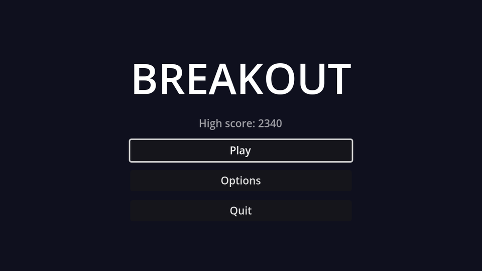

## Layout

New scene with a `Control` root named `MainMenu`, saved as `main_menu.tscn`. Use the anchor preset **Full Rect** on the root.

```text
MainMenu (Control, Full Rect)
└── CenterContainer (Full Rect)
    └── VBoxContainer              # minimum size 200×0, separation 12
        ├── Title (Label)          # "BREAKOUT", font size 56, centred
        ├── BestLabel (Label, %)   # "High score: 0", centred, font colour white at 60%
        ├── PlayButton (Button, %)
        ├── OptionsButton (Button)
        └── QuitButton (Button, %)
```

The `VBoxContainer`'s minimum width makes the three buttons equally wide. Connect each button's `pressed` signal to `MainMenu`.

## The script

```gdscript title="main_menu.gd"
extends Control

@onready var best_label: Label = %BestLabel
@onready var play_button: Button = %PlayButton
@onready var quit_button: Button = %QuitButton


func _ready() -> void:
	best_label.text = "High score: %d" % HighScore.load_best()
	# Browsers can't close the tab for us, so hide Quit in web builds.
	quit_button.visible = not OS.has_feature("web")
	play_button.grab_focus()


func _on_play_button_pressed() -> void:
	get_tree().change_scene_to_file("res://game.tscn")


func _on_options_button_pressed() -> void:
	get_tree().change_scene_to_file("res://options_menu.tscn")


func _on_quit_button_pressed() -> void:
	get_tree().quit()
```

- `HighScore.load_best()` is the static function from the lives chapter. No setup, it just reads the file.
- `change_scene_to_file` throws away the current scene (the whole menu) and loads another. Anything that should survive a scene change can't live in a scene; that's what the autoload in the options chapter is for.
- `OS.has_feature("web")` is true in web exports, where `quit()` can't close the browser tab.
- `grab_focus()` makes the menu work from the keyboard: arrow keys move between buttons, <kbd>Enter</kbd> presses.

:::warning
`options_menu.tscn` doesn't exist yet. Clicking **Options** prints an error until the options chapter.
:::

## Start here

Set **Project Settings → Application → Run → Main Scene** to `res://main_menu.tscn`. <kbd>F5</kbd> now opens the menu, and <kbd>F6</kbd> still runs whichever scene is open in the editor, which is handy for jumping straight into `game.tscn`.

```quiz
question: Why can't the score or settings simply be stored in a variable of the main menu script?
options:
  - Control nodes can't have variables
  - change_scene_to_file frees the menu, and its variables with it
  - Variables are reset every frame
answer: 1
```
