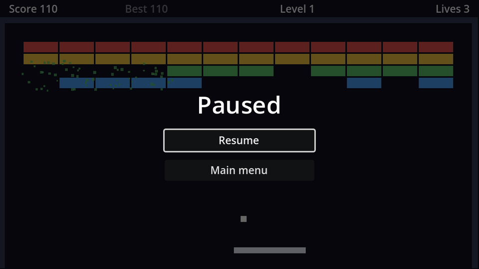

## Process modes

The level complete screen already paused the game. Here's the full picture. `get_tree().paused = true` stops `_process`, `_physics_process`, physics, timers and tweens for every node that is **pausable**. Each node's **Process → Mode** decides what it does:

| Mode | While paused | While running |
| --- | --- | --- |
| Inherit (default) | Same as its parent. The root is Pausable. | Same as its parent |
| Pausable | Stops | Runs |
| When Paused | Runs | Stops |
| Always | Runs | Runs |
| Disabled | Stops | Stops |

## The scene

New scene, `CanvasLayer` root named `PauseMenu`, **Layer** `10`, **Process Mode** `Always`. Save as `pause_menu.tscn`. It has the same shape as the level complete screen:

```text
PauseMenu (CanvasLayer, layer 10, Process Mode: Always)
├── Dim (ColorRect)                  # Full Rect, black at 60% alpha
└── CenterContainer                  # Full Rect
    └── VBoxContainer                # minimum size 200×0, separation 12
        ├── Title (Label)            # "Paused", font size 32
        ├── ResumeButton (Button, %)
        └── MainMenuButton (Button)
```

```gdscript title="pause_menu.gd"
extends CanvasLayer

@onready var resume_button: Button = %ResumeButton


func _ready() -> void:
	hide()


func _unhandled_input(event: InputEvent) -> void:
	if not event.is_action_pressed("pause"):
		return
	if get_tree().paused and not visible:
		return # Another screen (level complete, game over) paused the game.
	set_paused(not visible)
	get_viewport().set_input_as_handled()


func set_paused(paused: bool) -> void:
	get_tree().paused = paused
	visible = paused
	if paused:
		resume_button.grab_focus()


func _on_resume_button_pressed() -> void:
	set_paused(false)


func _on_main_menu_button_pressed() -> void:
	get_tree().paused = false # The pause state outlives the scene!
	get_tree().change_scene_to_file("res://main_menu.tscn")
```

- The menu has to be **Always**, not **When Paused**: it must hear <kbd>Esc</kbd> while the game is running to open at all.
- The second `if` is the interesting one. The level complete screen and the game over screen pause the game too. Without this check, pressing <kbd>Esc</kbd> on the level complete screen would toggle the pause off underneath it and set the game running behind the menu. "Paused, but not by me" means hands off.
- `set_input_as_handled()` stops this key press from reaching anything else.

:::danger[Unpause before leaving]
`paused` belongs to the **SceneTree**, not to the game scene. Switch to the main menu without resetting it, and the menu loads frozen.
:::

Instance `pause_menu.tscn` in `game.tscn`. Because `SlowTimer`, `WideTimer` and the HUD banner's tween are all pausable, power-ups don't secretly run out while you're paused.

```quiz
question: The level complete screen is showing (the game is paused) and the player presses Esc. What happens?
options:
  - The pause menu opens on top
  - The game unpauses behind the level complete screen
  - Nothing; the pause menu sees the game is paused but not by itself
answer: 2
```

```quiz
question: Why does the pause menu use **Always** rather than **When Paused**?
options:
  - When Paused nodes can't contain buttons
  - A When Paused node doesn't process input while the game runs, so it would never see the Esc press that should open it
  - Always is the default for CanvasLayers
answer: 1
explain: 'With **Pausable** it would be the other way round: it could open, but would freeze the moment it paused the game, and never close again.'
```
