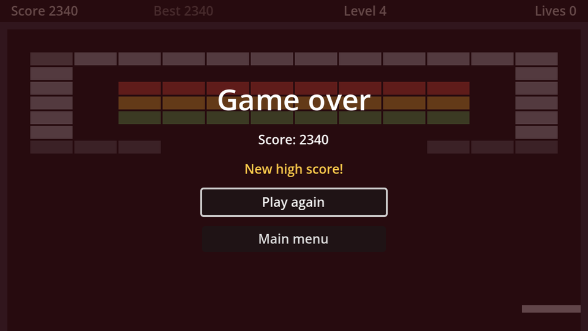

Losing your last life and clearing the last level both end the game. They can share one screen with a different title.

## The scene

`CanvasLayer` named `GameOver`, **Layer** `10`, **Process Mode** `Always`, saved as `game_over.tscn`:

```text
GameOver (CanvasLayer, layer 10, Process Mode: Always)
├── Dim (ColorRect)
└── CenterContainer
    └── VBoxContainer                    # minimum size 200×0, separation 12
        ├── TitleLabel (Label, %)        # font size 32
        ├── ScoreLabel (Label, %)
        ├── HighScoreLabel (Label, %)    # "New high score!", font colour #ffcc4d
        ├── PlayAgainButton (Button, %)
        └── MainMenuButton (Button)
```

```gdscript title="game_over.gd"
extends CanvasLayer

@onready var title_label: Label = %TitleLabel
@onready var score_label: Label = %ScoreLabel
@onready var high_score_label: Label = %HighScoreLabel
@onready var play_again_button: Button = %PlayAgainButton


func _ready() -> void:
	hide()


func open(won: bool, score: int, new_high_score: bool) -> void:
	title_label.text = "You win!" if won else "Game over"
	score_label.text = "Score: %d" % score
	high_score_label.visible = new_high_score
	show()
	get_tree().paused = true
	play_again_button.grab_focus()


func _on_play_again_button_pressed() -> void:
	get_tree().paused = false
	get_tree().reload_current_scene()


func _on_main_menu_button_pressed() -> void:
	get_tree().paused = false
	get_tree().change_scene_to_file("res://main_menu.tscn")
```

- `"You win!" if won else "Game over"` is GDScript's one-line *if expression*.
- `reload_current_scene()` throws the whole game scene away and loads it fresh. Score, lives, level, balls, bricks and timers all reset, without a single line of reset code.
- A hidden `Label` takes up no room in a `VBoxContainer`, so the buttons move up when there's no new high score.

## Ending the game

Instance `game_over.tscn` in `game.tscn` and route both endings through one function:

```gdscript title="game.gd" ins={2,14,24-29} del={12-13,23}
@onready var level_complete: CanvasLayer = $LevelComplete
@onready var game_over: CanvasLayer = $GameOver


func _on_kill_zone_body_entered(body: Node2D) -> void:
	body.queue_free()
	if not _live_balls().is_empty():
		return # Multi-ball: keep playing while any ball is left.
	lives -= 1
	hud.update_lives(lives)
	if lives == 0:
		HighScore.submit(score)
		get_tree().reload_current_scene.call_deferred() # A game over screen comes in the menus chapter.
		_end_game(false)
	else:
		_reset_round.call_deferred()


func _on_bricks_cleared() -> void:
	if level_index + 1 < levels.size():
		level_complete.open(level_index + 1, score)
	else:
		_start_level(0) # A proper "you win" screen comes in the menus chapter.
		_end_game(true)


func _end_game(won: bool) -> void:
	var new_high_score := HighScore.submit(score)
	game_over.open(won, score, new_high_score)
```

`HighScore.submit` returns whether the score was a new best, which is exactly what the screen needs to know. And because the game over screen pauses the game, the pause menu's "not paused by me" check keeps <kbd>Esc</kbd> from interfering here too.

That's a complete game loop: menu, four levels, game over or victory, and back.

```quiz
question: Why doesn't "Play again" need to reset the score, lives and bricks?
options:
  - reload_current_scene builds a brand new game scene from the file
  - Godot remembers the starting value of every variable
  - It does need to, that's a bug
answer: 0
```

```quiz
question: What does `"You win!" if won else "Game over"` evaluate to when `won` is false?
type: text
answer: ["Game over", "\"Game over\""]
```
