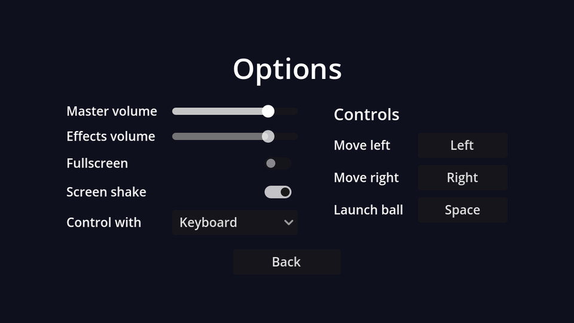

## Layout

New scene, `Control` root (Full Rect) named `OptionsMenu`, saved as `options_menu.tscn`. The settings go in a two-column `GridContainer` (label, control, label, control...), and the key bindings in a second column next to it:

```text
OptionsMenu (Control, Full Rect)
├── CenterContainer (Full Rect)
│   └── VBoxContainer                          # separation 16
│       ├── Title (Label)                      # "Options", font size 32
│       ├── Columns (HBoxContainer)            # separation 40
│       │   ├── SettingsGrid (GridContainer)   # columns 2
│       │   │   ├── Label "Master volume"   ├── MasterSlider (HSlider, %)
│       │   │   ├── Label "Effects volume"  ├── SfxSlider (HSlider, %)
│       │   │   ├── Label "Fullscreen"      ├── FullscreenCheck (CheckButton, %)
│       │   │   ├── Label "Screen shake"    ├── ShakeCheck (CheckButton, %)
│       │   │   └── Label "Control with"    └── SchemeOption (OptionButton, %)
│       │   └── Controls (VBoxContainer)
│       │       ├── ControlsTitle (Label)                 # "Controls", font size 18
│       │       └── ControlsGrid (GridContainer, %)       # columns 2, filled from code
│       └── BackButton (Button)                # centred, minimum width 120
└── TestSound (AudioStreamPlayer)              # Bus: SFX
```

| Node | Properties |
| --- | --- |
| `MasterSlider`, `SfxSlider` | Max Value `1`, Step `0.05`, Custom Minimum Size x `140` |
| `SchemeOption` | Items: "Mouse" (id 0), "Keyboard" (id 1) |

The items in `SchemeOption` are in the same order as `enum ControlScheme { MOUSE, KEYBOARD }`, so an item's index is the enum value.

## The script

Connect the change signals to `OptionsMenu`: `value_changed` for the sliders, `toggled` for the two CheckButtons, `item_selected` for the OptionButton, and `pressed` for Back.

```gdscript title="options_menu.gd"
extends Control

@onready var master_slider: HSlider = %MasterSlider
@onready var sfx_slider: HSlider = %SfxSlider
@onready var fullscreen_check: CheckButton = %FullscreenCheck
@onready var shake_check: CheckButton = %ShakeCheck
@onready var scheme_option: OptionButton = %SchemeOption


func _ready() -> void:
	# The *_no_signal setters avoid triggering our change handlers (and the test sound).
	master_slider.set_value_no_signal(Settings.master_volume)
	sfx_slider.set_value_no_signal(Settings.sfx_volume)
	fullscreen_check.set_pressed_no_signal(Settings.fullscreen)
	shake_check.set_pressed_no_signal(Settings.screen_shake)
	scheme_option.selected = Settings.control_scheme
	master_slider.grab_focus()


func _on_master_slider_value_changed(value: float) -> void:
	Settings.master_volume = value
	Settings.apply()


func _on_sfx_slider_value_changed(value: float) -> void:
	Settings.sfx_volume = value
	Settings.apply()
	$TestSound.play() # Let the player hear the new volume.


func _on_fullscreen_check_toggled(toggled_on: bool) -> void:
	Settings.fullscreen = toggled_on
	Settings.apply()


func _on_shake_check_toggled(toggled_on: bool) -> void:
	Settings.screen_shake = toggled_on


func _on_scheme_option_item_selected(index: int) -> void:
	Settings.control_scheme = index as Settings.ControlScheme


func _on_back_button_pressed() -> void:
	Settings.save_settings()
	get_tree().change_scene_to_file("res://main_menu.tscn")
```

- Changes apply **immediately** (you hear the volume as you drag) and are **saved** when you leave the screen. Saving on every slider tick would write the file dozens of times a second.
- `index as Settings.ControlScheme` converts the item index into the enum type. Assigning a plain `int` to an enum variable works too, but Godot warns about it.
- Enums declared in an autoload are reachable through its name: `Settings.ControlScheme.MOUSE`.

:::warning[The `_no_signal` setters]
Setting `slider.value = x` emits `value_changed`, exactly like dragging does. In `_ready` that would run every handler, and play the test sound the moment the screen opens. `set_value_no_signal` and `set_pressed_no_signal` change the control quietly. (`OptionButton.selected` doesn't emit `item_selected`, so it needs no special treatment.)
:::

`TestSound` has no sound yet. We'll give it one in the polish chapter.

```quiz
question: Why are settings saved when leaving the screen rather than in every handler?
options:
  - ConfigFile can only save once per scene
  - Sliders emit value_changed many times while dragging; saving each time would write the file constantly
  - Settings.apply() already saves them
answer: 1
```

```quiz
question: Which CheckButton method changes its state without emitting `toggled`?
type: text
answer: ["set_pressed_no_signal", "set_pressed_no_signal()"]
```
