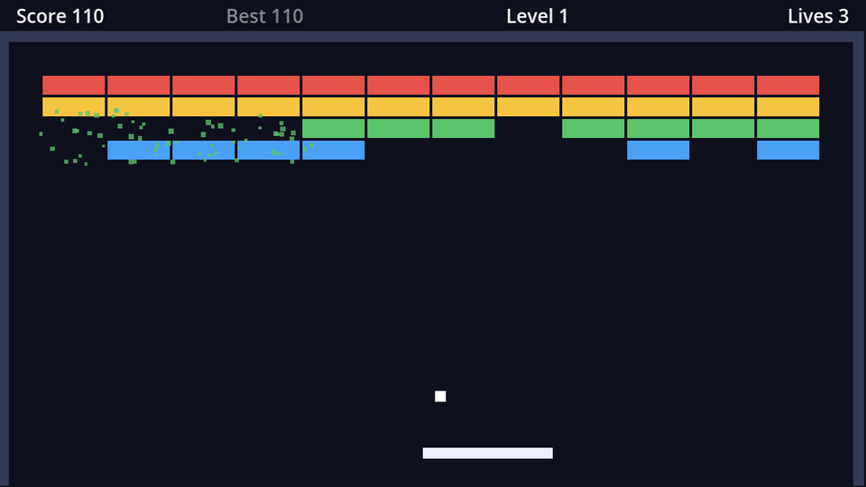

## The burst scene

When a brick breaks, a handful of small squares in the brick's colour should fly out and fall away. New scene with a `CPUParticles2D` root named `BrickBurst`, saved as `brick_burst.tscn`:

| Property | Value | Why |
| --- | --- | --- |
| **Emitting** | on | Start as soon as it's added |
| **Amount** | `16` | |
| **Time → Lifetime** | `0.6` | Each particle lives 0.6 s |
| **Time → One Shot** | on | Emit once, then stop |
| **Time → Explosiveness** | `1` | All particles at once, a burst rather than a stream |
| **Emission Shape** | Rectangle, extents `(20, 5)` | Spawn over the brick's area |
| **Direction → Spread** | `180` | Fly out in every direction |
| **Gravity** | `(0, 400)` | Then fall |
| **Initial Velocity** | min `40`, max `140` | |
| **Scale → Scale Amount** | min `2`, max `4` | Particles are 1px squares by default |
| **Color → Color Ramp** | a Gradient from white to transparent white | Fade out over the lifetime |

The colour ramp is multiplied by the particle's **Color**, which we set from code to the brick's colour. White-to-transparent therefore means "brick colour, fading out".

Finally, in **Node → Signals**, connect the burst's own `finished` signal to `BrickBurst` itself, with `queue_free` as the receiver method. The node has no script, so type the name in (or click **Pick** to choose from its built-in methods). One-shot particles emit `finished` when the last particle dies, so every burst cleans itself up. No script needed.

:::note[CPU or GPU particles?]
`GPUParticles2D` can handle many thousands of particles. `CPUParticles2D` is simpler, works identically on every renderer and in web builds, and 16 particles are nothing for a CPU.
:::

## Spawning bursts

```gdscript title="game.gd" ins={2,7,10-16}
const PICKUP_SCENE := preload("res://pickup.tscn")
const BURST_SCENE := preload("res://brick_burst.tscn")

func _on_bricks_brick_destroyed(brick: Node2D) -> void:
	_add_points(brick.type.points)
	$Sounds/BrickBreak.play()
	_spawn_burst(brick.global_position, brick.type.color)
	if randf() < drop_chance:
		_spawn_pickup(brick.global_position)


func _spawn_burst(at: Vector2, color: Color) -> void:
	var burst := BURST_SCENE.instantiate()
	burst.position = at
	burst.color = color
	add_child(burst)
```

The burst is added to `Game`, not to `Bricks`: the brick grid frees all its children when the next level is built, and a burst that's mid-explosion shouldn't vanish because of that.

## A flash on every hit

A brick that survives a hit should still react. `modulate` multiplies a node's colours, and values above 1 brighten them. Here's the final brick script:

```gdscript title="brick.gd" ins={23,35-39}
extends StaticBody2D

## Emitted when a hit doesn't break the brick (including unbreakable ones).
signal damaged
signal destroyed

@export var type: BrickType

var hit_points := 1

@onready var rect: ColorRect = $ColorRect


func _ready() -> void:
	hit_points = type.hit_points
	rect.color = type.color


## Called by the ball when it bounces off this brick.
func hit() -> void:
	if hit_points <= 0:
		return # Already destroyed by another ball this frame.
	_flash()
	if type.unbreakable:
		damaged.emit()
		return
	hit_points -= 1
	if hit_points > 0:
		# Darker means closer to breaking.
		rect.color = type.color.darkened(0.5 * (1.0 - float(hit_points) / type.hit_points))
		damaged.emit()
	else:
		destroyed.emit()
		queue_free()


func _flash() -> void:
	modulate = Color(2, 2, 2)
	create_tween().tween_property(self, "modulate", Color.WHITE, 0.1)
```

The tween brings `modulate` back to white (no change) over a tenth of a second. Silver and steel bricks now visibly flinch.

```quiz
question: Why is the burst added as a child of `Game` rather than of `Bricks`?
options:
  - Particles can't be children of a Node2D
  - Bricks frees all its children when it builds the next level
  - So the burst inherits the brick's colour
answer: 1
```

```quiz
question: What does setting **Explosiveness** to 1 do?
options:
  - Particles move faster
  - All particles are emitted at the same moment instead of spread over the lifetime
  - Particles are destroyed on collision
answer: 1
```
