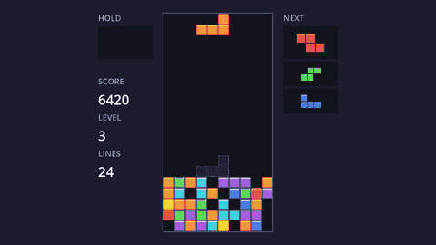

This tutorial builds **Blockfall**, a Tetris-style falling blocks puzzle: seven kinds of pieces drop into a 10×20 well, you move and rotate them, and every row you complete disappears. Along the way it adds everything a modern take on the genre is expected to have: a fair randomizer, wall kicks, a ghost piece, hard drop, a hold box, a next-piece preview, adjustable auto-repeat, levels that speed up, a main menu, a pause menu, high scores saved to disk, an options screen with key rebinding, sound effects, a line clear animation and a bit of screen shake. The last chapter exports it as a game you can share.



Every chapter ends in something you can run, so you can stop at any point and still have a working project.

## Who this is for

This is a step up from a first Godot project. You'll get the most out of it if you've made something small before (the Pong tutorial on this site is a good warm-up), but every Godot concept is explained the first time it's used, so it also works on its own. The new ideas here are mostly about **game logic**: unlike a physics game, a falling blocks puzzle is a grid of numbers with rules, and Godot is only there to draw it and read the keyboard.

## Download

Grab the **standard** (non-.NET) build of Godot 4 from the official site. It is a single executable with no installer. This tutorial was written against Godot 4.7, but anything from 4.3 up works.

:::tip
On macOS, drag Godot into `/Applications` so Spotlight can find it.
:::

## The project manager

When you start Godot you land in the *project manager*. This is where you create, import and open projects. Everything else (scenes, scripts, settings) happens in the *editor* that opens once you pick a project.

:::note[A word on the name]
"Tetris" is a trademark that its owners actively protect, so games inspired by it need their own name and look. That's why ours is called Blockfall, and why this tutorial talks about a "falling blocks puzzle". The pieces themselves, four squares joined edge to edge, are called **tetrominoes**, a plain geometry term anyone can use.
:::

```quiz
question: Which Godot build do you need for a GDScript-only project like this one?
options:
  - The .NET build
  - The standard build
  - Either; they are identical
answer: 1
explain: The .NET build adds C# support. For GDScript the **standard** build is smaller and simpler.
```
