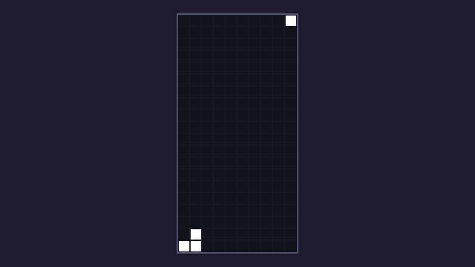

A grid of 200 cells could be 200 `ColorRect` nodes, but that's a lot of nodes to keep in sync with an array. Instead, the board draws itself: any `CanvasItem` (every 2D node and every `Control`) can override **`_draw()`** and paint rectangles, lines, text and textures with code.

## How _draw() works

Godot calls `_draw()` once, records what you drew, and keeps showing that until you call **`queue_redraw()`**. Then it calls `_draw()` again at the end of the frame. So drawing is cheap: nothing is redrawn unless something changed, and calling `queue_redraw()` several times in one frame still draws only once.

All drawing calls use the node's local coordinates, which is why we put the board's position at the well's corner.

## Draw the well

Add colours for the background, the grid lines and a frame, then the drawing code:

```gdscript title="board.gd" ins={6-9,17-21,29-51}
const COLUMNS := 10
const ROWS := 20
const CELL_SIZE := 16
const EMPTY := -1

const BACKGROUND_COLOR := Color(0.07, 0.08, 0.11)
const GRID_COLOR := Color(1, 1, 1, 0.04)
const FRAME_COLOR := Color(0.29, 0.31, 0.44)

## rows[y][x] is EMPTY or the Tetromino.Type that filled the cell. Row 0 is the top.
var rows: Array[Array] = []


func _ready() -> void:
	for y in ROWS:
		rows.append(_empty_row())
	# Temporary test blocks, to check the drawing code.
	rows[19][0] = 0
	rows[19][1] = 0
	rows[18][1] = 0
	rows[0][9] = 0


func _empty_row() -> Array:
	var row := []
	row.resize(COLUMNS)
	row.fill(EMPTY)
	return row


func _draw() -> void:
	var well := Rect2(0, 0, COLUMNS * CELL_SIZE, ROWS * CELL_SIZE)
	draw_rect(well.grow(2), FRAME_COLOR)
	draw_rect(well, BACKGROUND_COLOR)
	for x in range(1, COLUMNS):
		draw_line(Vector2(x * CELL_SIZE, 0), Vector2(x * CELL_SIZE, well.size.y), GRID_COLOR)
	for y in range(1, ROWS):
		draw_line(Vector2(0, y * CELL_SIZE), Vector2(well.size.x, y * CELL_SIZE), GRID_COLOR)

	for y in ROWS:
		for x in COLUMNS:
			if rows[y][x] != EMPTY:
				_draw_cell(Vector2i(x, y), Color.WHITE)


func _cell_rect(cell: Vector2i) -> Rect2:
	return Rect2(Vector2(cell * CELL_SIZE), Vector2(CELL_SIZE, CELL_SIZE))


func _draw_cell(cell: Vector2i, color: Color) -> void:
	draw_rect(_cell_rect(cell).grow(-1), color)
```

Reading it from the top:

1. **The frame** is a rectangle 2 pixels bigger than the well on every side (`grow(2)`), drawn first. The background is drawn on top of it, so only a 2 px border of frame colour remains visible.
2. **Grid lines**: nine vertical and nineteen horizontal lines at 4% white, barely there but enough to judge distances. `range(1, COLUMNS)` skips the outer edges, which the frame already covers.
3. **Blocks**: every non-empty cell becomes a slightly shrunken rectangle (`grow(-1)`), which leaves a 1 px gap between neighbours.

`Vector2i` is a vector of whole numbers, perfect for grid positions. `cell * CELL_SIZE` is still a `Vector2i`; `Rect2` needs float coordinates, so we convert it with `Vector2(...)`.

:::note[Why no queue_redraw yet?]
Godot always draws a node once when it enters the scene, and the test blocks are set in `_ready()`, before that first draw. Once pieces start moving we'll call `queue_redraw()` whenever the data changes.
:::

Run the game. You should see the well in the middle of the screen, with three white blocks in the bottom-left corner and one in the top-right:



Once you've checked the four blocks are where you expect, delete the four test lines and the comment above them from `_ready()`. The next chapter puts real pieces on the board.

```quiz
question: What happens if you change `rows[5][5]` in the middle of the game but never call `queue_redraw()`?
options:
  - The block appears on the next frame anyway
  - Nothing changes on screen; the board keeps showing its last drawing
  - Godot raises an error
answer: 1
explain: Godot caches whatever `_draw()` drew. Only `queue_redraw()` makes it call `_draw()` again.
```

```quiz
question: Which call shrinks a `Rect2` by one pixel on every side?
type: text
answer: ["grow(-1)", ".grow(-1)", "rect.grow(-1)"]
explain: '`grow(amount)` moves every edge outwards by `amount`. A negative amount moves the edges inwards.'
```
