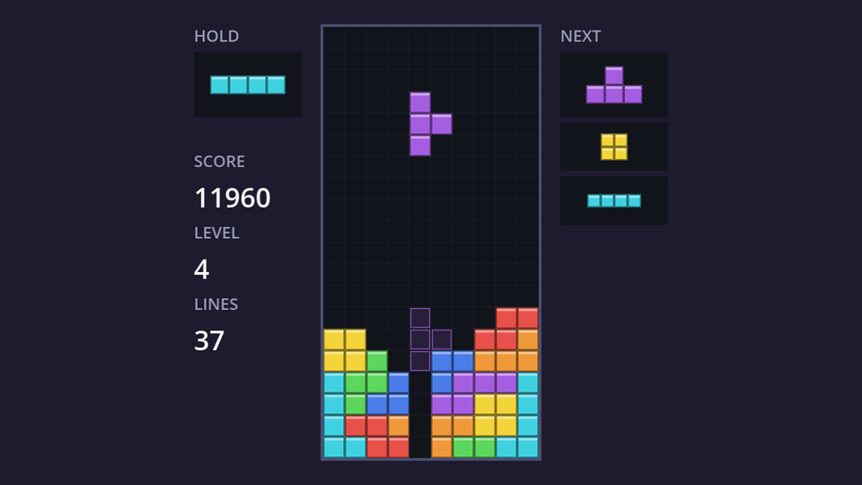

## A piece preview control

The hold box and the three next boxes all show one piece, centred in a small rectangle. That's a perfect job for a custom `Control` that draws itself. Create `piece_preview.gd`:

```gdscript title="piece_preview.gd"
class_name PiecePreview
extends Control
## Draws a single piece centred in this control. Used for the hold and next boxes.

const BACKGROUND_COLOR := Color(0.07, 0.08, 0.11)
const DIMMED_COLOR := Color(0.35, 0.36, 0.42)

@export var cell_size := 12.0

## The Tetromino.Type to show, or -1 to show nothing.
var piece_type := -1:
	set(value):
		piece_type = value
		queue_redraw()
## Draw the piece in grey, for a hold that can't be used right now.
var dimmed := false:
	set(value):
		dimmed = value
		queue_redraw()


func _draw() -> void:
	draw_rect(Rect2(Vector2.ZERO, size), BACKGROUND_COLOR)
	if piece_type < 0:
		return
	var cells: Array = Tetromino.SHAPES[piece_type]
	# Find the shape's bounding box so we can centre it.
	var top_left := Vector2i(99, 99)
	var bottom_right := Vector2i(-99, -99)
	for cell: Vector2i in cells:
		top_left = top_left.min(cell)
		bottom_right = bottom_right.max(cell)
	var shape_size := Vector2(bottom_right - top_left + Vector2i.ONE) * cell_size
	var origin := (size - shape_size) / 2.0
	var color := DIMMED_COLOR if dimmed else Tetromino.COLORS[piece_type]
	for cell: Vector2i in cells:
		var rect := Rect2(origin + Vector2(cell - top_left) * cell_size, Vector2(cell_size, cell_size))
		Tetromino.draw_block(self, rect, color)
```

- **Centring.** The shapes don't fill their boxes (the `I` sits in row 1 of a 4×4 box), so we can't just centre the box. Instead we find the smallest rectangle around the four cells: `min()` and `max()` on `Vector2i` compare x and y separately. Then we put that rectangle in the middle of the control.
- **`size`** is the control's own size, set by its container. Drawing is in local coordinates, so (0, 0) is the control's top-left corner.
- **`@export var cell_size`** shows up in the Inspector, so each preview can use its own block size.
- **Setters with `queue_redraw()`** again: assigning `piece_type` or `dimmed` is all the HUD has to do.

Because of `class_name PiecePreview`, the editor lists **PiecePreview** in the **Create New Node** dialog like any built-in node type.

## The HUD layout

Open `hud.tscn` and add the hold box to the top of `LeftPanel`, and a new `RightPanel` for the next pieces:

```text
HUD (CanvasLayer)
├── LeftPanel (VBoxContainer)      # position (144, 18), size 80×322, separation 4
│   ├── HoldTitle (Label)          # "HOLD", font size 12, grey
│   ├── HoldPreview (PiecePreview, %)   # custom minimum size 80×48, cell size 14
│   ├── Spacer (Control)           # custom minimum size 0×16
│   ├── ScoreTitle (Label)
│   └── ...                        # the rest as before
└── RightPanel (VBoxContainer)     # position (416, 18), size 80×322, separation 4
    ├── NextTitle (Label)          # "NEXT", font size 12, grey
    ├── Next1 (PiecePreview, %)    # custom minimum size 80×48, cell size 14
    ├── Next2 (PiecePreview, %)    # custom minimum size 80×36, cell size 10
    └── Next3 (PiecePreview, %)    # custom minimum size 80×36, cell size 10
```

Containers size their children to at least their **Custom Minimum Size** (under **Layout**), which is what gives our previews their height. The first next piece is drawn bigger than the other two, which makes "this is the one coming up" readable at a glance. The empty `Spacer` control just pushes the score down a little.

Then extend `hud.gd`:

```gdscript title="hud.gd" ins={6-7,14-25}
extends CanvasLayer

@onready var score_label: Label = %ScoreLabel
@onready var level_label: Label = %LevelLabel
@onready var lines_label: Label = %LinesLabel
@onready var hold_preview: PiecePreview = %HoldPreview
@onready var next_previews: Array[PiecePreview] = [%Next1, %Next2, %Next3]


func update_stats(score: int, level: int, lines: int) -> void:
	score_label.text = str(score)
	level_label.text = str(level)
	lines_label.text = str(lines)


func update_hold(piece_type: int, can_hold: bool) -> void:
	hold_preview.piece_type = piece_type
	hold_preview.dimmed = not can_hold


func update_next(piece_types: Array[int]) -> void:
	for i in next_previews.size():
		next_previews[i].piece_type = piece_types[i]
```

An `@onready` typed array of the three previews means `update_next` doesn't care how many there are, as long as the game sends enough piece types.

## Hold

**Hold** puts the falling piece aside and brings out the held one (or the next piece, the first time). To stop players from swapping back and forth forever, you can only hold once per piece; it becomes available again when a piece locks. The hold box turns grey while it's used up.

```gdscript title="game.gd" ins={3-4,9-11,18,25-26,35,42-55,65-66}
## How often moving or rotating on the ground may restart the lock delay.
const MAX_LOCK_RESETS := 15
## How many upcoming pieces the HUD shows.
const NEXT_COUNT := 3

## The falling piece, or null between pieces and after game over.
var piece: Tetromino
var bag := PieceBag.new()
## The Tetromino.Type in the hold box, or -1 when it's empty.
var hold_type := -1
var can_hold := true
var score := 0

# ...

func _ready() -> void:
	hud.update_stats(score, level, lines)
	hud.update_hold(hold_type, can_hold)
	_spawn(bag.next())

# ...

	elif event.is_action_pressed(&"hard_drop"):
		hard_drop()
	elif event.is_action_pressed(&"hold"):
		hold()


func _spawn(piece_type: int) -> void:
	piece = Tetromino.spawn(piece_type, Board.COLUMNS)
	board.piece = piece
	_lowest_row = piece.position.y
	_lock_resets = 0
	lock_timer.stop()
	hud.update_next(bag.peek(NEXT_COUNT))
	if not board.fits(piece):
		_game_over() # Blocked right at the top: the stack is too high.
		return

# ...

## Swap the falling piece with the hold box. Allowed once per piece.
func hold() -> void:
	if not can_hold:
		return
	can_hold = false
	var held := piece.type
	if hold_type == -1:
		_spawn(bag.next())
	else:
		_spawn(hold_type)
	hold_type = held
	hud.update_hold(hold_type, can_hold)


func _lock_piece() -> void:
	lock_timer.stop()
	gravity_timer.stop()
	var locked := piece
	piece = null
	var inside := board.lock_piece(locked)
	if not inside:
		_game_over() # Locked partly above the board.
		return
	can_hold = true
	hud.update_hold(hold_type, can_hold)
	var full := board.full_rows()
```

- `hold()` remembers the falling piece's **type**, not the piece itself: a held piece always comes back at the top, in spawn rotation. `_spawn` takes care of that, and also restarts the lock delay and gravity for it.
- The **next preview** comes from `bag.peek(NEXT_COUNT)`, updated every time a piece spawns. Thanks to the bag refilling whole bags at a time, peeking three ahead never breaks the 7-bag guarantee.

Run it: <kbd>C</kbd> holds, the hold box greys out until the next lock, and the next three pieces are always visible.

```quiz
question: The hold box is empty and you press hold on a T. Which piece do you get?
options:
  - Another T
  - The first piece from the next preview
  - A random piece
answer: 1
explain: With an empty hold, `hold()` spawns `bag.next()`, which is exactly the piece shown first in the preview.
```

```quiz
question: Why can you only hold once per piece?
options:
  - Holding twice would crash the game
  - Otherwise you could swap back and forth forever to stall or reset the lock delay
  - The hold box can only be drawn once per frame
answer: 1
```
