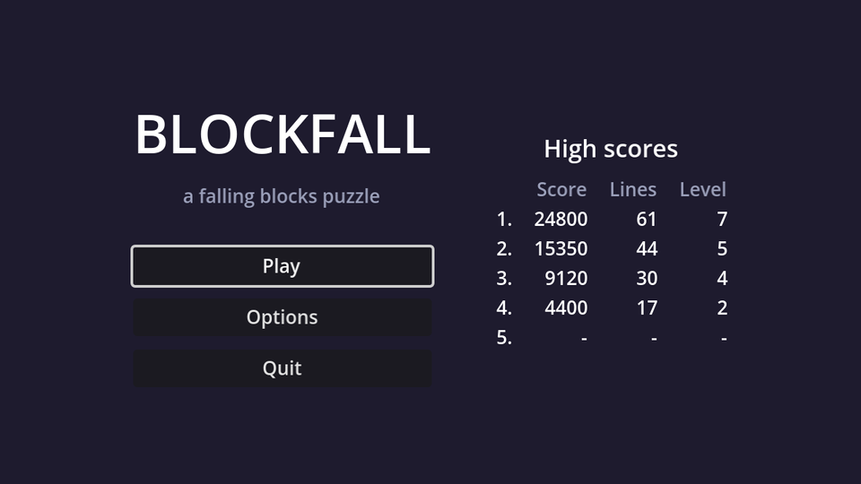

## A project theme

Godot's default UI font size is 16, which is large for a 640×360 screen. Rather than overriding the size on every control, create a **Theme**: in the FileSystem dock, right-click → **New → Resource… → Theme**, save it as `theme.tres`, and set its **Default Font Size** to `14`. Then make it the project-wide theme in **Project Settings → GUI → Theme → Custom**.

Every `Control` in the game now uses it. Individual nodes, like the title or the HUD values, can still override it.

## Layout

Create a scene with a `Control` root named `MainMenu` and save it as `main_menu.tscn`. In the toolbar's **Anchor preset** menu, choose **Full Rect** so it covers the whole screen.

```text
MainMenu (Control, Full Rect)
└── CenterContainer (Full Rect)
    └── Columns (HBoxContainer)          # separation 48
        └── Menu (VBoxContainer)         # min size 220×0, separation 10
            ├── Title (Label)            # "BLOCKFALL", font size 40, centred
            ├── Subtitle (Label)         # "a falling blocks puzzle", grey, centred
            ├── Spacer (Control)         # min size 0×8
            ├── PlayButton (Button, %)
            ├── OptionsButton (Button)
            └── QuitButton (Button, %)
```

The `Menu` container's minimum width makes all buttons the same width, and the `CenterContainer` keeps everything centred at any window size. `Columns` holds just the menu for now; the high score table joins it as a second column later in this chapter.

## The script

Connect each button's `pressed` signal to `MainMenu` (Node dock → Signals), then fill in the methods:

```gdscript title="main_menu.gd"
extends Control

@onready var play_button: Button = %PlayButton
@onready var quit_button: Button = %QuitButton


func _ready() -> void:
	# Browsers can't close the tab for us, so hide Quit in web builds.
	quit_button.visible = not OS.has_feature("web")
	play_button.grab_focus()


func _on_play_button_pressed() -> void:
	get_tree().change_scene_to_file("res://game.tscn")


func _on_options_button_pressed() -> void:
	get_tree().change_scene_to_file("res://options_menu.tscn")


func _on_quit_button_pressed() -> void:
	get_tree().quit()
```

`grab_focus()` matters more than it looks. With a focused button, the menu works entirely from the keyboard: arrow keys move between buttons and <kbd>Enter</kbd> or <kbd>Space</kbd> presses them. Godot works out the focus order from the layout. For a game played entirely on the keyboard, a menu that needs the mouse would be a small insult.

:::warning
`options_menu.tscn` doesn't exist until the next chapter. Clicking Options will print an error until then.
:::

## Make it the main scene

Open **Project Settings → Application → Run** and set **Main Scene** to `res://main_menu.tscn`. <kbd>F5</kbd> now starts at the menu, while <kbd>F6</kbd> still runs whatever scene is open, which is handy for testing the game directly.

```quiz
question: Why call `play_button.grab_focus()` in `_ready()`?
options:
  - It makes the button bigger
  - So the menu can be used with the keyboard straight away
  - Buttons don't work until they have focus
answer: 1
explain: Without a focused control, arrow keys and Enter do nothing until the player clicks something with the mouse.
```

```quiz
question: Which path does `change_scene_to_file` need?
type: text
answer: ["res://game.tscn", "\"res://game.tscn\""]
hint: Scene paths start with the project's resource prefix.
```
