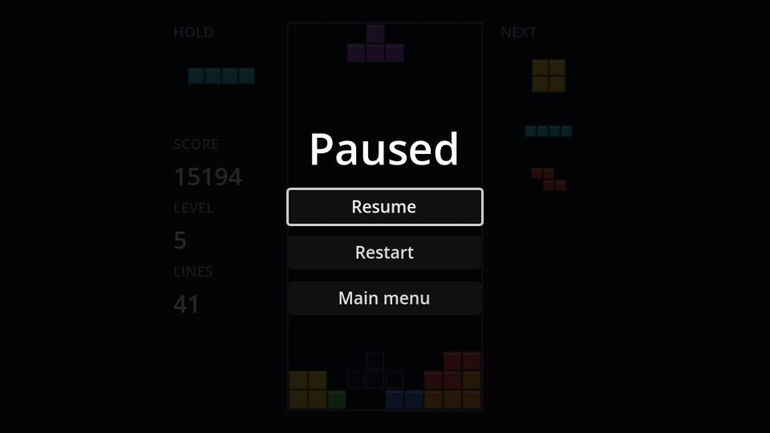

## How pausing works

`get_tree().paused = true` freezes every node's `_process`, `_physics_process` and input callbacks, along with timers and tweens. Each node's **Process → Mode** decides how it reacts:

| Mode | While paused |
| --- | --- |
| Inherit (default) | Same as its parent; the root is *Pausable* |
| Pausable | Stops |
| When Paused | Runs *only* while paused |
| Always | Keeps running |
| Disabled | Never runs |

Our gravity and lock timers are ordinary pausable nodes, so pausing stops pieces mid-air with their lock delay intact. The pause menu itself has to keep working while everything else is frozen, otherwise you could never unpause.

## The scene

New scene, `CanvasLayer` root named `PauseMenu`, **Layer** `10` (above the HUD, which is on layer 1), **Process → Mode** `Always`. Save as `pause_menu.tscn`.

```text
PauseMenu (CanvasLayer, layer 10, process mode Always)
├── Dim (ColorRect, Full Rect, black at 85% alpha)
└── CenterContainer (Full Rect)
    └── VBoxContainer                  # min size 160×0, separation 10
        ├── Title (Label)              # "Paused", font size 36
        ├── ResumeButton (Button, %)
        ├── RestartButton (Button)
        └── MainMenuButton (Button)
```

The `Dim` rectangle darkens the game behind the menu and also swallows mouse clicks so they don't reach anything underneath. At 85% it almost hides the board, which is deliberate: in a puzzle game, pausing shouldn't be a free chance to study the stack.

```gdscript title="pause_menu.gd"
extends CanvasLayer

@onready var resume_button: Button = %ResumeButton


func _ready() -> void:
	hide()


func _unhandled_input(event: InputEvent) -> void:
	if event.is_action_pressed(&"pause"):
		set_paused(not get_tree().paused)
		get_viewport().set_input_as_handled()


func set_paused(paused: bool) -> void:
	get_tree().paused = paused
	visible = paused
	if paused:
		resume_button.grab_focus()


func _on_resume_button_pressed() -> void:
	set_paused(false)


func _on_restart_button_pressed() -> void:
	get_tree().paused = false
	get_tree().reload_current_scene()


func _on_main_menu_button_pressed() -> void:
	get_tree().paused = false # The pause state outlives the scene!
	get_tree().change_scene_to_file("res://main_menu.tscn")
```

- `_unhandled_input` only receives events that no UI control consumed, the right place for gameplay shortcuts. `set_input_as_handled()` stops the same <kbd>Esc</kbd> press from reaching anything else.
- **Restart** reloads the game scene. `reload_current_scene()` throws away the whole scene and builds a fresh one, so the board, score, bag and timers all reset without a single line of reset code.

:::danger[Unpause before leaving]
`paused` belongs to the **SceneTree**, not to the scene. Forget to reset it and the next scene loads... frozen.
:::

Connect the three buttons' `pressed` signals, then instance `pause_menu.tscn` in `game.tscn`. Press <kbd>Esc</kbd> or <kbd>P</kbd> during a game to try it.

```quiz
question: Which process mode should the pause menu have?
options:
  - Pausable
  - When Paused
  - Always
  - Disabled
answer: 2
explain: '**When Paused** would keep the buttons working, but then `_unhandled_input` would not run while the game is running, so Esc could never open the menu. **Always** covers both.'
```

```quiz
question: Why does Restart not need any code to reset the board and score?
options:
  - reload_current_scene builds a fresh copy of every node in the scene
  - Godot remembers the initial value of every variable
  - The pause menu resets them in _ready()
answer: 0
```
