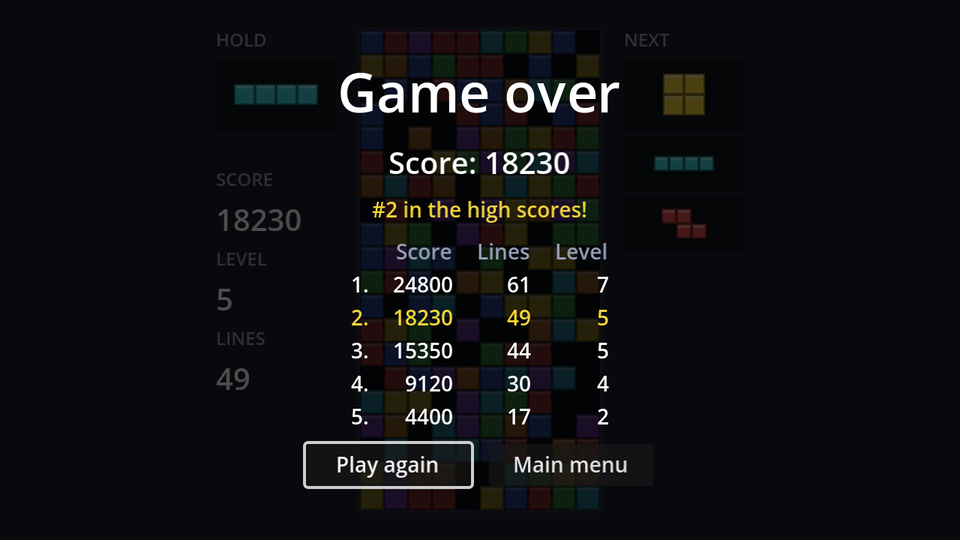

## The screen

The game over screen is built like the pause menu: a `CanvasLayer` on layer 10 named `GameOver`, with a dim background and a centred stack. This one stays pausable (the default), since it never needs to run while the game is paused.

```text
GameOver (CanvasLayer, layer 10)
├── Dim (ColorRect, Full Rect, black at 70% alpha)
└── CenterContainer (Full Rect)
    └── VBoxContainer                        # separation 8
        ├── Title (Label)                    # "Game over", font size 36, centred
        ├── ScoreLabel (Label, %)            # font size 20, centred
        ├── RankLabel (Label, %)             # yellow, centred
        ├── HighScoreTable (high_score_table.tscn, %)   # horizontal size flags: Shrink Center
        └── Buttons (HBoxContainer)          # separation 12, alignment Center
            ├── PlayAgainButton (Button, %)  # min size 110×0
            └── MainMenuButton (Button)      # min size 110×0
```

Save it as `game_over.tscn`, connect both buttons, and attach:

```gdscript title="game_over.gd"
extends CanvasLayer

## Seconds to wait before showing the screen, so a player still mashing
## hard drop doesn't press a button by accident.
const SHOW_DELAY := 0.8

@onready var score_label: Label = %ScoreLabel
@onready var rank_label: Label = %RankLabel
@onready var high_score_table: GridContainer = %HighScoreTable
@onready var play_again_button: Button = %PlayAgainButton


func _ready() -> void:
	hide()


## `rank` is the place in the high score table, or -1 if the score didn't make it.
func show_result(score: int, rank: int) -> void:
	score_label.text = "Score: %d" % score
	rank_label.visible = rank >= 0
	rank_label.text = "New high score!" if rank == 0 else "#%d in the high scores!" % (rank + 1)
	high_score_table.refresh(rank)
	await get_tree().create_timer(SHOW_DELAY).timeout
	show()
	play_again_button.grab_focus()


func _on_play_again_button_pressed() -> void:
	get_tree().reload_current_scene()


func _on_main_menu_button_pressed() -> void:
	get_tree().change_scene_to_file("res://main_menu.tscn")
```

**Why the delay?** <kbd>Space</kbd> is both hard drop and "press the focused button". A player who's frantically hard-dropping when the stack tops out would otherwise land on "Play again" before even seeing their score. `await` pauses `show_result` for 0.8 seconds and then carries on where it left off, without blocking the rest of the game.

`"Score: %d" % score` is **string formatting**: `%d` is replaced by the number. The rank label uses the same trick for "#3 in the high scores!".

## Ending the game

Instance `game_over.tscn` in `game.tscn`, and replace the temporary restart in `game.gd`:

```gdscript title="game.gd" ins={5-6,17-20} del={14-16}
@onready var board: Board = $Board
@onready var hud: CanvasLayer = $HUD
@onready var gravity_timer: Timer = $GravityTimer
@onready var lock_timer: Timer = $LockTimer
@onready var pause_menu: CanvasLayer = $PauseMenu
@onready var game_over: CanvasLayer = $GameOver

# ...

func _game_over() -> void:
	piece = null
	gravity_timer.stop()
	lock_timer.stop()
	print("Game over")
	# Temporary: start a new game. Chapter 8 adds a real game over screen.
	get_tree().reload_current_scene.call_deferred()
	board.modulate = Color(0.5, 0.5, 0.55) # Grey out the stack.
	pause_menu.set_process_unhandled_input(false)
	var rank := HighScores.submit(score, lines, level)
	game_over.show_result(score, rank)
```

- `board.modulate` greys out the whole board, a clear "it's over" signal behind the dimmed screen.
- `set_process_unhandled_input(false)` switches off the pause menu's <kbd>Esc</kbd> handling: pausing on the game over screen would stack two menus on top of each other.
- `HighScores.submit` records the game and tells us its place, which the screen uses to highlight the new row.

Play until you top out. The game over screen appears, your score is in the table, and it's still there on the main menu and after restarting Godot.

```quiz
question: What does `await get_tree().create_timer(0.8).timeout` do inside `show_result`?
options:
  - Freezes the whole game for 0.8 seconds
  - Pauses only this function for 0.8 seconds; the rest of the game keeps running
  - Calls show_result again after 0.8 seconds
answer: 1
explain: '`await` turns the function into a coroutine: it returns immediately to its caller and resumes after the timer''s `timeout` signal.'
```

```quiz
question: Why is the pause menu's input switched off on game over?
options:
  - So Esc can't open a pause menu on top of the game over screen
  - Because the pause menu crashes after game over
  - To save CPU time
answer: 0
```
