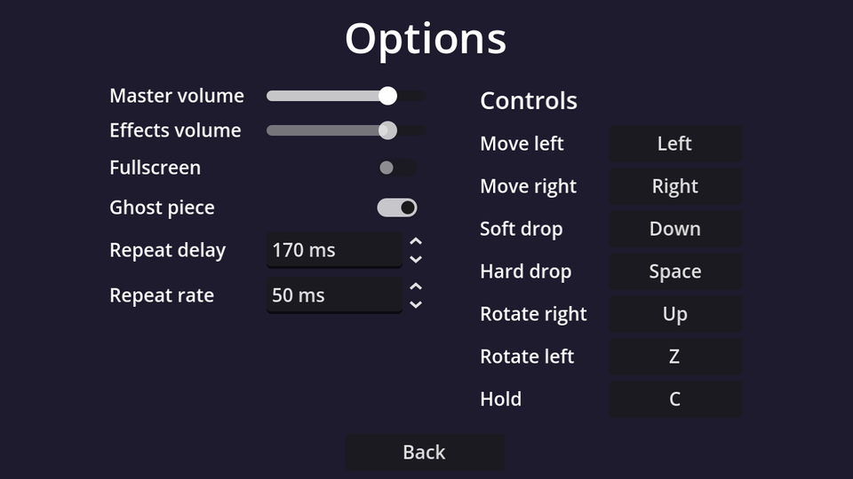

## Layout

New scene, `Control` root (Full Rect) named `OptionsMenu`, saved as `options_menu.tscn`. Settings go in a two-column `GridContainer` (labels left, controls right), with the key bindings in a second column next to it:

```text
OptionsMenu (Control, Full Rect)
├── CenterContainer (Full Rect)
│   └── VBoxContainer                          # separation 12
│       ├── Title (Label)                      # "Options", font size 32, centred
│       ├── Columns (HBoxContainer)            # separation 40
│       │   ├── SettingsGrid (GridContainer)   # columns 2, h separation 16, v separation 6
│       │   │   ├── Label "Master volume"   ├── MasterSlider (HSlider, %)
│       │   │   ├── Label "Effects volume"  ├── SfxSlider (HSlider, %)
│       │   │   ├── Label "Fullscreen"      ├── FullscreenCheck (CheckButton, %)
│       │   │   ├── Label "Ghost piece"     ├── GhostCheck (CheckButton, %)
│       │   │   ├── Label "Repeat delay"    ├── DasSpin (SpinBox, %)
│       │   │   └── Label "Repeat rate"     └── ArrSpin (SpinBox, %)
│       │   └── Controls (VBoxContainer)       # separation 6
│       │       ├── ControlsTitle (Label)      # "Controls", font size 18
│       │       └── ControlsGrid (GridContainer, %)   # columns 2, filled from code
│       └── BackButton (Button)                # min size 120×0, centred
└── TestSound (AudioStreamPlayer)              # bus: SFX
```

A `GridContainer` fills row by row, so add the children in label, control, label, control… order. Control settings:

| Node | Properties |
| --- | --- |
| `MasterSlider`, `SfxSlider` | Max Value `1`, Step `0.05`; Custom Minimum Size x `120` on the first one (the column takes the widest) |
| `DasSpin` | Min `50`, Max `300`, Step `10`, Suffix `ms` |
| `ArrSpin` | Min `0`, Max `100`, Step `5`, Suffix `ms` |
| `TestSound` | Bus `SFX` |

"Repeat delay" and "Repeat rate" are friendlier names for DAS and ARR. Players who know the acronyms will recognise the `ms` values, and everyone else gets a label that says what it does.

## The script

Connect each control's change signal to `OptionsMenu`: `value_changed` for the sliders and spin boxes, `toggled` for the check buttons, and `pressed` for Back.

```gdscript title="options_menu.gd"
extends Control

@onready var master_slider: HSlider = %MasterSlider
@onready var sfx_slider: HSlider = %SfxSlider
@onready var fullscreen_check: CheckButton = %FullscreenCheck
@onready var ghost_check: CheckButton = %GhostCheck
@onready var das_spin: SpinBox = %DasSpin
@onready var arr_spin: SpinBox = %ArrSpin


func _ready() -> void:
	# The *_no_signal setters avoid triggering our change handlers (and the test sound).
	master_slider.set_value_no_signal(Settings.master_volume)
	sfx_slider.set_value_no_signal(Settings.sfx_volume)
	fullscreen_check.set_pressed_no_signal(Settings.fullscreen)
	ghost_check.set_pressed_no_signal(Settings.ghost_piece)
	das_spin.set_value_no_signal(Settings.das_ms)
	arr_spin.set_value_no_signal(Settings.arr_ms)
	master_slider.grab_focus()


func _on_master_slider_value_changed(value: float) -> void:
	Settings.master_volume = value
	Settings.apply()


func _on_sfx_slider_value_changed(value: float) -> void:
	Settings.sfx_volume = value
	Settings.apply()
	$TestSound.play() # Let the player hear the new volume.


func _on_fullscreen_check_toggled(toggled_on: bool) -> void:
	Settings.fullscreen = toggled_on
	Settings.apply()


func _on_ghost_check_toggled(toggled_on: bool) -> void:
	Settings.ghost_piece = toggled_on


func _on_das_spin_value_changed(value: float) -> void:
	Settings.das_ms = int(value)


func _on_arr_spin_value_changed(value: float) -> void:
	Settings.arr_ms = int(value)


func _on_back_button_pressed() -> void:
	Settings.save_settings()
	get_tree().change_scene_to_file("res://main_menu.tscn")
```

Changes apply **immediately** (you hear the volume change as you drag), and are **saved** when you leave the screen. Saving on every slider tick would write the file dozens of times per second.

:::warning[The `_no_signal` setters]
Setting `slider.value = x` emits `value_changed` just like dragging does. In `_ready` that would run every handler and play the test sound as soon as the screen opens. `set_value_no_signal` and `set_pressed_no_signal` update the control quietly.
:::

`TestSound` has no sound yet; the polish chapter adds the sound files. Until then it plays silence. The ghost and repeat settings take effect the next time you start a game, since the game reads them when it needs them.

```quiz
question: In _ready, why use `set_value_no_signal` instead of assigning `value`?
options:
  - Assigning value is deprecated
  - Assigning value emits value_changed, which would run the handlers and play the test sound
  - set_value_no_signal is faster
answer: 1
```

```quiz
question: Why does the options screen save only when you press Back?
options:
  - ConfigFile can only save once per scene
  - A slider emits value_changed many times while dragging; saving each time would be wasteful
  - Settings can't be saved while the options screen is open
answer: 1
```
