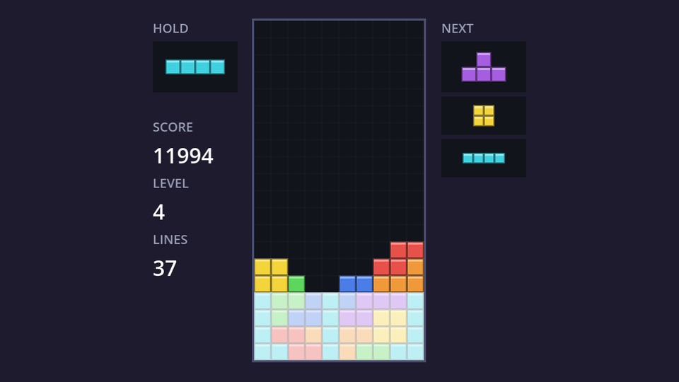
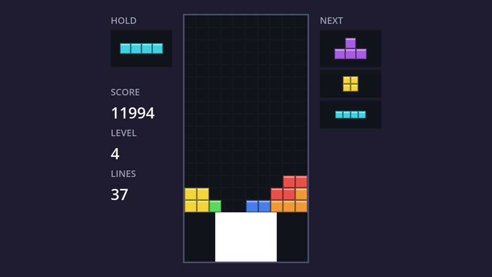

Right now full rows vanish the instant a piece locks. A short animation (the rows flash white, then shrink to nothing) makes clears readable and satisfying, especially multi-line ones.

| Halfway through the flash | Shrinking |
| --- | --- |
|  |  |

## Animate a number, draw from it

A **tween** animates a property from code: "take `_clear_progress` from 0 to 1 over 0.3 seconds". The board then draws the clearing rows based on that number. Because the property has a setter that calls `queue_redraw()`, every step of the tween redraws the board automatically. In `board.gd`:

```gdscript title="board.gd" ins={5-6,12-18,23,25-29,41-43,52-62} del={22}
const COLUMNS := 10
const ROWS := 20
const CELL_SIZE := 16
const EMPTY := -1
## How long the line clear animation takes, in seconds.
const CLEAR_TIME := 0.3

# ...

## Draw a preview of where the falling piece will land.
var show_ghost := true

## Rows being cleared, and how far along their animation is (0 to 1).
var _clearing: Array[int] = []
var _clear_progress := 0.0:
	set(value):
		_clear_progress = value
		queue_redraw()

# ...

## Remove the rows and let everything above fall down.
## Flash the rows, then remove them and let everything above fall down.
func clear_rows(full: Array[int]) -> void:
	_clearing = full
	var tween := create_tween()
	tween.tween_property(self, "_clear_progress", 1.0, CLEAR_TIME).from(0.0)
	await tween.finished
	_clearing = []
	# Going top to bottom keeps the remaining indices valid: removing a row
	# and adding an empty one at the top leaves every row below in place.
	for y in full:
		rows.remove_at(y)
		rows.push_front(_empty_row())
	queue_redraw()

# ...at the end of _draw():

		for cell in piece.cells():
			_draw_cell(cell, color)

	for y in _clearing:
		_draw_clearing_row(y)

# ...

func _draw_ghost_cell(cell: Vector2i, color: Color) -> void:
	if cell.y >= 0:
		var rect := _cell_rect(cell).grow(-1)
		draw_rect(rect, Color(color, 0.15))
		draw_rect(rect, Color(color, 0.6), false, 1.0)


## First half: the row fades to white. Second half: the white bar shrinks to nothing.
func _draw_clearing_row(y: int) -> void:
	var row := Rect2(0, y * CELL_SIZE, COLUMNS * CELL_SIZE, CELL_SIZE)
	if _clear_progress < 0.5:
		draw_rect(row, Color(1, 1, 1, _clear_progress * 2.0))
	else:
		draw_rect(row, BACKGROUND_COLOR)
		var shrink := (_clear_progress - 0.5) * 2.0 * row.size.x / 2.0
		draw_rect(row.grow_individual(-shrink, 0, -shrink, 0), Color.WHITE)
```

- **`create_tween()`** makes a tween bound to this node: it pauses when the game pauses and dies if the board is freed. `.from(0.0)` sets the starting value, so the animation always starts from scratch.
- **`tween_property(self, "_clear_progress", ...)`** works on any property by name, including our own script variables.
- **The drawing** happens in two halves. Below 0.5, a white rectangle fades in over the row (alpha goes 0 → 1). Above 0.5, the row is covered with the background colour and a white bar shrinks from both ends towards the centre. `grow_individual` moves each edge separately; negative values move them inwards.

## Await the animation

Here's the clever part. `clear_rows` contains an `await`, which makes it a **coroutine**: when it reaches `await tween.finished`, it returns to whoever called it, and resumes after the tween has finished. Everything after the `await` (actually removing the rows) waits for the animation.

The game needs to wait too, before it scores and spawns the next piece. So in `game.gd`'s `_lock_piece()`:

```gdscript title="game.gd" ins={4} del={3}
	var full := board.full_rows()
	if not full.is_empty():
		board.clear_rows(full)
		await board.clear_rows(full)
		_score_lines(full.size())
	_spawn(bag.next())
```

`await` on a coroutine waits for it to finish. During those 0.3 seconds, `piece` is `null` (we set that at the start of `_lock_piece`), so input, gravity and auto-shift all ignore the keyboard, which is exactly what we want. The rows are still in the grid while they animate, so the ghost and the drawing are correct throughout.

:::warning[Coroutines and pausing]
Because the tween belongs to the board, pausing mid-clear freezes the animation, and `_lock_piece` simply waits longer. If the player quits to the menu mid-clear, the board is freed, the tween dies, and the waiting function never resumes. That's harmless here, because the whole game scene goes away with it.
:::

```quiz
question: What happens when execution reaches `await tween.finished` inside `clear_rows`?
options:
  - The whole game freezes until the tween finishes
  - clear_rows returns to its caller for now and resumes after the tween finishes
  - The tween is skipped
answer: 1
```

```quiz
question: Why can't the player move a piece during the line clear animation?
options:
  - Godot blocks input while a tween runs
  - piece is null until the next piece spawns, and the input and timer code ignore a null piece
  - The pause menu is open
answer: 1
```
