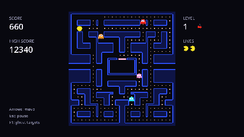

This tutorial builds **Maze Muncher**, a maze chase game in the style of the 1980s arcade classics: you steer a hungry yellow circle through a maze, eat every pellet, and avoid four ghosts. Eat a power pellet and the tables turn for a few seconds.



Along the way you'll build:

- a maze drawn by a `TileMapLayer` from a plain-text layout,
- grid-based movement with buffered turns, so the controls feel forgiving,
- four ghosts that follow one simple rule but behave very differently, with scatter, chase and frightened modes and a ghost house,
- lives, levels that speed up, bonus fruit and a saved high score,
- menus, an options screen with key rebinding, sound, and an exported game.

Every chapter ends in something you can run. The tutorial is marked *intermediate*: it assumes you've made a small Godot game before (the [Pong tutorial](../../godot-pong/tutorial.md) is plenty) and explains Godot basics only briefly.

## Godot

You need the **standard** (non-.NET) build of Godot 4. This tutorial was written against Godot 4.7; anything from 4.3 up should work.

## Create the project

In the project manager, click **Create**, name the project `Maze Muncher` and pick the **Compatibility** renderer. A 2D game doesn't need anything fancier, and Compatibility also runs in web browsers, which matters when we export at the end.

:::note
The project name decides the name of the folder where the game saves its settings and high score, so it's worth getting right now.
:::

## Window and pixel art settings

Open **Project → Project Settings**, turn on **Advanced Settings** (top right), and set:

| Setting | Value | Why |
| --- | --- | --- |
| Display → Window → Viewport Width / Height | `640` × `360` | The game's logical resolution; every position in this tutorial uses it. |
| Display → Window → Window Width / Height Override | `1280` × `720` | Opens a bigger window on desktop. |
| Display → Window → Stretch → Mode | `canvas_items` | Scales the 640×360 game to fit the window. |
| Rendering → Textures → Canvas Textures → Default Texture Filter | `Nearest` | Keeps pixel art sharp when it's scaled up. |
| Rendering → Environment → Default Clear Color | `#08080f` | A near-black background behind the maze. |

The maze tiles are only 10 pixels wide. With the default *Linear* filter, Godot blends neighbouring pixels when it scales them up and everything looks blurry. *Nearest* picks the closest pixel instead, which is what you want for pixel art.

Godot stores all of this in `project.godot`, a plain text file:

```ini title="project.godot"
[display]

window/size/viewport_width=640
window/size/viewport_height=360
window/size/window_width_override=1280
window/size/window_height_override=720
window/stretch/mode="canvas_items"

[rendering]

renderer/rendering_method="gl_compatibility"
renderer/rendering_method.mobile="gl_compatibility"
textures/canvas_textures/default_texture_filter=0
environment/defaults/default_clear_color=Color(0.03, 0.03, 0.06, 1)
```

:::warning[Stretch mode]
Without `canvas_items`, resizing the window or going fullscreen shows the game tiny in a corner. We add a fullscreen option later, so set it now.
:::

## The game scene

Click **Other Node** in the Scene dock, pick `Node2D`, rename it to `Game` and save it as `game.tscn`. Press <kbd>F5</kbd> and choose **Select Current** when Godot asks for a main scene. You should get an empty, dark window.

```quiz
question: Why set the default texture filter to Nearest?
options:
  - It makes the game run faster
  - Scaled-up pixel art stays sharp instead of blurry
  - The Compatibility renderer requires it
answer: 1
explain: Linear filtering blends neighbouring pixels when a texture is scaled. Nearest keeps each pixel a crisp square.
```
