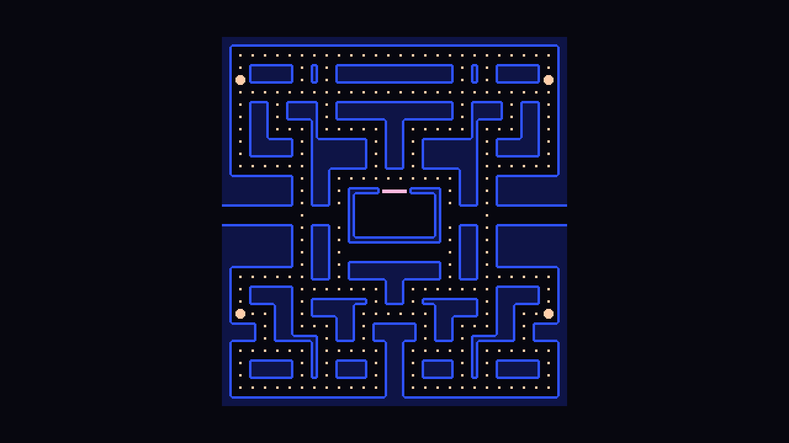

You could paint the maze by hand in the TileMap editor. Instead, we'll describe it as text. Text is easy to read, easy to change, and the code can ask questions about it ("is this cell a wall?") without poking at tiles.

## The layout

Each character is one 10×10 cell. The maze is 28 cells wide and 30 tall, so 280×300 pixels: it fits nicely in the middle of our 640×360 screen.

| Character | Meaning |
| --- | --- |
| `#` | wall |
| `.` | pellet |
| `o` | power pellet |
| `_` | empty floor |
| `t` | tunnel floor (ghosts slow down here) |
| `-` | ghost door |

## The script

Attach a script to the `Maze` node:

```gdscript title="maze.gd"
class_name Maze
extends Node2D
## The maze: builds the walls and pellets from text, and answers questions
## about cells (is it open? is it the tunnel?) for the player and the ghosts.

const TILE := 10
## # wall   . pellet   o power pellet   _ empty floor   t tunnel   - ghost door
const LAYOUT := """
############################
#..........................#
#.####.#.##########.#.####.#
#o####.#.##########.#.####o#
#..........................#
#.##.###.##########.###.##.#
#.##.###.##########.###.##.#
#.##...#.....##.....#...##.#
#.####.#####.##.#####.####.#
#.####.#####.##.#####.####.#
#......#####.##.#####......#
######.##..........##.######
######.##.###--###.##.######
######.##.#______#.##.######
tttttt.___#______#___.tttttt
######.##.#______#.##.######
######.##.########.##.######
######.##.________.##.######
######.##.########.##.######
#......##.########.##......#
#.####.......##.......####.#
#.####.#####.##.#####.####.#
#o..##.####......####.##..o#
###.##...##.####.##...##.###
###.####.##.####.##.####.###
#......#.....##.....#......#
#.####.#.###.##.###.#.####.#
#.####.#.###.##.###.#.####.#
#............##............#
############################
"""
## Atlas coordinates in tiles.png.
const DOOR_TILE := Vector2i(2, 16)
## The eight neighbours, in the order of the bits in a wall's mask.
const NEIGHBOURS: Array[Vector2i] = [
	Vector2i(0, -1), Vector2i(1, 0), Vector2i(0, 1), Vector2i(-1, 0),
	Vector2i(1, -1), Vector2i(1, 1), Vector2i(-1, 1), Vector2i(-1, -1),
]

var grid_size := Vector2i.ZERO
## Just above the ghost door, and the middle of the ghost house (in pixels).
var house_exit := Vector2.ZERO
var house_center := Vector2.ZERO

var _rows: PackedStringArray

@onready var walls: TileMapLayer = $Walls


func _ready() -> void:
	_rows = LAYOUT.strip_edges().split("\n")
	grid_size = Vector2i(_rows[0].length(), _rows.size())
	_build_walls()


func _build_walls() -> void:
	var door_cells: Array[Vector2i] = []
	for y in grid_size.y:
		for x in grid_size.x:
			var cell := Vector2i(x, y)
			match _char_at(cell):
				"#":
					walls.set_cell(cell, 0, _wall_tile(cell))
				"-":
					walls.set_cell(cell, 0, DOOR_TILE)
					door_cells.append(cell)
	# Ghosts line up on the middle of the (two cells wide) door.
	var door := (cell_center(door_cells[0]) + cell_center(door_cells[-1])) / 2
	house_exit = door + Vector2(0, -TILE)
	house_center = door + Vector2(0, 2 * TILE)


## Picks the wall picture that matches the walls around `cell`.
func _wall_tile(cell: Vector2i) -> Vector2i:
	var mask := 0
	for i in NEIGHBOURS.size():
		if _char_at(cell + NEIGHBOURS[i]) == "#":
			mask |= 1 << i
	return Vector2i(mask & 15, mask >> 4)


## The layout character at `cell`. Beyond the left and right edges every row
## repeats its edge character, so the tunnel carries on outside the maze.
func _char_at(cell: Vector2i) -> String:
	if cell.y < 0 or cell.y >= grid_size.y:
		return "#"
	return _rows[cell.y][clampi(cell.x, 0, grid_size.x - 1)]


func cell_center(cell: Vector2i) -> Vector2:
	return Vector2(cell * TILE) + Vector2(TILE, TILE) / 2
```

Let's walk through it.

- **`class_name Maze`** registers the script as a global type. Other scripts can now write `var maze: Maze` and get autocompletion for its functions.
- **`LAYOUT`** is a multi-line string. `strip_edges()` removes the newlines right after the opening and before the closing quotes, and `split("\n")` turns it into one string per row. `_rows[y][x]` is then the character at column *x*, row *y*.
- **`set_cell(cell, source_id, atlas_coords)`** places a tile. Source `0` is the one atlas we added to the TileSet.
- **`_wall_tile`** builds the mask from the previous page: for each of the eight neighbours that is a wall, it sets that neighbour's bit with `mask |= 1 << i`. Then `mask & 15` (the low four bits) is the column and `mask >> 4` (the high four bits) is the row. That's the same as `% 16` and `/ 16`, written in a way that doesn't make Godot warn about integer division.
- **`_char_at`** never fails, even outside the maze. Above and below it answers "wall". To the left and right it repeats the row's edge character, so the tunnel row (`t` at both ends) carries on forever and every other row is solid. We'll lean on this when actors walk through the tunnel.
- **`house_exit`** and **`house_center`** are pixel positions the ghosts will need: the spot just above the door and the middle of the house. The door is two cells wide, so both sit on the line *between* two cells.

:::note[Why match with strings?]
`_rows[y][x]` gives a one-character `String`, so `match` compares it against `"#"` and `"-"`. GDScript has no separate character type.
:::

## Put the maze in the game

Open `game.tscn` and build this tree:

```text
Game (Node2D)
└── World (Node2D)       # position (180, 30)
    └── Maze             # instance of maze.tscn
```

`World` will hold everything that lives *inside* the maze: the maze itself, the player, the ghosts and the bonus fruit. Its position centres the 280×300 maze on screen, and because the other nodes are its children, a position of `(0, 0)` for any of them means "the maze's top-left corner". In chapter 7 `World` gets a second job: freezing everything at once.

Press <kbd>F5</kbd>. You should see the maze, with rounded walls, a pink door on the ghost house and the tunnel openings on the left and right.



:::tip[Seeing it in the editor]
The walls only appear when the game runs, because the code creates them in `_ready`. Adding `@tool` above `class_name` would run the script in the editor too, but then a typo in the script can break the editor. It's handy, but not necessary here.
:::

```quiz
question: What does `_char_at(Vector2i(-5, 14))` return? Row 14 is the tunnel row and starts with `t`.
options:
  - '"#"'
  - '"t"'
  - An error, -5 is out of range
answer: 1
explain: The x coordinate is clamped to 0, so outside the maze the tunnel row keeps repeating its edge character.
```

```quiz
question: Why does the code use `mask & 15` and `mask >> 4` instead of `mask % 16` and `mask / 16`?
options:
  - They're required for TileMapLayer coordinates
  - They give the same results without an integer division warning
  - They're faster on the Compatibility renderer
answer: 1
```
