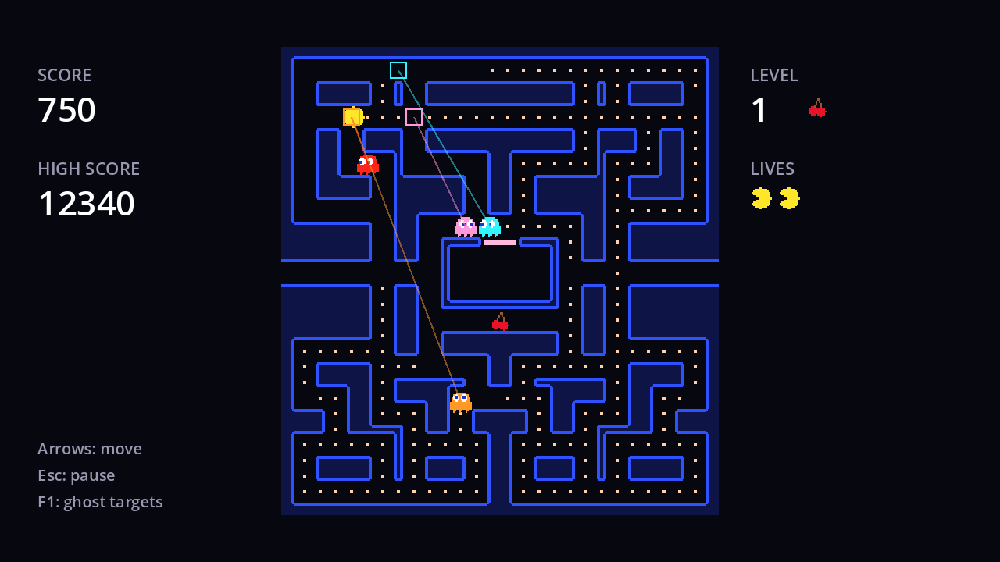

## Home corners

Every ghost has a **home corner**, a target tile just outside one corner of the maze. In the next chapter, ghosts regularly break off the chase and head home for a few seconds ("scatter mode"). Pumpkin, the last ghost, already needs its corner now, so let's add it. In `ghost.gd`:

```gdscript title="ghost.gd" ins={2-3}
@export var color := Color.RED
## The cell this ghost heads for in scatter mode, usually outside a corner of the maze.
@export var scatter_target := Vector2i.ZERO
@export var player: Player
```

Set it on each instance in `game.tscn`:

| Ghost | Scatter target | Corner |
| --- | --- | --- |
| `Ember` | (25, -3) | top right |
| `Rosie` | (2, -3) | top left |
| `Frost` | (27, 31) | bottom right |
| `Pumpkin` | (0, 31) | bottom left |

These cells are outside the maze (rows -3 and 31 don't exist), and that's fine: the movement rule only compares distances. A ghost heading for (25, -3) can never get there, so it ends up circling the walls nearest to it, round and round, until its mode changes.

## Pumpkin, the shy one

Pumpkin chases like Ember while it's far away. But once it gets within 8 tiles of the player, it loses its nerve and heads for its home corner instead:

```gdscript title="pumpkin.gd"
extends Ghost
## Pumpkin, the orange ghost: the shy one. Chases from afar, retreats when close.

## Closer than this (in tiles), Pumpkin loses its nerve and heads for its corner.
@export var shy_distance := 8.0


func get_chase_target() -> Vector2i:
	if Vector2(cell).distance_to(Vector2(player.cell)) > shy_distance:
		return player.cell
	return scatter_target
```

Converting both cells to `Vector2` gives a real (float) distance in tiles. The result is a ghost that hovers at the edge of your vision: approaching, veering off, approaching again. It's the least dangerous ghost, but it often blocks the corridor you were counting on, especially when you're near its corner (the bottom left).

## Four ghosts, one rule

Run the game and press <kbd>F1</kbd>:



The red square (Ember) is on you. The pink one (Rosie) is ahead of you. The cyan one (Frost) is somewhere on the far side of you from Ember. Pumpkin's orange square is either on you or, as here, way down in its corner below the maze.

None of the ghosts know about each other's plans, apart from Frost peeking at Ember's position. Yet together they surround you, cut you off and herd you. That's **emergent behaviour**: complex-looking teamwork from very simple, independent rules. The next page shows why "smarter" pathfinding would actually make them worse.

```quiz
question: Pumpkin is 5 tiles from the player, in chase mode. What is its target?
options:
  - The player's tile
  - Four tiles ahead of the player
  - Its scatter target, (0, 31)
answer: 2
explain: 5 is less than `shy_distance` (8), so Pumpkin heads for its corner.
```

```quiz
question: Why can a scatter target lie outside the maze?
options:
  - Godot clamps it into the maze automatically
  - The rule only compares distances to the target; it never has to reach it
  - It can't; that's a bug
answer: 1
```
