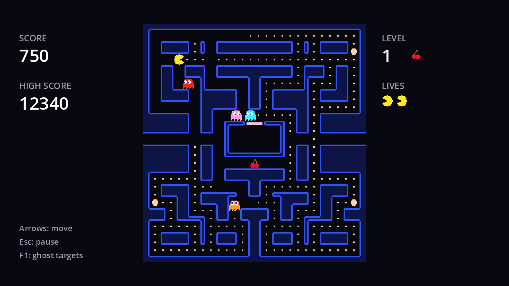

Four ghosts chasing you non-stop would be exhausting. The arcade games gave players regular breathers: every so often, the ghosts **scatter** to their home corners for a few seconds, then resume the **chase**. The schedule on the first level looks like this:

| Phase | Scatter | Chase | Scatter | Chase | Scatter | Chase | Scatter | Chase |
| --- | --- | --- | --- | --- | --- | --- | --- | --- |
| Seconds | 7 | 20 | 7 | 20 | 5 | 20 | 5 | forever |

Scatter waves are your chance to clear a crowded area. They also stop the ghosts from bunching up for good: after a scatter, they come back at you from four different corners.

And every time the mode changes, every ghost **turns around** immediately. It's the only time ghosts reverse, and it's a deliberate signal to the player that something just changed.

## The ghost side

In `ghost.gd`, add a `chasing` flag, make `get_target` use it, and add two small functions:

```gdscript title="ghost.gd"
## False in scatter mode, true in chase mode.
var chasing := false


## The cell this ghost is heading for right now.
func get_target() -> Vector2i:
	if chasing:
		return get_chase_target()
	return scatter_target


func set_chasing(value: bool) -> void:
	chasing = value
	reverse()


## Mode changes make ghosts turn around: the player's warning that something changed.
func reverse() -> void:
	direction = -direction
```

Also set `chasing = false` in `reset()`, so every round starts in scatter mode.

## The game side

The schedule is a list of durations, and a `Timer` steps through it. Add a `Timer` named `ModeTimer` under `World` with **One Shot** on, and connect its `timeout` to `Game`. Then in `game.gd`:

```gdscript title="game.gd"
## Seconds of scatter, chase, scatter, chase... After the last entry, ghosts chase forever.
const MODE_SCHEDULE := [7.0, 20.0, 7.0, 20.0, 5.0, 20.0, 5.0]

var _mode_index := 0

@onready var mode_timer: Timer = $World/ModeTimer


func _ready() -> void:
	player.ate_pellet.connect(_on_player_ate_pellet)
	hud.update_score(score)
	mode_timer.start(MODE_SCHEDULE[0])


## Scatter and chase take turns, following MODE_SCHEDULE.
func _on_mode_timer_timeout() -> void:
	_mode_index += 1
	for ghost: Ghost in ghosts:
		ghost.set_chasing(_mode_index % 2 == 1)
	if _mode_index < MODE_SCHEDULE.size():
		mode_timer.start(MODE_SCHEDULE[_mode_index])
```

- Even indexes (0, 2, 4, 6) are scatter phases and odd ones are chase, so `_mode_index % 2 == 1` means "chase".
- `mode_timer.start(seconds)` restarts the timer with a new wait time. After the last scatter phase (index 6), index 7 is chase and there's no next entry, so the timer simply isn't started again: chase forever.
- `ghosts` already holds the four ghost nodes, from the touch check in chapter 4.

:::note[Why a Timer node?]
`await get_tree().create_timer(7.0).timeout` would also work, but a `Timer` node lives inside the scene. It pauses when the game is paused, it can itself be paused (we'll need that for frightened mode), and it disappears if you quit to the menu halfway through.
:::

Run the game with the debug overlay (<kbd>F1</kbd>). For the first 7 seconds the target squares sit outside the corners and the ghosts circle there. Then they all turn around at once and come for you.



```quiz
question: At 30 seconds into a level (ignoring other modes), what are the ghosts doing?
options:
  - Scattering
  - Chasing
answer: 0
explain: 0–7 scatter, 7–27 chase, 27–34 scatter. At 30 seconds they're in the second scatter phase.
```

```quiz
question: Why do ghosts reverse when the mode changes?
options:
  - So they can reach their new target faster
  - It's a visible signal to the player that the mode changed
  - Because the movement rule requires it
answer: 1
```
