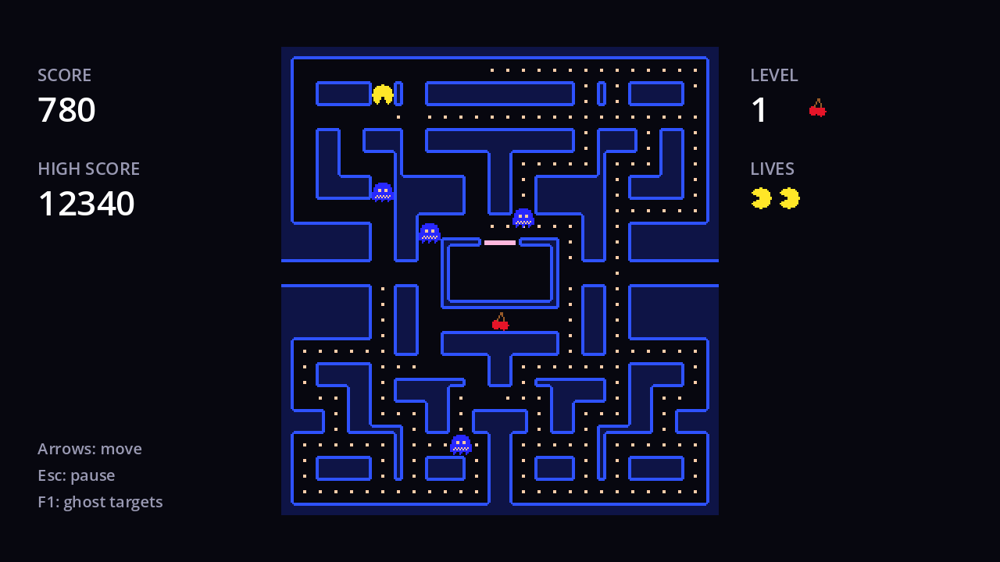

Eat a power pellet and, for a few seconds, the hunters become the hunted. Frightened ghosts:

- turn **blue** and lose their eyes' focus,
- **reverse** immediately (the same "something changed" signal as a mode switch),
- move **slower**, and
- pick a **random** direction at every junction instead of following a target.

Ghosts still in the house turn blue too. Eyes of eaten ghosts (next page) can't be frightened.



## The ghost side

```gdscript title="ghost.gd"
var frightened := false


func frighten() -> void:
	if state == State.EATEN or state == State.ENTERING:
		return # Eyes can't be frightened.
	frightened = true
	reverse()


func calm() -> void:
	frightened = false
```

The random choice slots into `_choose_direction`, after the options are collected. Frightened ghosts still never reverse, so the "can't turn back" rule keeps them flowing through the maze rather than jittering on the spot:

```gdscript title="ghost.gd" ins={5-6}
func _choose_direction() -> Vector2i:
	# ...
	if options.is_empty():
		return -direction # A dead end: the only way out is back.
	if frightened:
		return options.pick_random()
	var target := get_target()
```

Add a `fright_speed` to the `Speeds` group and use it in `_current_speed`, after the tunnel check (a frightened ghost in the tunnel is slowed by the tunnel):

```gdscript title="ghost.gd" ins={2,11-12}
@export var house_speed := 36.0
@export var fright_speed := 45.0


func _current_speed() -> float:
	match state:
		State.IN_HOUSE, State.LEAVING:
			return house_speed
	if maze.is_tunnel(cell):
		return tunnel_speed
	if frightened:
		return fright_speed
	return speed
```

And show it. Frightened ghosts use the blue `frightened` animation, which has the face drawn in, so the eyes are hidden; the body isn't tinted:

```gdscript title="ghost.gd"
func _update_sprite() -> void:
	eyes.visible = not frightened
	eyes.frame = EYE_FRAMES.get(direction, eyes.frame)
	if frightened:
		body.self_modulate = Color.WHITE
		body.play(&"frightened")
	else:
		body.self_modulate = color
		body.play(&"normal")
```

Calling `play()` every frame is fine: playing the animation that's already playing just carries on. Also add `frightened = false` to `reset()`.

A frightened ghost has no target, and neither does a ghost waiting in the house, so the debug overlay should skip them:

```gdscript title="target_debug.gd" ins={3-4}
func _draw() -> void:
	for ghost: Ghost in get_tree().get_nodes_in_group(&"ghosts"):
		if ghost.state != Ghost.State.ROAMING or ghost.frightened:
			continue
		var target := ghost.get_target()
```

## The game side

Add a one-shot `Timer` named `FrightTimer` under `World` and connect its `timeout` to `Game`:

```gdscript title="game.gd"
## Seconds the ghosts stay frightened.
const FRIGHT_TIME := 6.0

@onready var fright_timer: Timer = $World/FrightTimer


func _start_fright() -> void:
	mode_timer.paused = true # The scatter/chase clock stops while ghosts are frightened.
	fright_timer.start(FRIGHT_TIME)
	for ghost: Ghost in ghosts:
		ghost.frighten()


func _on_fright_timer_timeout() -> void:
	mode_timer.paused = false
	for ghost: Ghost in ghosts:
		ghost.calm()
```

and call it when a power pellet is eaten, at the end of `_on_player_ate_pellet`:

```gdscript title="game.gd"
	if power:
		_start_fright()
```

- **`mode_timer.paused`** freezes the scatter/chase countdown without resetting it. Frightened time doesn't count towards the schedule, as in the original.
- Eating a second power pellet while the ghosts are still blue calls `start` again, which restarts the 6 seconds.
- `FRIGHT_TIME` is a constant for now. In chapter 7 it gets shorter on every level.

Run the game and eat a power pellet. The ghosts turn around, turn blue and wander off. Touching one still restarts the game; the next page fixes that.

```quiz
question: Which of these happen when a power pellet is eaten? Select all that apply.
type: multiple
options:
  - Roaming ghosts reverse direction
  - Ghosts in the house turn blue
  - The scatter/chase timer restarts from zero
  - Frightened ghosts pick random directions at junctions
answer: [0, 1, 3]
explain: The mode timer is **paused**, not restarted; it continues where it left off when the fright ends.
```

```quiz
question: What does `options.pick_random()` return if `options` holds only one direction?
options:
  - That direction
  - A random direction from all four
  - An error
answer: 0
explain: In a corridor there's only one option, so even a frightened ghost follows the corridor.
```
