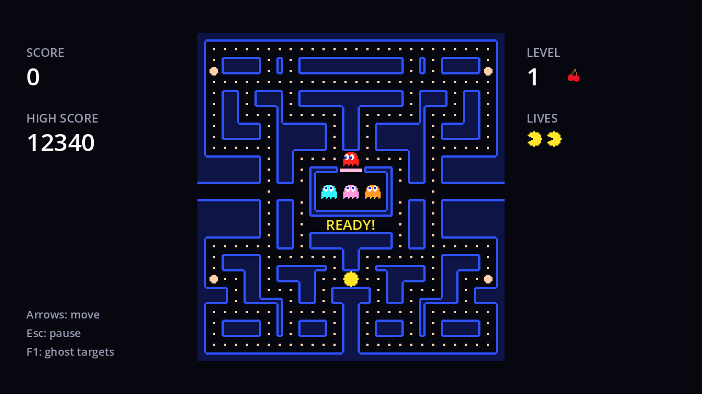

A maze game freezes a lot: before each round ("READY!"), for a moment after eating a ghost, while the player's death animation plays, when a level is cleared. Each time, everything in the maze must stop: player, ghosts, timers, animations, even the blinking power pellets.

## Disabling World

Remember the `World` node from chapter 2, which holds the maze, the player, the ghosts and the mode, fright and release timers? Its second job is to be that switch. Every node has a **process mode**:

| Process mode | The node processes... |
| --- | --- |
| Inherit (default) | like its parent |
| Pausable | unless the game is paused |
| When Paused | only while the game is paused |
| Always | always |
| Disabled | never |

Set `World` to **Disabled**, and every child that inherits its mode stops: no `_process`, no `_physics_process`, Timer nodes stop counting, `AnimatedSprite2D`s stop animating. Set it back to **Inherit** and everything carries on exactly where it was.

Add this to `game.gd`:

```gdscript title="game.gd"
## False while the world is frozen: before a round, after a death, between levels.
var playing := false

@onready var wait_timer: Timer = $WaitTimer


## Freezes or unfreezes everything in the maze. Freezing disables the World
## node, which stops its children's processing, timers and animations.
func _set_world_running(running: bool) -> void:
	playing = running
	world.process_mode = Node.PROCESS_MODE_INHERIT if running else Node.PROCESS_MODE_DISABLED


## Waits without blocking the game. Timer nodes pause with the game and vanish with the scene.
func _wait(seconds: float) -> void:
	wait_timer.start(seconds)
	await wait_timer.timeout
```

Add a one-shot `Timer` named `WaitTimer` directly under `Game`, **not** under `World`: it has to keep running while the world is frozen.

- **`playing`** mirrors the switch for code that isn't in `World`. `game.gd` itself is not frozen, so its touch check needs to know: at the top of `_physics_process`, add `if not playing: return`.
- **`_wait`** is a coroutine: `await _wait(2.0)` pauses the *calling function* for two seconds while the rest of the game keeps running. Because it uses a `Timer` node under `Game`, the wait also pauses with the pause menu (chapter 8), and if you quit to the main menu mid-wait, the timer disappears with the scene and the waiting function is simply never resumed.

## READY!

Add a label to `hud.tscn` for the classic "READY!" message:

| Node | Position | Size | Font size | Colour | Text |
| --- | --- | --- | --- | --- | --- |
| `ReadyLabel` (%) | (180, 196) | 280×18 | 13 | yellow `#ffe629` | `READY!` |

Centre it horizontally and untick **Visible**. It sits on row 17 of the maze, the empty corridor just below the ghost house. Then in `hud.gd`:

```gdscript title="hud.gd"
@onready var ready_label: Label = %ReadyLabel


func show_ready(on: bool) -> void:
	ready_label.visible = on
```

## Starting a round

A **round** is everything from "READY!" until you lose a life or clear the level. Starting one resets the actors and timers, but not the pellets or the score:

```gdscript title="game.gd"
func _ready() -> void:
	player.ate_pellet.connect(_on_player_ate_pellet)
	hud.update_score(score)
	_start_round()


## Puts everyone in their starting spot and shows "READY!" for a moment.
func _start_round() -> void:
	_set_world_running(false)
	player.reset()
	for ghost: Ghost in ghosts:
		ghost.reset()
	fright_timer.stop()
	_mode_index = 0
	mode_timer.paused = false
	mode_timer.start(MODE_SCHEDULE[0])
	release_timer.start()
	_pellets_this_life = 0
	hud.show_ready(true)
	await _wait(2.0)
	hud.show_ready(false)
	_set_world_running(true)
	_release_ghosts()
```

The mode, release and fright setup moved here from `_ready`. Starting `mode_timer` while `World` is disabled is fine: it's armed, and starts counting when the world runs.



## A pause after eating a ghost

A short freeze makes catching a ghost feel weighty: everything stops, the points appear where the ghost was, and the player is hidden for a moment. Extend `_eat_ghost`:

```gdscript title="game.gd" ins={7-14}
func _eat_ghost(ghost: Ghost) -> void:
	var points: int = GHOST_POINTS[mini(_ghosts_eaten, GHOST_POINTS.size() - 1)]
	_ghosts_eaten += 1
	_add_score(points)
	ghost.eat()
	_show_points(points, ghost.position)
	# A short freeze, with the points where the ghost was, makes the catch feel good.
	_set_world_running(false)
	player.hide()
	ghost.hide()
	await _wait(0.6)
	player.show()
	ghost.show()
	_set_world_running(true)
```

While `World` is frozen, `FrightTimer` stops too, so the freeze doesn't eat into your frightened time.

This is also why `_show_points` used `get_tree().create_tween()` in the previous chapter. A tween made with a node's `create_tween()` belongs to that node, and only runs while the node can process. The points label lives in the frozen `World`, so a tween owned by the label would sit still during the freeze. A tween from the `SceneTree` belongs to no node and keeps counting.

Also add `show()` to the end of `Ghost.reset()`: a ghost hidden during a freeze must reappear at the next round.

```quiz
question: Why is WaitTimer a child of Game rather than World?
options:
  - Timers must be direct children of the scene root
  - World is disabled during the waits, and a disabled Timer never times out
  - So it can be paused separately
answer: 1
```

```quiz
question: Which of these stop when World's process mode is set to Disabled? Select all that apply.
type: multiple
options:
  - The ghosts' `_physics_process`
  - FrightTimer, a child of World
  - The power pellets blinking (BlinkTimer is in the maze scene)
  - "`game.gd`'s `_physics_process`"
answer: [0, 1, 2]
explain: Game is World's parent, not its child, so it keeps running. That's why it checks `playing`.
```
