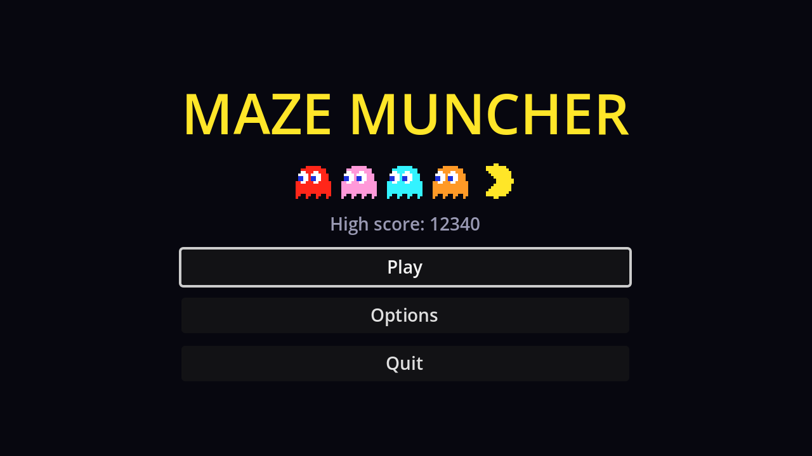

## A project theme

Godot's default UI font is small at 640×360. Rather than overriding the size on every control, create a **Theme**: in the FileSystem dock, **New Resource → Theme**, save it as `theme.tres`, and set **Default Font Size** to `14`. Make it the project-wide theme in **Project Settings → GUI → Theme → Custom**. Every `Control` now uses it, and individual nodes can still override it.

## Layout

Create a scene with a `Control` root named `MainMenu`, and in the toolbar's **Anchor preset** menu choose **Full Rect**. Save it as `main_menu.tscn`.

```text
MainMenu (Control, Full Rect)
└── CenterContainer (Full Rect)
    └── VBoxContainer                # min size 200×0, separation 10
        ├── Title (Label)            # "MAZE MUNCHER", font size 44, yellow, centred
        ├── Parade (HBoxContainer)   # separation 8, alignment Center
        │   ├── Ember (TextureRect)
        │   │   └── Eyes (TextureRect)
        │   ├── Rosie, Frost, Pumpkin (the same)
        │   └── Player (TextureRect)
        ├── HighScoreLabel (Label, %)   # grey, centred (used on page 3)
        ├── PlayButton (Button, %)
        ├── OptionsButton (Button)
        └── QuitButton (Button, %)
```

The `VBoxContainer`'s minimum width makes all buttons equally wide, and the `CenterContainer` keeps the stack centred at any window size.

### The ghost parade

The parade reuses the game's art through **AtlasTextures**, like the lives icons:

| Node | Texture (New AtlasTexture) | Region | Other |
| --- | --- | --- | --- |
| `Ember` etc. | `art/ghost.png` | (0, 0, 14, 14) | Self Modulate: the ghost's colour |
| `Eyes` (child) | `art/ghost_eyes.png` | (28, 0, 14, 14) | Anchor preset Full Rect |
| `Player` | `art/player.png` | (28, 0, 14, 14) | Flip H on |

Give each `TextureRect` a **Custom Minimum Size** of 28×28 and set **Expand Mode** to **Ignore Size**, so the 14-pixel art is drawn at double size. Thanks to the Nearest filter from chapter 1, it stays crisp.

The ghosts are tinted with **Self Modulate**, not **Modulate**: `modulate` also tints a node's children, and the `Eyes` would turn red, pink, cyan and orange along with the bodies. Create the first ghost, then duplicate it (<kbd>Ctrl</kbd>+<kbd>D</kbd>) and change the colour; the duplicates share the AtlasTextures, which is fine since they show the same picture.

## The script

Connect each button's `pressed` signal to `MainMenu`, then:

```gdscript title="main_menu.gd"
extends Control

@onready var play_button: Button = %PlayButton
@onready var quit_button: Button = %QuitButton


func _ready() -> void:
	# Browsers can't close the tab for us, so hide Quit in web builds.
	quit_button.visible = not OS.has_feature("web")
	play_button.grab_focus()


func _on_play_button_pressed() -> void:
	get_tree().change_scene_to_file("res://game.tscn")


func _on_options_button_pressed() -> void:
	get_tree().change_scene_to_file("res://options_menu.tscn")


func _on_quit_button_pressed() -> void:
	get_tree().quit()
```

`grab_focus()` makes the menu work from the keyboard straight away: the arrow keys move between buttons and <kbd>Enter</kbd> or <kbd>Space</kbd> presses one. Godot works out the focus order from the layout.

:::warning
`options_menu.tscn` doesn't exist until chapter 9. Clicking Options prints an error until then.
:::

## Make it the main scene

Open **Project Settings → Application → Run** and set **Main Scene** to `res://main_menu.tscn`. <kbd>F5</kbd> now starts at the menu, while <kbd>F6</kbd> still runs the open scene directly, which is handy for testing the game.

```quiz
question: Why are the parade ghosts tinted with Self Modulate instead of Modulate?
options:
  - Modulate doesn't work on TextureRects
  - Modulate would also tint the child Eyes node
  - Self Modulate is faster
answer: 1
```

```quiz
question: What does `play_button.grab_focus()` make possible?
options:
  - Clicking the button with the mouse
  - Using the menu with only the keyboard or a gamepad
  - Showing the button on top of the others
answer: 1
```
