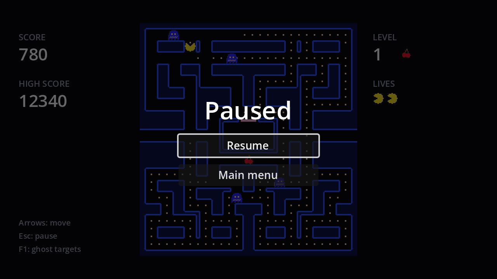

## Pausing vs freezing

We already freeze the world by disabling `World`. Pausing is different: `get_tree().paused = true` pauses **every** node whose process mode is *Pausable* (or inherits it from the root), including `Game`, the `WaitTimer`, and everything in `World`. A "READY!" countdown or a death animation stops mid-way and continues on unpause.

The pause menu itself must keep running while paused, or you could never unpause: its process mode is **Always**.

## The scene

New scene, `CanvasLayer` root named `PauseMenu`, saved as `pause_menu.tscn`. Set **Layer** to `10` (above the HUD, which is on layer 1) and **Process → Mode** to `Always`.

```text
PauseMenu (CanvasLayer, layer 10, process mode Always)
├── Dim (ColorRect, Full Rect, black at 60% alpha)
└── CenterContainer (Full Rect)
    └── VBoxContainer                  # min size 180×0, separation 10
        ├── Title (Label)              # "Paused", font size 32
        ├── ResumeButton (Button, %)
        └── MainMenuButton (Button)
```

`Dim` darkens the game behind the menu and swallows mouse clicks. Connect both buttons' `pressed` signals:

```gdscript title="pause_menu.gd"
extends CanvasLayer

@onready var resume_button: Button = %ResumeButton


func _ready() -> void:
	hide()


func _unhandled_input(event: InputEvent) -> void:
	if event.is_action_pressed(&"pause"):
		set_paused(not get_tree().paused)
		get_viewport().set_input_as_handled()


func set_paused(paused: bool) -> void:
	get_tree().paused = paused
	visible = paused
	if paused:
		resume_button.grab_focus()


func _on_resume_button_pressed() -> void:
	set_paused(false)


func _on_main_menu_button_pressed() -> void:
	get_tree().paused = false # The pause state outlives the scene!
	get_tree().change_scene_to_file("res://main_menu.tscn")
```

- **`_unhandled_input`** receives only events that no UI control used, the right place for gameplay shortcuts like <kbd>Esc</kbd>.
- **`set_input_as_handled()`** stops the same key press from reaching anything else.

Instance `pause_menu.tscn` under `Game`.

:::danger[Unpause before leaving]
`paused` belongs to the **SceneTree**, not to the scene. Forget to reset it and the main menu loads... frozen.
:::

## Pause and the death animation

There's one subtle interaction. In chapter 10 the player's sprite will keep animating while `World` is disabled, by giving it the process mode *Pausable* for the length of the death animation. *Pausable* means "process unless the tree is paused", so pausing during the animation still stops it. Process modes compose nicely: `World` handles freezing, the tree handles pausing.

```quiz
question: Which process mode does the pause menu need?
options:
  - Pausable
  - When Paused
  - Always
  - Disabled
answer: 2
explain: '**When Paused** would keep the buttons working, but `_unhandled_input` wouldn''t run while unpaused, so Esc could never open the menu. **Always** covers both.'
```

```quiz
question: The game is paused during the 2-second "READY!" wait, 1 second in. What happens when you resume?
options:
  - The round starts immediately
  - The wait continues with 1 second left
  - The wait restarts from 2 seconds
answer: 1
explain: WaitTimer is a pausable Timer node, so it stops counting while paused and carries on afterwards.
```
