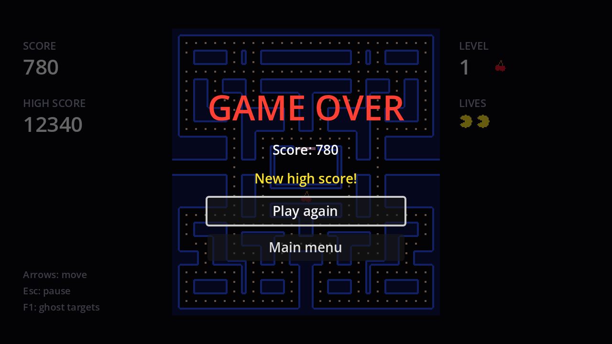
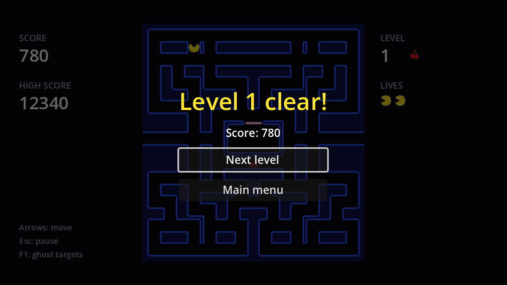

Both screens are built like the pause menu: a `CanvasLayer` on layer 10 with a dim background and a centred column. Neither needs a special process mode, because nothing is paused while they're shown.

## Game over



```text
GameOver (CanvasLayer, layer 10)
├── Dim (ColorRect)
└── CenterContainer
    └── VBoxContainer
        ├── Title (Label)              # "GAME OVER", font size 36, red
        ├── ScoreLabel (Label, %)
        ├── RecordLabel (Label, %)     # "New high score!", yellow
        ├── PlayAgainButton (Button, %)
        └── MainMenuButton (Button)
```

```gdscript title="game_over.gd"
extends CanvasLayer

@onready var score_label: Label = %ScoreLabel
@onready var record_label: Label = %RecordLabel
@onready var play_again_button: Button = %PlayAgainButton


func _ready() -> void:
	hide()


func show_result(score: int, new_record: bool) -> void:
	score_label.text = "Score: %d" % score
	record_label.visible = new_record
	show()
	play_again_button.grab_focus()


func _on_play_again_button_pressed() -> void:
	get_tree().reload_current_scene()


func _on_main_menu_button_pressed() -> void:
	get_tree().change_scene_to_file("res://main_menu.tscn")
```

`reload_current_scene()` throws away the game scene and loads a fresh one, so score, lives, level and maze all reset without any reset code. The high score survives because it lives in the `HighScore` autoload.

Instance it under `Game`, and replace the temporary restart in `_lose_life`:

```gdscript title="game.gd" del={2} ins={3}
	if lives == 0:
		get_tree().reload_current_scene() # Game over, for now.
		_game_over()
		return
```

```gdscript title="game.gd"
@onready var pause_menu: CanvasLayer = $PauseMenu
@onready var game_over: CanvasLayer = $GameOver


func _game_over() -> void:
	pause_menu.set_process_unhandled_input(false)
	var new_record: bool = HighScore.submit(score)
	game_over.show_result(score, new_record)
```

`set_process_unhandled_input(false)` switches off the pause menu's <kbd>Esc</kbd> handling: pausing on top of the game over screen would just stack two menus.

## Level clear



The level clear screen is the same shape: a yellow `TitleLabel` (%), a `ScoreLabel` (%), a `NextButton` (%) and a `MainMenuButton`. The difference is what happens on **Next level**: the game has to carry on, so the screen announces it with a signal.

```gdscript title="level_clear.gd"
extends CanvasLayer

signal next_level_pressed

@onready var title_label: Label = %TitleLabel
@onready var score_label: Label = %ScoreLabel
@onready var next_button: Button = %NextButton


func _ready() -> void:
	hide()


func show_level(level: int, score: int) -> void:
	title_label.text = "Level %d clear!" % level
	score_label.text = "Score: %d" % score
	show()
	next_button.grab_focus()


func _on_next_button_pressed() -> void:
	hide()
	next_level_pressed.emit()


func _on_main_menu_button_pressed() -> void:
	get_tree().change_scene_to_file("res://main_menu.tscn")
```

Instance it under `Game` as `LevelClear`. In `_clear_level`, replace the second wait with the screen, and **await the signal**:

```gdscript title="game.gd" del={7} ins={8-11}
func _clear_level() -> void:
	_set_world_running(false)
	await _wait(1.0)
	for ghost: Ghost in ghosts:
		ghost.hide()
	fruit.hide()
	await _wait(1.0)
	pause_menu.set_process_unhandled_input(false)
	level_clear.show_level(level, score)
	await level_clear.next_level_pressed
	pause_menu.set_process_unhandled_input(true)
	level += 1
	maze.reset_pellets()
	_start_round()
```

with `@onready var level_clear: CanvasLayer = $LevelClear` at the top. `await` works on any signal, not just timers: the function stops at that line until the player presses **Next level**, however long that takes. If they choose **Main menu** instead, the scene is freed and the function never resumes, which is exactly right.

The `LevelClear` screen doesn't know anything about levels or mazes. It shows what it's told and emits a signal; `game.gd` decides what "next level" means.

```quiz
question: Why does Play again not need to reset the score, lives or maze?
options:
  - reload_current_scene creates a fresh copy of every node in the game scene
  - Godot remembers the initial values of all variables
  - The HighScore autoload resets them
answer: 0
```

```quiz
question: What does `await level_clear.next_level_pressed` do?
options:
  - Blocks the whole game until the button is pressed
  - Pauses only `_clear_level` until the signal is emitted; the rest of the game keeps running
  - Calls next_level_pressed immediately
answer: 1
```
