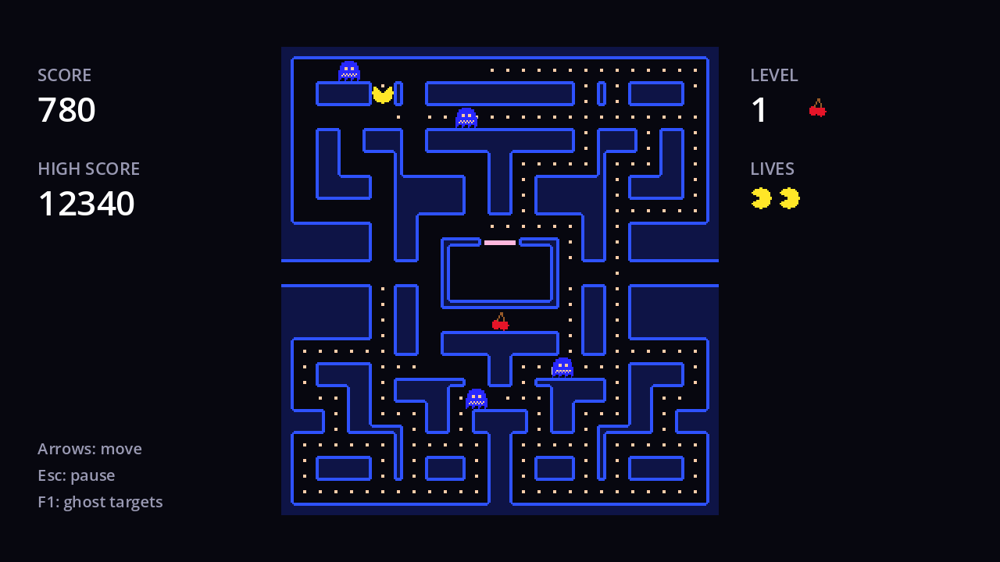

## Flashing ghosts

Chasing a blue ghost is a gamble: if frightened mode ends just before you reach it, you run straight into a dangerous one. The arcade games gave a warning: for the last couple of seconds, frightened ghosts **flash** white.



The `flashing` animation from chapter 4 alternates blue and pale frames. The ghost needs a flag to choose it:

```gdscript title="ghost.gd"
## True during the last seconds of frightened mode.
var flashing := false
```

Use it in `_update_sprite`:

```gdscript title="ghost.gd" del={7} ins={8}
func _update_sprite() -> void:
	body.visible = state != State.EATEN and state != State.ENTERING
	eyes.visible = not frightened
	eyes.frame = EYE_FRAMES.get(direction, eyes.frame)
	if frightened:
		body.self_modulate = Color.WHITE
		body.play(&"frightened")
		body.play(&"flashing" if flashing else &"frightened")
	else:
		body.self_modulate = color
		body.play(&"normal")
```

and add `flashing = false` next to `frightened = ...` in `reset()`, `frighten()`, `calm()` and `eat()`, so a ghost never starts flashing on its own.

The game knows how much fright time is left, so it decides when to flash. At the end of `_physics_process` in `game.gd`:

```gdscript title="game.gd"
## Frightened ghosts start flashing when this many seconds are left.
const FLASH_TIME := 2.0
```

```gdscript title="game.gd" ins={3-5}
	if fruit.visible and player.position.distance_to(fruit.position) < TOUCH_DISTANCE:
		_eat_fruit()
	var ending := not fright_timer.is_stopped() and fright_timer.time_left < FLASH_TIME
	for ghost: Ghost in ghosts:
		ghost.flashing = ghost.frightened and ending
```

Only ghosts that are actually frightened flash. A ghost eaten and revived during the fright stays in its normal colours, as it should: it's dangerous again.

On later levels, where the fright lasts only 2 seconds, the ghosts flash for the whole of it. That's fine, and it's the warning working as intended.

## Flashing the maze

The arcade games celebrated a cleared level by flashing the maze walls. Add to `maze.gd`:

```gdscript title="maze.gd"
## Flashes the walls a few times, for the end of a level.
func flash() -> void:
	# The world is frozen when this runs, so the tween must not belong to the maze.
	var tween := get_tree().create_tween()
	for i in 4:
		tween.tween_property(walls, "modulate", Color(4, 4, 4), 0.2)
		tween.tween_property(walls, "modulate", Color.WHITE, 0.2)
	await tween.finished
```

- **Tweeners run in sequence** on one tween, so this goes bright, normal, bright, normal... eight steps of 0.2 seconds.
- **`modulate` above 1** brightens. The walls are blue, so multiplying by 4 turns the outline a light blue-white and the dark fill a bright blue.
- **`get_tree().create_tween()`**, not `create_tween()`: the maze is inside `World`, which is frozen when this runs. A tween created by the maze would belong to it and never advance, and `await tween.finished` would wait forever.

In `_clear_level`, flash before showing the level clear screen:

```gdscript title="game.gd" ins={7}
func _clear_level() -> void:
	_set_world_running(false)
	await _wait(1.0)
	for ghost: Ghost in ghosts:
		ghost.hide()
	fruit.hide()
	await maze.flash()
	pause_menu.set_process_unhandled_input(false)
```

That's the game complete. Play a few levels, and notice how much the small touches (the waka, the rising siren, the flashing warnings) add.

```quiz
question: Why does `Maze.flash()` use `get_tree().create_tween()`?
options:
  - SceneTree tweens are smoother
  - The maze is in the frozen World, and a tween owned by the maze wouldn't advance
  - Nodes can't tween their children's properties
answer: 1
```

```quiz
question: A ghost was eaten during a fright, and has revived. The fright has 1 second left. Does the revived ghost flash?
options:
  - Yes, every ghost flashes in the last 2 seconds
  - No, it's not frightened, so `ghost.frightened and ending` is false
answer: 1
```
