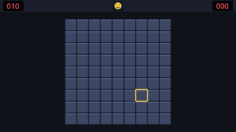

This tutorial builds a complete Minesweeper: a board you can click, mines that are never under your first click, empty regions that open in one go, flags, chording, a mine counter, a timer and a restart smiley, three difficulties plus custom boards, menus, best times saved to disk, an options screen with key rebinding, sound, animations, and finally an exported game you can share.



Every chapter ends in something you can run and play, so you can stop at any point.

## A game without physics

If you've built an action game before, Minesweeper is a change of pace. Nothing moves on its own and nothing collides: there are no physics bodies, no collision layers and no velocities. Instead, the game is all about two things:

| Topic | What you'll learn |
| --- | --- |
| **Game logic** | Keeping the rules in a plain data model (a 2D array of cells), placing mines fairly, counting neighbours, and the *flood fill* algorithm that opens empty regions. |
| **UI** | `Control` nodes, containers, a custom-drawn board, themes, mouse and keyboard input, menus, and screens that scale to fit. |

Both carry straight over to puzzle games, strategy games, inventories, level editors and anything else built on a grid.

## Download

Grab the **standard** (non-.NET) build of Godot 4 from the official site. It is a single executable with no installer. This tutorial was written against Godot 4.7, but anything from 4.4 up works (we use typed dictionaries, which arrived in 4.4).

:::tip
On macOS, drag Godot into `/Applications` so Spotlight can find it.
:::

## The project manager

When you start Godot you land in the *project manager*. This is where you create, import and open projects. Everything else (scenes, scripts, settings) happens in the *editor* that opens once you pick a project.

```quiz
question: Which Godot build do you need for a GDScript-only project like this one?
options:
  - The .NET build
  - The standard build
  - Either; they are identical
answer: 1
explain: The .NET build adds C# support. For GDScript the **standard** build is smaller and simpler.
```

```quiz
type: multiple
question: Which of these will the Minesweeper project use? Select all that apply.
options:
  - Control nodes and containers
  - CharacterBody2D and collision layers
  - A 2D array of cells
  - Signals
answer: [0, 2, 3]
explain: Minesweeper has no physics at all. The board is a grid of data drawn by a single `Control`, and signals connect the pieces.
```
