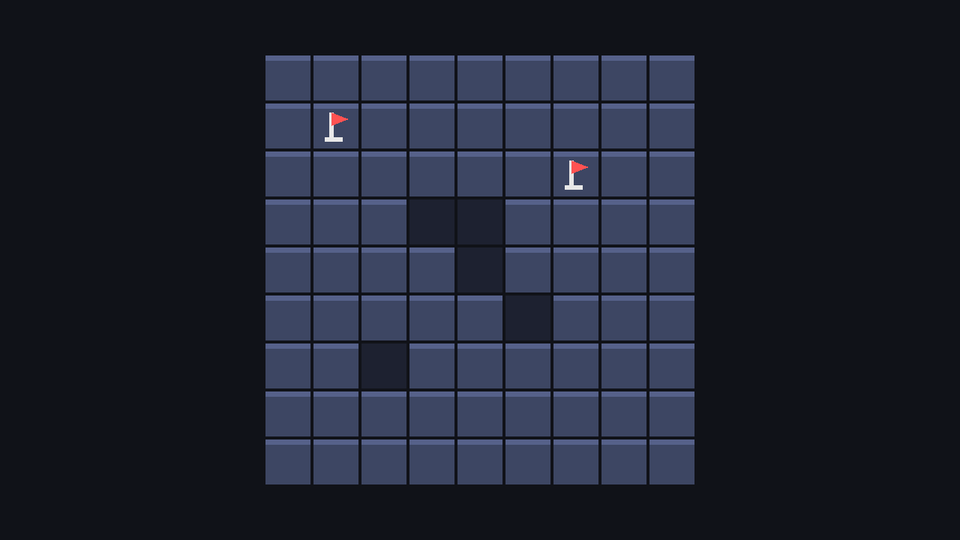

## Moves belong to the model

First, give the model the two moves a player can make. Add these to the end of `board_model.gd`:

```gdscript title="board_model.gd"
## Reveal a covered cell. Returns every cell that was revealed, in order.
func reveal(pos: Vector2i) -> Array[Vector2i]:
	var revealed: Array[Vector2i] = []
	if not get_cell(pos).can_reveal():
		return revealed
	get_cell(pos).state = CellState.REVEALED
	revealed.append(pos)
	return revealed


## Flag a hidden cell, or unflag a flagged one.
func toggle_flag(pos: Vector2i) -> bool:
	var cell := get_cell(pos)
	match cell.state:
		CellState.HIDDEN:
			cell.state = CellState.FLAGGED
			flags_placed += 1
		CellState.FLAGGED:
			cell.state = CellState.HIDDEN
			flags_placed -= 1
		_:
			return false # Revealed cells can't be flagged.
	return true
```

`reveal` returns a list of the cells it revealed. Right now that's always zero or one cell, which seems like overkill. In the revealing chapter, one click will open dozens of cells, and the board will want to know which ones (to animate them, and to pick a sound).

`toggle_flag` uses `match`, GDScript's version of a switch statement. `_` matches anything that the earlier branches didn't. It returns whether anything changed, so the board can skip a redraw when you right-click a revealed cell.

## Which input callback?

Godot offers several places to receive input. For a `Control`, the right one is usually `_gui_input`:

| Callback | Receives | Use for |
| --- | --- | --- |
| `_input` | Every event, before anything else | Global shortcuts that must always win |
| `_gui_input` (Controls only) | Mouse events *over this control*, and keys while it has focus | Clicking on a specific piece of UI |
| `_unhandled_input` | Whatever no control consumed | Gameplay keys like pause |

`_gui_input` only fires when the mouse is over the board, and `event.position` is already in the board's own coordinates: `(0, 0)` is its top-left corner, wherever the container placed it. No subtracting offsets.

## From pixels back to cells

Drawing went from cell to pixels (multiply by `cell_size`); input goes the other way (divide and round down). A click at pixel `(70, 40)` on a 32px board is cell `(2, 1)`.

Add the input code to `board.gd`. The constant goes with the others at the top; the rest goes between `setup()` and the drawing section:

```gdscript title="board.gd"
const NO_CELL := Vector2i(-1, -1)


func _cell_at(point: Vector2) -> Vector2i:
	var pos := Vector2i((point / cell_size).floor())
	return pos if model.is_inside(pos) else NO_CELL


# --- Input -----------------------------------------------------------------

func _gui_input(event: InputEvent) -> void:
	if event is InputEventMouseButton:
		var pos := _cell_at(event.position)
		if event.button_index == MOUSE_BUTTON_LEFT and event.pressed:
			_reveal(pos)
		elif event.button_index == MOUSE_BUTTON_RIGHT and event.pressed:
			_toggle_flag(pos)
		accept_event()


# --- Moves -----------------------------------------------------------------

## Reveal a covered cell.
func _reveal(pos: Vector2i) -> void:
	if pos == NO_CELL:
		return
	model.reveal(pos)
	queue_redraw()


func _toggle_flag(pos: Vector2i) -> void:
	if pos == NO_CELL:
		return
	if model.toggle_flag(pos):
		queue_redraw()
```

- **`NO_CELL`** is a *sentinel*: a value that can't be a real cell, used to mean "none". `(-1, -1)` is never inside the board. Returning it is clearer than returning `null`, because the type stays `Vector2i` everywhere.
- **`floor()`** before converting matters for positions just outside the grid. While a button is held, Godot keeps sending mouse events to the control you pressed on, even when the pointer leaves it. `-0.5` floors to `-1` (outside), while plain `int()` would round it towards zero and give `0` (inside).
- **`event.pressed`** is true on the button-down event and false on the button-up one. We act on the press.
- **`accept_event()`** marks the click as handled, so it doesn't travel on to `_unhandled_input` elsewhere.
- **`queue_redraw()`** after every change. Forget it and the model changes, but the screen doesn't.

:::note[Mouse filter]
A `Control` only receives mouse events if its **Mouse → Filter** is `Stop` (the default) or `Pass`. Labels default to `Ignore`, which is why clicking text doesn't steal clicks from what's behind it.
:::

## Try it

Run the game. Left-click reveals a cell (an empty dark square, since there are no mines or numbers yet), right-click plants and removes flags, and flagged cells ignore left-clicks.



It's not a game yet, but the whole pipeline is in place: input → model → redraw.

```quiz
question: A click arrives at `event.position = (100, 20)` on a board with 32px cells. Which cell is it?
options:
  - (3, 0)
  - (0, 3)
  - (3, 1)
answer: 0
explain: 100 / 32 = 3.1 → 3 and 20 / 32 = 0.6 → 0. Divide and round down.
```

```quiz
question: Why does the board use `_gui_input` instead of `_input`?
options:
  - _input doesn't receive mouse events
  - _gui_input only fires for events over the control, with positions already local to it
  - _gui_input runs faster
answer: 1
explain: The board only cares about clicks on itself, and local coordinates make the cell maths trivial.
```

```quiz
question: Which method marks an input event as handled from inside `_gui_input`?
type: text
answer: [accept_event, accept_event()]
explain: '`accept_event()` stops the event from propagating to other nodes. Outside of `_gui_input`, you use `get_viewport().set_input_as_handled()`.'
```
