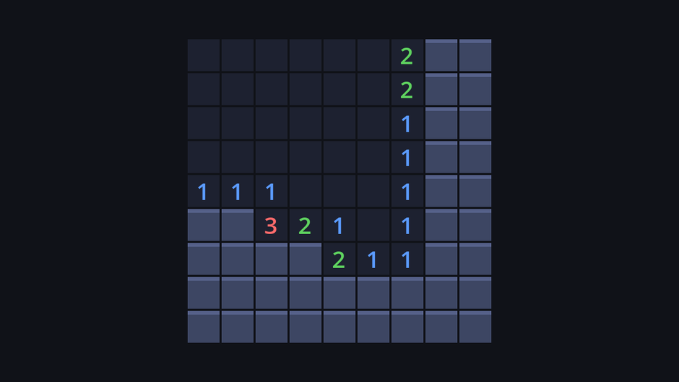

## A to-do list you control

Recursion keeps "cells still to look at" implicitly, on the call stack. We can keep that list ourselves, in an ordinary array called a **queue**:

1. Reveal the clicked cell and put it in the queue.
2. While the queue isn't empty: take the cell at the **front**.
   - If it's a number, do nothing more with it: it's the edge of the region.
   - If it's a `0`, reveal each of its hidden neighbours and add them to the **back** of the queue.

The function never calls itself, so the call stack stays one frame deep, however big the region. The array can hold thousands of cells without complaint.

## Step by step

Here's the 4×3 board from the previous page, with its numbers filled in. The only mine is at `(3, 0)`:

```text
      x=0  x=1  x=2  x=3
y=0    0    0    1    *
y=1    0    0    1    1
y=2    0    0    0    0
```

We click `(0, 0)`. It's revealed and queued. Then the loop runs. The neighbours are checked in the order of `NEIGHBOUR_OFFSETS`: top-left, top, top-right, left, right, bottom-left, bottom, bottom-right.

| Step | Take from front | Value | Newly revealed and queued | Queue afterwards |
| --- | --- | --- | --- | --- |
| 1 | (0,0) | 0 | (1,0) (0,1) (1,1) | (1,0) (0,1) (1,1) |
| 2 | (1,0) | 0 | (2,0) (2,1) | (0,1) (1,1) (2,0) (2,1) |
| 3 | (0,1) | 0 | (0,2) (1,2) | (1,1) (2,0) (2,1) (0,2) (1,2) |
| 4 | (1,1) | 0 | (2,2) | (2,0) (2,1) (0,2) (1,2) (2,2) |
| 5 | (2,0) | 1 | (a number: stop) | (2,1) (0,2) (1,2) (2,2) |
| 6 | (2,1) | 1 | (a number: stop) | (0,2) (1,2) (2,2) |
| 7 | (0,2) | 0 | (all neighbours already revealed) | (1,2) (2,2) |
| 8 | (1,2) | 0 | (all neighbours already revealed) | (2,2) |
| 9 | (2,2) | 0 | (3,1) (3,2) | (3,1) (3,2) |
| 10 | (3,1) | 1 | (a number: stop) | (3,2) |
| 11 | (3,2) | 0 | (all neighbours already revealed) | *empty: done* |

All 11 safe cells are revealed, in this order:

```text
(0,0) (1,0) (0,1) (1,1) (2,0) (2,1) (0,2) (1,2) (2,2) (3,1) (3,2)
```

Notice the shape of that order: first the clicked cell, then the cells next to it, then the cells next to *those*. The region opens in rings around your click. Processing the oldest entry first is called **breadth-first** search (BFS). We'll use that ring order in the polish chapter to animate the reveal.

## Reveal when you queue, not when you take

Look at step 2: `(1,0)` has `(0,1)` and `(1,1)` as neighbours too, but they were already revealed in step 1, so they aren't queued again. That's the most important detail of the algorithm: a cell is marked revealed **at the moment it's added to the queue**, so the `can_reveal()` check stops it from being added twice.

If you only revealed cells when taking them from the front, `(1,1)` would be queued by `(0,0)`, then again by `(1,0)`, then again by `(0,1)`... On a big open region, cells would be queued up to eight times each, and the queue would balloon.

## The code

Add the flood fill to `board_model.gd`, right after `_open`:

```gdscript title="board_model.gd"
## Breadth-first flood fill: reveal `start`, and keep going through empty cells.
func _flood_reveal(start: Vector2i, revealed: Array[Vector2i]) -> void:
	var queue: Array[Vector2i] = [start]
	_reveal_one(start, revealed)
	while not queue.is_empty():
		var pos: Vector2i = queue.pop_front()
		if get_cell(pos).adjacent > 0:
			continue # A number is the edge of the region.
		for next in neighbours(pos):
			if get_cell(next).can_reveal():
				_reveal_one(next, revealed) # Reveal when queued, so no cell is queued twice.
				queue.append(next)
```

- `pop_front()` removes and returns the first element: the oldest entry.
- `continue` skips the rest of this loop iteration and moves on to the next cell in the queue.
- `can_reveal()` is true for hidden and question-marked cells. Flagged cells are left alone: if you flagged a safe cell by mistake, the flood stops there and the flag stays.
- Mines can never be reached. The only cells whose neighbours get queued are `0`s, and a `0` has no mines around it by definition.

Then make `_open` use it instead of revealing a single cell:

```gdscript title="board_model.gd" del={1,11} ins={2,12}
## Reveal one cell the player chose. A mine ends the game.
## Reveal one cell the player chose. A mine ends the game; an empty cell floods.
func _open(pos: Vector2i, revealed: Array[Vector2i]) -> void:
	var cell := get_cell(pos)
	if cell.is_mine:
		cell.state = CellState.REVEALED
		revealed.append(pos)
		exploded = pos
		state = GameState.LOST
		return
	_reveal_one(pos, revealed)
	_flood_reveal(pos, revealed)
```

Clicking a number still works: `_flood_reveal` reveals the start cell, takes it from the queue, sees it's a number, and stops. One cell, no special case needed.

The board doesn't change at all. It calls `model.reveal()` and redraws, and it doesn't care whether one cell or a hundred changed. That's the model/view split paying off.

Run the game. Thanks to the safe first click, your first click is always a `0` now, so it always opens a region:



:::tip[Queue or stack?]
Change `pop_front()` to `pop_back()` and you get a **stack**: the newest entry first. That's depth-first order, like the recursive version, but still without recursion. The same cells get revealed, just in a different order. We keep the queue because the ring order looks better when animated.
:::

:::note[Is `pop_front()` slow?]
Removing the first element shifts every other element one place, so on a huge queue it adds up. For the at most 800 cells of our biggest board, it's nothing. If you ever flood-fill millions of pixels, keep an index of the next entry to read instead of removing anything.
:::

```quiz
question: Why does the flood fill reveal a cell when it's queued rather than when it's taken from the queue?
options:
  - It makes the animation smoother
  - So the can_reveal() check stops the same cell from being queued more than once
  - pop_front() only works on revealed cells
answer: 1
explain: Revealing a cell is also our "seen" marker. Mark it as soon as it's queued and no other neighbour will add it again.
```

```quiz
question: In the trace above, why are (0,1) and (1,1) not queued again in step 2?
options:
  - They're numbers
  - They were already revealed in step 1
  - They aren't neighbours of (1,0)
answer: 1
explain: Both are neighbours of (1,0), but they were revealed (and queued) when (0,0) was processed, so can_reveal() returns false.
```

```quiz
question: What's the name for processing the oldest entry first, which makes the region open in rings?
type: text
answer: [breadth-first, breadth first, bfs, breadth-first search, breadth first search]
explain: A queue gives breadth-first order. A stack (newest first) gives depth-first order.
```

```quiz
question: Can the flood fill ever reveal a mine?
options:
  - Yes, if a mine is next to a number
  - No; only zeros queue their neighbours, and a zero has no neighbouring mines
  - Only if the mine is question-marked
answer: 1
explain: Numbers stop the spread. Every cell that gets queued is a neighbour of a 0, and a 0 has no mines next to it.
```
