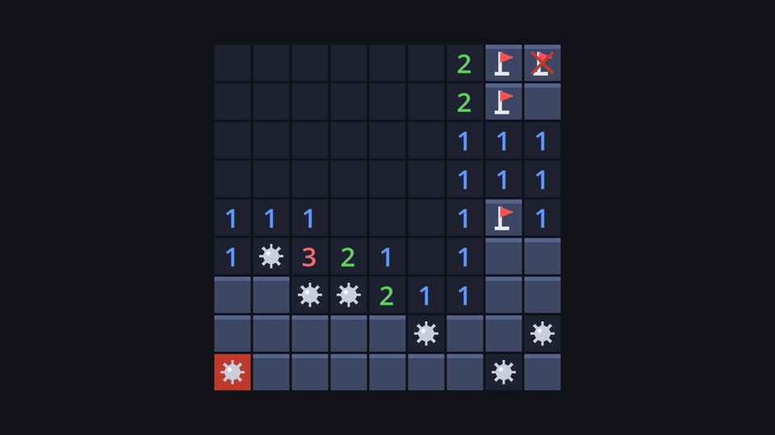

When you hit a mine, classic Minesweeper shows you the whole truth:

| Cell | Shown as |
| --- | --- |
| The mine you clicked | A mine on a red background |
| Other mines you didn't flag | A mine |
| Mines you flagged correctly | Still a flag |
| Flags on safe cells (your mistakes) | A flag with a red cross |

None of this needs the model to change. The model already knows where every mine is and what you flagged. Showing it is purely a drawing decision, so it all happens in `board.gd`.

## Drawing the truth

A cell is drawn **face up** (revealed) or **face down** (covered). Until now, that was decided by `cell.state` alone. After a loss, unflagged mines are face up too:

```gdscript title="board.gd" del={4} ins={5-10,14-15}
func _draw_cell(pos: Vector2i) -> void:
	var cell := model.get_cell(pos)
	var rect := _cell_rect(pos)
	if cell.state != BoardModel.CellState.REVEALED:
	var lost := model.state == BoardModel.GameState.LOST
	var face_up := cell.state == BoardModel.CellState.REVEALED
	# When the game is lost, unflagged mines are shown too.
	if lost and cell.is_mine and cell.state != BoardModel.CellState.FLAGGED:
		face_up = true
	if not face_up:
		_draw_covered(rect)
		if cell.state == BoardModel.CellState.FLAGGED:
			_draw_flag(rect)
			if lost and not cell.is_mine:
				_draw_cross(rect) # This flag was wrong.
		return
	draw_rect(rect, COLOR_EXPLODED if pos == model.exploded else COLOR_REVEALED)
	if cell.is_mine:
		_draw_mine(rect)
	elif cell.adjacent > 0:
		_draw_text(rect, str(cell.adjacent), NUMBER_COLORS[cell.adjacent])
```

The face-up branch didn't change: it already draws mines, and the red background for the one in `model.exploded`. A wrong flag gets a cross drawn over it. Add the helper at the end of the script:

```gdscript title="board.gd"
func _draw_cross(rect: Rect2) -> void:
	var line_width := maxf(1.0, cell_size * 0.08)
	draw_line(_at(rect, 0.2, 0.2), _at(rect, 0.8, 0.8), COLOR_EXPLODED, line_width)
	draw_line(_at(rect, 0.8, 0.2), _at(rect, 0.2, 0.8), COLOR_EXPLODED, line_width)
```

## Announcing it with a signal

Declare a signal at the top of `board.gd`, under the doc comment:

```gdscript title="board.gd"
signal game_lost(cell: Vector2i)
```

A **signal** is a message a node can send without knowing who receives it. The `cell: Vector2i` part says every emission carries the fatal cell's position.

Now `_reveal` checks the game state after each move and emits the signal when you lose:

```gdscript title="board.gd" del={5} ins={6-10}
## Reveal a covered cell.
func _reveal(pos: Vector2i) -> void:
	if pos == NO_CELL:
		return
	model.reveal(pos)
	var revealed := model.reveal(pos)
	if revealed.is_empty():
		return
	if model.state == BoardModel.GameState.LOST:
		game_lost.emit(model.exploded)
	queue_redraw()
```

Here's the first use of the list `reveal` returns: an empty list means nothing changed (you clicked a revealed or flagged cell, or the game was already over), so there's nothing to emit and nothing to redraw.

## Listening in the game

Select `Board` in `game.tscn`, open the **Node** dock → **Signals**, and double-click `game_lost`. Pick `Game` as the receiver and accept the suggested method name, `_on_board_game_lost`. Godot adds an empty method to `game.gd`; fill it in:

```gdscript title="game.gd"
func _on_board_game_lost(cell: Vector2i) -> void:
	print("Boom! You hit the mine at ", cell)
```

Connections made in the editor are saved in the scene file, as a `[connection ...]` line in `game.tscn`. A green icon appears next to the method in the script editor.

Run it, flag a few cells (some right, some wrong) and step on a mine. The board reveals every mine, crosses out your wrong flags, and the Output panel prints where you died. The game still doesn't end when you win, though.



```quiz
question: After a loss, how is a flag on a cell that is *not* a mine drawn?
options:
  - As a mine
  - As a flag with a red cross
  - As a revealed number
answer: 1
explain: The cell stays face down with its flag, and a cross marks the mistake. Only unflagged mines flip face up.
```

```quiz
question: Why does the model not change at all for this page?
options:
  - The model can't know which flags are wrong
  - What to show after a loss is a drawing decision; the model already has all the facts
  - Because the board is faster
answer: 1
explain: The model knows every mine and every flag. Turning that into "show this mine, cross out that flag" is the view's job.
```

```quiz
question: 'What does a signal with a parameter, like `game_lost(cell: Vector2i)`, send to its receivers?'
options:
  - Nothing; parameters are just documentation
  - The value passed to `emit()`, as an argument to every connected method
  - A copy of the whole board
answer: 1
explain: '`game_lost.emit(model.exploded)` calls every connected method with that position as its argument.'
```
