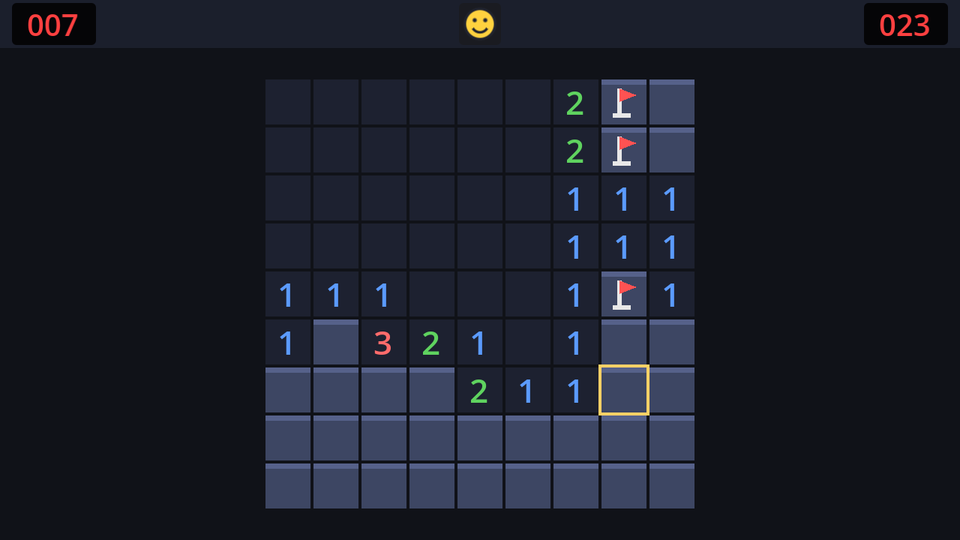

The smiley is the game's mood ring: it smiles while you play, gasps while you hold the mouse button down, dies when you hit a mine, and puts on sunglasses when you win. Clicking it starts a new game.

| Face | When |
| --- | --- |
| `SMILE` | Playing |
| `WORRIED` | Left mouse button held down on the board |
| `DEAD` | You hit a mine |
| `COOL` | You cleared the board |

## Drawing on a Button

A `Button` already draws its background and hover and pressed states. If you give it a script with a `_draw()` method, Godot calls yours **after** the button's own drawing, so the face lands on top of the normal button. We get button behaviour for free and only draw the face.

Create `smiley_button.gd` and attach it to the HUD's `Smiley` button:

```gdscript title="smiley_button.gd"
class_name SmileyButton
extends Button
## The restart button. Draws its own face on top of the normal button.

enum Face { SMILE, WORRIED, DEAD, COOL }

const COLOR_SKIN := Color("ffd23f")
const COLOR_INK := Color("20232e")

var face := Face.SMILE:
	set(value):
		face = value
		queue_redraw()


func _draw() -> void:
	var center := size / 2
	var radius := minf(size.x, size.y) * 0.36
	draw_circle(center, radius, COLOR_SKIN)
	draw_circle(center, radius, COLOR_INK, false, 1.5, true)
	var left_eye := center + Vector2(-0.35, -0.25) * radius
	var right_eye := center + Vector2(0.35, -0.25) * radius
	match face:
		Face.SMILE:
			_draw_eyes(left_eye, right_eye, radius)
			draw_arc(center, radius * 0.55, PI * 0.2, PI * 0.8, 12, COLOR_INK, 1.5, true)
		Face.WORRIED:
			_draw_eyes(left_eye, right_eye, radius)
			draw_circle(center + Vector2(0, 0.4) * radius, radius * 0.18, COLOR_INK, false, 1.5, true)
		Face.DEAD:
			for eye in [left_eye, right_eye]:
				var d := Vector2(radius, radius) * 0.14
				draw_line(eye - d, eye + d, COLOR_INK, 1.5, true)
				draw_line(eye + Vector2(-d.x, d.y), eye + Vector2(d.x, -d.y), COLOR_INK, 1.5, true)
			# The top of a circle below the face makes a frown.
			draw_arc(center + Vector2(0, 0.85) * radius, radius * 0.45, PI * 1.25, PI * 1.75, 12, COLOR_INK, 1.5, true)
		Face.COOL:
			for eye in [left_eye, right_eye]:
				draw_circle(eye + Vector2(0, 0.05) * radius, radius * 0.26, COLOR_INK, true, -1.0, true)
			draw_line(left_eye, right_eye, COLOR_INK, 1.5, true)
			draw_arc(center, radius * 0.55, PI * 0.2, PI * 0.8, 12, COLOR_INK, 1.5, true)


func _draw_eyes(left_eye: Vector2, right_eye: Vector2, radius: float) -> void:
	draw_circle(left_eye, radius * 0.1, COLOR_INK, true, -1.0, true)
	draw_circle(right_eye, radius * 0.1, COLOR_INK, true, -1.0, true)
```

### The setter

`var face := Face.SMILE:` followed by an indented `set(value):` is a **property setter**. Every assignment to `face`, from inside or outside the script, runs that function instead of just storing the value. Ours stores it and asks for a redraw. The HUD can simply write `smiley.face = SmileyButton.Face.DEAD` and the button takes care of updating itself.

### Circles and arcs

Everything is positioned relative to `center` and `radius`, so the face scales with the button.

- `draw_circle(center, radius, color)` draws a filled circle. With `filled = false` and a width, it draws an outline instead. The last `true` turns on antialiasing for smooth edges.
- `draw_arc(center, radius, start_angle, end_angle, point_count, color, width, antialiased)` draws part of a circle's outline. Angles are in radians and start at the right (0), going **clockwise** because y points down:

```text
              PI × 1.5 (up)
                   │
   PI (left) ──────┼────── 0 (right)
                   │
              PI × 0.5 (down)
```

So the smile, from `PI × 0.2` to `PI × 0.8`, is the bottom part of a smaller circle around the centre. The frown uses the *top* part (`PI × 1.25` to `PI × 1.75`) of a circle centred lower down. The dead face's X eyes are two short crossed lines each, and the sunglasses are two filled circles joined by a line.

## Gasping while you click

The board knows when the left button is down. Add a signal and a variable to `board.gd`:

```gdscript title="board.gd"
## True while the left mouse button is held down on the board.
signal held_changed(held: bool)

var _held := false
```

Emit it from `_gui_input` whenever the left button goes down or up:

```gdscript title="board.gd" del={6-7} ins={8-11,19-22}
func _gui_input(event: InputEvent) -> void:
	if event is InputEventMouseMotion:
		_set_hover(_cell_at(event.position))
	elif event is InputEventMouseButton:
		var pos := _cell_at(event.position)
		if event.button_index == MOUSE_BUTTON_LEFT and event.pressed:
			_reveal(pos)
		if event.button_index == MOUSE_BUTTON_LEFT:
			if event.pressed:
				_reveal(pos)
			_set_held(event.pressed and not model.is_finished())
		elif event.button_index == MOUSE_BUTTON_RIGHT and event.pressed:
			_toggle_flag(pos)
		elif event.button_index == MOUSE_BUTTON_MIDDLE and event.pressed:
			_reveal(pos)
		accept_event()


func _set_held(held: bool) -> void:
	if held != _held:
		_held = held
		held_changed.emit(held)
```

`_set_held` comes after `_set_hover` in the script. The press reveals first and *then* updates `_held`, so if that click lost the game, `not model.is_finished()` keeps the face from switching to "worried" over the top of "dead". When the button comes back up, `held` is false either way.

## The HUD side

The HUD exposes the face and reports clicks on the smiley with its own signal, so the game doesn't need to know there's a button inside. The finished `hud.gd`:

```gdscript title="hud.gd" ins={4,8,19-20,23-24}
extends CanvasLayer
## The bar at the top: mines left, the restart smiley, and the clock.

signal restart_pressed

@onready var mine_counter: Label = %MineCounter
@onready var time_label: Label = %TimeLabel
@onready var smiley: SmileyButton = %Smiley


func set_mines_left(count: int) -> void:
	mine_counter.text = "%03d" % clampi(count, -99, 999)


func set_time(seconds: float) -> void:
	time_label.text = "%03d" % mini(int(seconds), 999)


func set_face(face: SmileyButton.Face) -> void:
	smiley.face = face


func _on_smiley_pressed() -> void:
	restart_pressed.emit()
```

Connect the `Smiley`'s `pressed` signal to `HUD` (the method `_on_smiley_pressed`). Because `SmileyButton` has a `class_name`, its enum is usable as a type everywhere: `SmileyButton.Face`.

## The game side

In `game.tscn`, connect two more signals in the Node dock:

| From | Signal | To `Game` method |
| --- | --- | --- |
| `Board` | `held_changed` | `_on_board_held_changed` |
| `HUD` | `restart_pressed` | `restart` (pick it from the method list instead of creating a new one) |

and replace the prints in the win and loss handlers with faces. Here's the complete `game.gd` for this chapter:

```gdscript title="game.gd"
extends Node
## Runs one game: builds the board, keeps time, and reacts to the board's signals.

var model: BoardModel
var elapsed := 0.0

@onready var board: Control = %Board
@onready var hud: CanvasLayer = $HUD


func _ready() -> void:
	model = BoardModel.new(9, 9, 10)
	board.setup(model, 32)
	hud.set_mines_left(model.flags_left())
	hud.set_time(0.0)


func _process(delta: float) -> void:
	if model.state == BoardModel.GameState.PLAYING:
		elapsed += delta
		hud.set_time(elapsed)


func _unhandled_input(event: InputEvent) -> void:
	if event.is_action_pressed("restart"):
		get_viewport().set_input_as_handled() # Before restarting: that frees this node.
		restart()


func restart() -> void:
	get_tree().reload_current_scene()


func _on_board_flags_changed(flags_left: int) -> void:
	hud.set_mines_left(flags_left)


func _on_board_held_changed(held: bool) -> void:
	if not model.is_finished():
		hud.set_face(SmileyButton.Face.WORRIED if held else SmileyButton.Face.SMILE)


func _on_board_game_lost(_cell: Vector2i) -> void:
	hud.set_face(SmileyButton.Face.DEAD)


func _on_board_game_won() -> void:
	hud.set_face(SmileyButton.Face.COOL)
```

The loss handler no longer uses the cell, so its parameter is renamed `_cell`. The leading underscore tells Godot the unused parameter is intentional, which silences the warning. (The polish chapter will put it back to work, aiming an explosion.)

`restart` is connected directly to the HUD's signal: no wrapper method needed, because the signal has no arguments and neither does `restart`.

Run it, and play a few games. Watch the face as you click, lose and win, and restart with the smiley or <kbd>F2</kbd>.



```quiz
question: What runs when another script does `smiley.face = SmileyButton.Face.DEAD`?
options:
  - Nothing special; the variable just changes
  - The property's `set(value)` function, which stores the value and calls `queue_redraw()`
  - The button's `pressed` signal
answer: 1
explain: A setter intercepts every assignment, so the button redraws itself whenever its face changes.
```

```quiz
question: In Godot 2D, which angle points straight down in `draw_arc`?
options:
  - "0"
  - PI × 0.5
  - PI
  - PI × 1.5
answer: 1
explain: Angles start at the right and turn clockwise on screen, because y grows downwards. A quarter turn (PI / 2) points down.
```

```quiz
question: Why does the HUD emit its own `restart_pressed` signal instead of the game connecting to the Smiley button directly?
options:
  - Buttons inside instanced scenes can't be connected
  - It keeps the HUD's insides private, so the game doesn't break if the HUD's layout changes
  - Signals can't cross scenes
answer: 1
explain: The game only knows the HUD's public interface (methods and signals). How the HUD implements it is its own business.
```
