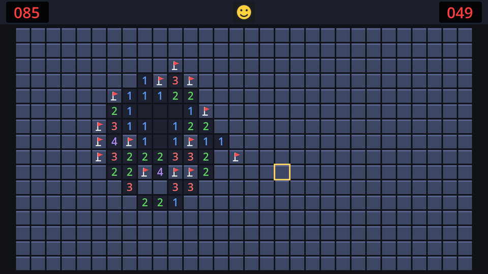

## How much room is there?

In the HUD chapter we gave `BoardArea` offsets of 4 pixels on the left, right and bottom, and 36 at the top for the bar. That leaves:

```text
width:  640 − 4 − 4  = 632 pixels
height: 360 − 36 − 4 = 320 pixels
```

The board has to fit in 632×320, both ways. A cell size that fits the width is `632 / columns`; one that fits the height is `320 / rows`. The board fits if we take the **smaller** of the two, rounded **down** to whole pixels:

```text
cell size = floor(min(632 / columns, 320 / rows))
```

| Board | 632 / columns | 320 / rows | Cell size | Board in pixels |
| --- | --- | --- | --- | --- |
| Beginner 9×9 | 70.2 | 35.6 | 35 → **32** (capped) | 288 × 288 |
| Intermediate 16×16 | 39.5 | 20 | **20** | 320 × 320 |
| Expert 30×16 | 21.1 | 20 | **20** | 600 × 320 |
| Custom 40×20 (largest) | 15.8 | 16 | **15** | 600 × 300 |
| Custom 5×5 (smallest) | 126.4 | 64 | 64 → **32** (capped) | 160 × 160 |

Small boards would get huge cells, which look odd, so the size is capped at 32.

:::note[Why whole pixels?]
With a cell size like 20.8, cell edges would land between pixels. Some 2px gaps would render as 1px and others as 3px, and the grid would look uneven. Rounding down costs at most a few pixels of margin and keeps every cell identical.
:::

## Why 640×360 is enough

Expert fits at exactly 20 pixels per cell. That sounds small, but remember the stretch mode: `canvas_items` scales the 640×360 viewport up to the window, and it draws shapes and text at the *window's* resolution. On a 1280×720 window, each 20-pixel cell is 40 real pixels, with sharp edges and crisp numbers. In fullscreen on a 1080p monitor, it's 60.

A bigger viewport (say 1280×720) would also work, but then every font size, margin and button in this tutorial would need doubling, and the menus would look sparse on small windows. Keeping the same 640×360 as other 2D tutorials means everything you've learned about sizes still applies.

## The code

Mark `BoardArea` as **Access as Unique Name** in `game.tscn`, because the game now needs its size. Then update `game.gd`:

```gdscript title="game.gd" del={18} ins={4-5,11,19,27-30}
extends Node
## Runs one game: builds the board, keeps time, and reacts to the board's signals.

## Small boards stop growing at this cell size.
const MAX_CELL_SIZE := 32

var model: BoardModel
var elapsed := 0.0

@onready var board: Control = %Board
@onready var board_area: CenterContainer = %BoardArea
@onready var hud: CanvasLayer = $HUD


func _ready() -> void:
	var config := Settings.board_config()
	model = BoardModel.new(config.width, config.height, config.mines)
	board.setup(model, 32)
	board.setup(model, fit_cell_size(board_area.size, model.width, model.height))
	hud.set_mines_left(model.flags_left())
	hud.set_time(0.0)


# ...


## The biggest whole-pixel cell size at which the board fits in `area`.
static func fit_cell_size(area: Vector2, columns: int, rows: int) -> int:
	var fit := floori(minf(area.x / columns, area.y / rows))
	return mini(fit, MAX_CELL_SIZE)
```

Place `fit_cell_size` after `_unhandled_input`, with the other helpers.

- **`board_area.size`** is the 632×320 we calculated, but measured, not typed in. Change the HUD's height or the margins, and the board adapts. It's already correct in `_ready`: a control's anchors and offsets are resolved as soon as it enters the tree.
- **`static func`** means the function doesn't use any of the node's variables, only its arguments. You can call it on the script itself, without a game instance, which is handy for testing.
- **`floori`**, **`minf`**, **`mini`**: Godot has typed versions of the common maths functions. `floori` floors a float and returns an `int`; `minf` and `mini` are `min` for floats and ints.

Now try all three presets by changing `difficulty` in `settings.gd` again. Each board is centred in the space below the HUD, as large as it can be:



```quiz
question: What cell size does a 24 × 12 custom board get?
type: text
answer: ["26"]
hint: Calculate 632 / 24 and 320 / 12, take the smaller one, and round down.
explain: 632 / 24 ≈ 26.3 and 320 / 12 ≈ 26.7. The smaller is 26.3, which floors to 26 (under the cap of 32).
```

```quiz
question: Why take the *smaller* of the two sizes?
options:
  - So the board fits both the width and the height
  - Smaller cells look better
  - The height always wins
answer: 0
explain: The width-based size might be too tall, and vice versa. The smaller one is the largest size that satisfies both.
```

```quiz
question: On a 1280×720 window, how many screen pixels wide is a 20-pixel cell?
options:
  - "20"
  - "40"
  - "64"
answer: 1
explain: The 640×360 viewport is scaled 2× to fill 1280×720, and `canvas_items` draws at that resolution.
```
