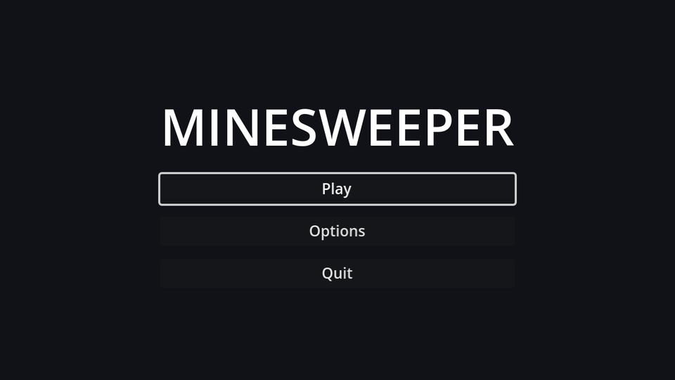

## Layout

Create a scene with a `Control` root named `MainMenu`, choose **Full Rect** in the anchor preset menu, and save it as `main_menu.tscn`:

```text
MainMenu (Control, Full Rect)
└── CenterContainer (Full Rect)
    └── VBoxContainer          # min size 200×0, separation 12
        ├── Title (Label)      # "MINESWEEPER", font size 48, centred
        ├── PlayButton (Button, %)
        ├── OptionsButton (Button)
        └── QuitButton (Button, %)
```

The `VBoxContainer`'s minimum width makes all buttons the same width, and the `CenterContainer` keeps the stack centred at any window size. The title overrides the theme's font size (**Theme Overrides → Font Sizes**); everything else uses the theme's 14.

## The script

Connect each button's `pressed` signal to `MainMenu`, then fill in the methods:

```gdscript title="main_menu.gd"
extends Control

@onready var play_button: Button = %PlayButton
@onready var quit_button: Button = %QuitButton


func _ready() -> void:
	# Browsers can't close the tab for us, so hide Quit in web builds.
	quit_button.visible = not OS.has_feature("web")
	play_button.grab_focus()


func _on_play_button_pressed() -> void:
	get_tree().change_scene_to_file("res://difficulty_menu.tscn")


func _on_options_button_pressed() -> void:
	get_tree().change_scene_to_file("res://options_menu.tscn")


func _on_quit_button_pressed() -> void:
	get_tree().quit()
```

`grab_focus()` matters more than it looks. With a focused button, the menu works entirely from the keyboard or a gamepad: arrow keys move between buttons and <kbd>Enter</kbd> or <kbd>Space</kbd> presses them. Godot works out the focus order from the layout.

`OS.has_feature("web")` is true when the game runs in a browser. There, `quit()` does nothing useful, so the button disappears instead of doing nothing.

:::warning
`options_menu.tscn` doesn't exist until the next chapter, so **Options** prints an error for now.
:::

## Make it the main scene

Set **Project Settings → Application → Run → Main Scene** to `res://main_menu.tscn`. The flow is now: main menu → difficulty menu → game, and the difficulty menu's **Back** button finally has somewhere to go.

```quiz
question: What does marking a node "Access as Unique Name" let you write in a script?
type: text
answer: ["%PlayButton", "$%PlayButton"]
hint: It's a single symbol followed by the node's name.
explain: '`%PlayButton` finds the node by name anywhere in the same scene, so moving it around the tree does not break the script.'
```

```quiz
question: Why does the main menu call `play_button.grab_focus()` in `_ready`?
options:
  - So the menu can be used with the keyboard or a gamepad straight away
  - Buttons don't work without focus
  - To make the button bigger
answer: 0
explain: Mouse clicks work without focus, but keyboard and gamepad navigation need a focused control to start from.
```
