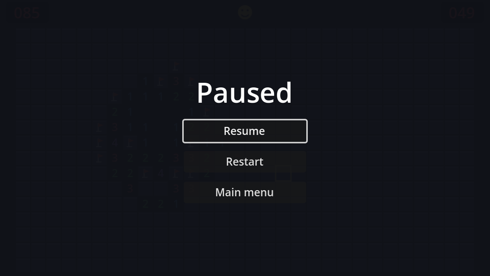

## How pausing works

`get_tree().paused = true` freezes every node's `_process` and `_physics_process`, input callbacks, timers and tweens. Each node's **Process → Mode** decides how it reacts:

| Mode | While paused |
| --- | --- |
| Inherit (default) | Same as its parent; the root is *Pausable* |
| Pausable | Stops |
| When Paused | Runs *only* while paused |
| Always | Keeps running |
| Disabled | Never runs |

Pausing gives us two things for free: the game's `_process` stops, so **the clock stops**, and the board's input callbacks stop, so **no moves** can be made. The pause menu itself has to keep working while everything else is frozen, otherwise you could never unpause.

## No peeking

In an action game, the pause menu can be see-through. In Minesweeper, that would be a cheat: pause, study the board for as long as you like with the clock stopped, unpause, click. So our pause menu covers the board with an almost opaque background.

## The scene

New scene, `CanvasLayer` root named `PauseMenu`, **Layer** `10` (above the HUD), **Process → Mode** `Always`. Save as `pause_menu.tscn`.

```text
PauseMenu (CanvasLayer, layer 10, process mode Always)
├── Dim (ColorRect, Full Rect)    # colour #10121a at 97% alpha
└── CenterContainer (Full Rect)
    └── VBoxContainer             # min width 160, separation 12
        ├── Title (Label)         # "Paused", font size 36
        ├── ResumeButton (Button, %)
        ├── RestartButton (Button)
        └── MainMenuButton (Button)
```

The `Dim` rect uses the game's background colour, so the paused screen looks like a clean menu with the faintest hint of the game behind it. It also swallows mouse clicks, so they can't reach the board.

```gdscript title="pause_menu.gd"
extends CanvasLayer

@onready var resume_button: Button = %ResumeButton


func _ready() -> void:
	hide()


func _unhandled_input(event: InputEvent) -> void:
	if event.is_action_pressed("pause"):
		set_paused(not get_tree().paused)
		get_viewport().set_input_as_handled()


func set_paused(paused: bool) -> void:
	get_tree().paused = paused
	visible = paused
	if paused:
		resume_button.grab_focus()


func _on_resume_button_pressed() -> void:
	set_paused(false)


func _on_restart_button_pressed() -> void:
	get_tree().paused = false
	get_tree().reload_current_scene()


func _on_main_menu_button_pressed() -> void:
	get_tree().paused = false # The pause state outlives the scene!
	get_tree().change_scene_to_file("res://main_menu.tscn")
```

- The `pause` action (<kbd>Esc</kbd> and <kbd>P</kbd>) was defined back in the keyboard chapter.
- `_unhandled_input` only receives events that no UI control consumed, the right place for gameplay shortcuts. Because the menu's process mode is *Always*, it hears <kbd>Esc</kbd> both while playing and while paused.
- `set_input_as_handled()` stops the same <kbd>Esc</kbd> press from reaching anything else.

:::danger[Unpause before leaving]
`paused` belongs to the **SceneTree**, not to the scene. Forget to reset it before restarting or changing scenes, and the next scene loads... frozen.
:::

Connect the three buttons' `pressed` signals, then instance `pause_menu.tscn` in `game.tscn`.

```quiz
question: Which process mode should the pause menu have?
options:
  - Pausable
  - When Paused
  - Always
  - Disabled
answer: 2
explain: '**When Paused** would keep the buttons working, but then `_unhandled_input` would not run while playing, so pressing Esc could never open the menu. **Always** covers both.'
```

```quiz
question: Why does the clock stop while the game is paused, without any extra code?
options:
  - The HUD checks the pause state
  - The game node is pausable, so its `_process` (which adds up the time) isn't called while paused
  - Timers are paused automatically
answer: 1
explain: The clock is just `elapsed += delta` in `_process`, and paused nodes don't process.
```

```quiz
question: Why is the pause menu's background almost opaque?
options:
  - Transparent backgrounds don't block clicks
  - So players can't study the board while the clock is stopped
  - CanvasLayers can't be transparent
answer: 1
explain: Thinking time is part of the challenge. A see-through pause menu would let players think for free.
```
