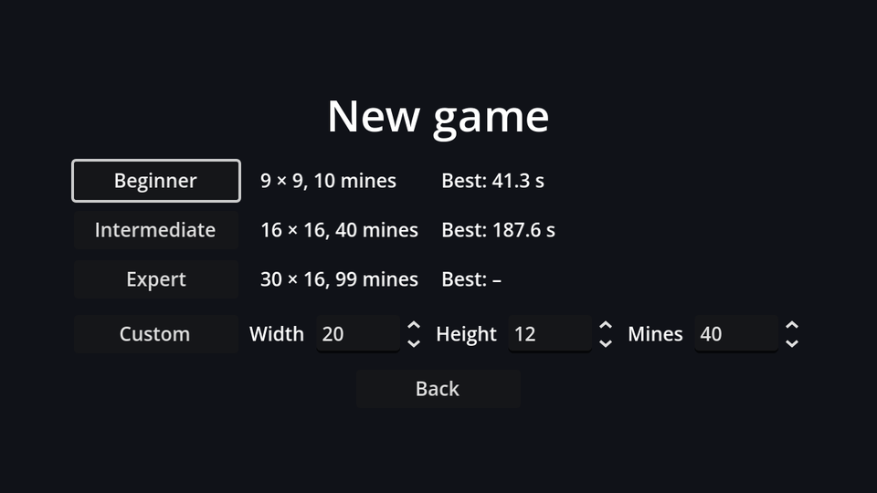

A best time is only worth chasing if it's still there tomorrow. That means writing it to a file.

## Where to save: `user://`

Godot has two special path prefixes:

| Prefix | Points to | Writable? |
| --- | --- | --- |
| `res://` | Your project folder | Only in the editor. Exported games pack it into a read-only archive. |
| `user://` | A per-user data folder for this game | Always |

`user://` is `%APPDATA%\Godot\app_userdata\Minesweeper` on Windows, `~/Library/Application Support/Godot/app_userdata/Minesweeper` on macOS and `~/.local/share/godot/app_userdata/Minesweeper` on Linux. The last part is the project name, which is why naming your project matters. Never save to `res://`: it seems to work while testing in the editor, and silently fails in the exported game.

## What to save: ConfigFile

`ConfigFile` reads and writes simple INI-style files: sections in brackets, then `key=value` lines. It handles numbers, strings, booleans, vectors and even arrays and dictionaries, and the files are human-readable. Times are stored with full precision (the clock adds up frame times, hence the long decimals):

```ini title="records.cfg"
[best_times]

beginner=38.21666666666578
intermediate=164.05
```

## A Records autoload

Best times aren't settings: clearing your settings shouldn't wipe your records, and the other way around. So they get their own small autoload and their own file. Create `records.gd`:

```gdscript title="records.gd"
extends Node
## Best times per difficulty. Registered as the "Records" autoload.

const SAVE_PATH := "user://records.cfg"

## Difficulty key → best time in seconds.
var best_times: Dictionary[String, float] = {}


func _ready() -> void:
	load_records()


## The best time for a difficulty, or -1 if there isn't one yet.
func get_best(difficulty: String) -> float:
	return best_times.get(difficulty, -1.0)


## Record a win. Returns true if it's a new best time.
func submit(difficulty: String, seconds: float) -> bool:
	if not Settings.PRESETS.has(difficulty):
		return false # Custom boards come in too many sizes to compare.
	var best := get_best(difficulty)
	if best >= 0.0 and seconds >= best:
		return false
	best_times[difficulty] = seconds
	save_records()
	return true


func format_time(seconds: float) -> String:
	return "%.1f s" % seconds


func save_records() -> void:
	var config := ConfigFile.new()
	for difficulty in best_times:
		config.set_value("best_times", difficulty, best_times[difficulty])
	config.save(SAVE_PATH)


func load_records() -> void:
	var config := ConfigFile.new()
	if config.load(SAVE_PATH) != OK or not config.has_section("best_times"):
		return
	for difficulty in config.get_section_keys("best_times"):
		best_times[difficulty] = config.get_value("best_times", difficulty)
```

Register it in **Project Settings → Globals → Autoload** as `Records`, next to `Settings`.

- **`Dictionary[String, float]`** is a *typed dictionary*: keys must be strings and values floats. Like typed arrays, it catches mistakes early.
- **`best_times.get(difficulty, -1.0)`** returns the stored time, or `-1.0` if there's none. A negative time is impossible, so it works as "no record yet", the same sentinel idea as `NO_CELL`.
- **`submit`** saves right away, but only when the record actually improved. Saving on every win would be harmless; saving on every *frame* would not.
- **Custom boards** don't get records: a 6×5 board with 3 mines isn't comparable to a 40×20 one with 300, and keeping a record for every combination would fill the list with noise.
- **`config.load()`** returns an error code. On the very first launch there's no file yet, and that's fine: we just start with no records. If the file exists but has no `[best_times]` section, `get_section_keys` would complain, so we check `has_section` first.

## Submit on a win

In `game.gd`, record the time when the board is cleared:

```gdscript title="game.gd" ins={3}
func _on_board_game_won() -> void:
	hud.set_face(SmileyButton.Face.COOL)
	Records.submit(Settings.difficulty, elapsed)
```

The game ignores `submit`'s return value for now; the result screen on the next page will use it to celebrate a new record.

## Show them on the difficulty screen

A third column in the preset table shows each best time. In `difficulty_menu.tscn`, set `PresetGrid`'s **Columns** to `3`, then add a label per row in `_build_presets`:

```gdscript title="difficulty_menu.gd" ins={10-12,15}
func _build_presets() -> void:
	for difficulty in Settings.PRESETS:
		var preset: Dictionary = Settings.PRESETS[difficulty]
		var button := Button.new()
		button.text = preset.name
		button.custom_minimum_size.x = 120
		button.pressed.connect(_start.bind(difficulty))
		var size_label := Label.new()
		size_label.text = "%d × %d, %d mines" % [preset.width, preset.height, preset.mines]
		var best_label := Label.new()
		var best := Records.get_best(difficulty)
		best_label.text = "Best: " + (Records.format_time(best) if best >= 0.0 else "–")
		preset_grid.add_child(button)
		preset_grid.add_child(size_label)
		preset_grid.add_child(best_label)
		if difficulty == Settings.difficulty:
			button.grab_focus()
```

`A if condition else B` is GDScript's inline conditional: the best time if there is one, a dash if not.



Win a beginner game, go back to the difficulty screen, and your time is there. Quit the game, start it again: still there.

```quiz
question: Why does `Records` save to `user://records.cfg` rather than `res://records.cfg`?
options:
  - user:// is faster
  - res:// is read-only in exported games
  - ConfigFile only supports user://
answer: 1
explain: Exported games pack `res://` into a read-only archive. `user://` always points at a writable per-user folder.
```

```quiz
question: The best beginner time is 41.3 s. What does `Records.submit("beginner", 45.0)` do?
options:
  - Saves 45.0 as the new best
  - Returns false and saves nothing
  - Saves the average
answer: 1
explain: Only faster times replace the record, and the file is only written when something changed.
```

```quiz
question: There's no record for expert yet. What does `Records.get_best("expert")` return?
type: text
answer: ["-1", "-1.0"]
explain: '`best_times.get(difficulty, -1.0)` falls back to -1.0, a time that can never really happen, meaning "no record yet".'
```
